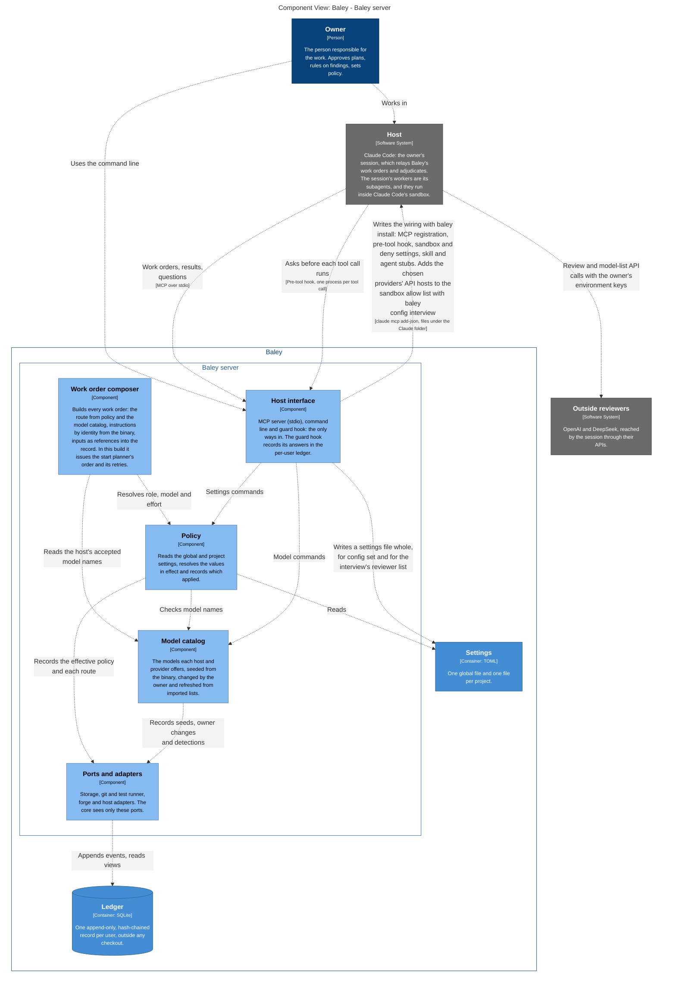
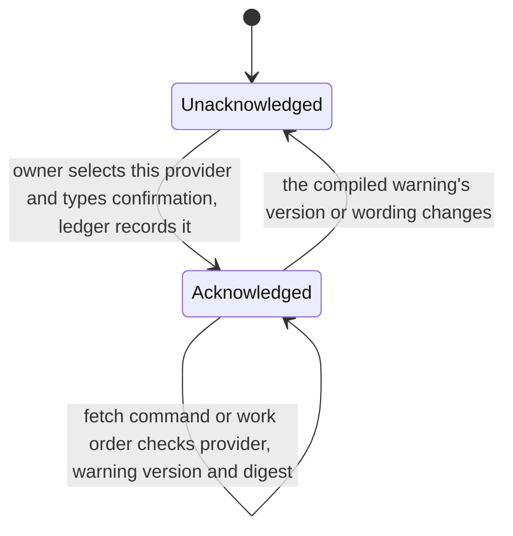
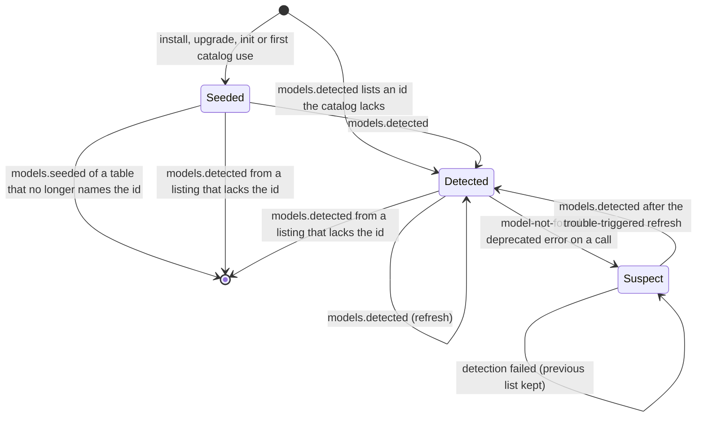
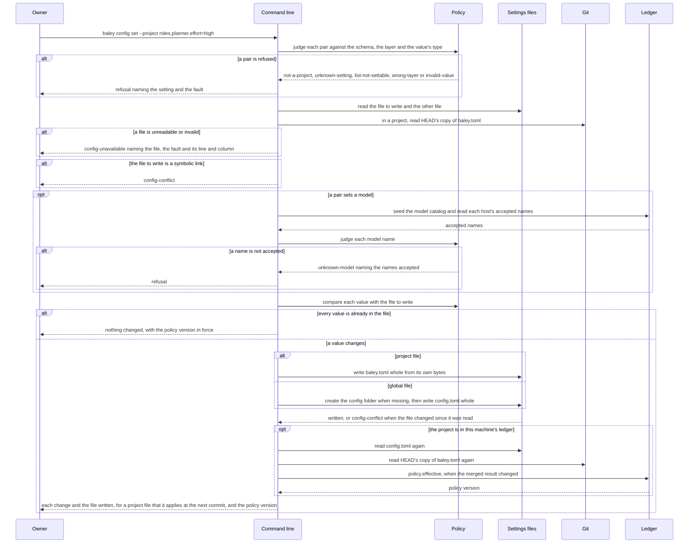
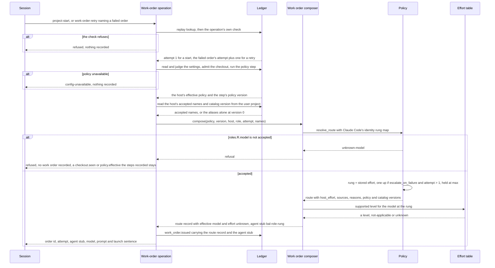
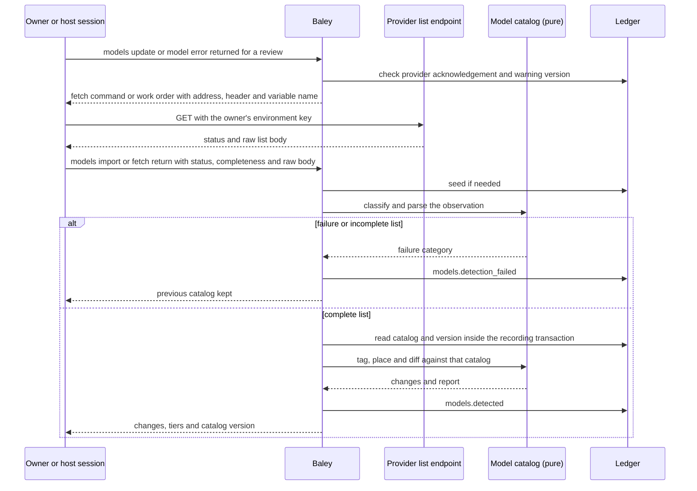
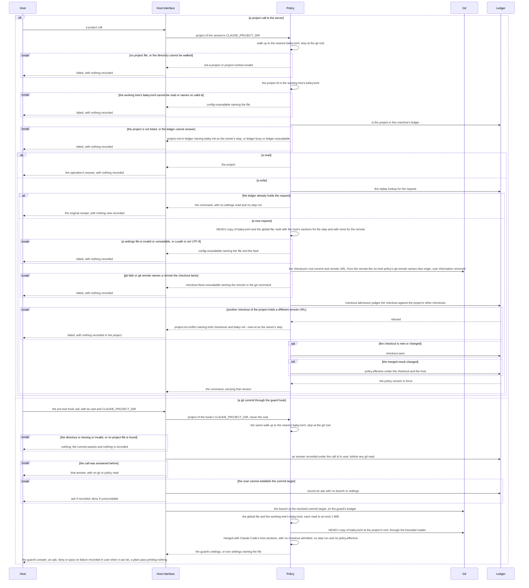

# 0003: Configuration and routing

| | |
|---|---|
| Status | Accepted |
| Design issue | none; build issue [#23](https://github.com/jcrenshaw-dev/baley/issues/23) |
| Requirement prefix | CFG |
| Applies | [0002: System design](0002-system-design.md) |
| Related | ADRs: [0003](../adr/0003-per-user-database.md), [0004](../adr/0004-project-identity.md), [0009](../adr/0009-served-instructions.md), [0015](../adr/0015-settings-in-toml.md), [0016](../adr/0016-key-store.md), [0027](../adr/0027-vendor-folders-and-plain-keys.md), [0028](../adr/0028-one-http-stack.md), [0032](../adr/0032-gemini-is-not-a-provider.md), [0033](../adr/0033-host-security-bar.md), [0039](../adr/0039-session-owned-provider-credentials.md) · C4 view: configuration |

The current design of this area, and nothing else. Edit it in place when the design changes; git holds the history. It describes the design only, never the work still to do.

## 1. Purpose and scope

This area decides:

- which settings exist, where each one may be set, and how the layers merge into the policy in effect;
- where the settings files live and how a checkout finds its project;
- how a role's model and effort are resolved for every work order, and what a retry changes;
- which model names Baley accepts for each host and provider, and how that list stays current;
- how provider selection and risk acknowledgement work without Baley reading credentials.

It does not decide the meaning of settings owned by other areas (section 9 lists every setting and its owner), how a work order reaches a host or how effort is delivered there ([0012: Host interface](0012-host-interface.md)), whether a review or a risk gate fires ([0008: Review](0008-review.md), [0009: Risk](0009-risk.md)), or what the guard does with git commands ([0010: Guard](0010-guard.md)).

Hand-offs: the work order composer ([0002](0002-system-design.md) section 8) asks this area for the model and effort of each dispatch; the ledger ([0001](0001-evidence-ledger.md)) stores what this area records; `baley init` ([0001](0001-evidence-ledger.md), EVD-R17, ADR 0004) creates the project file this area reads.

<!-- c4:configuration -->

<!-- /c4:configuration -->

*Figure 1. Policy and the model catalog inside Baley. The host session calls providers with environment credentials and hands list responses to Baley for parsing. The host interface also runs `baley install`, which writes Claude Code's wiring and seeds the catalog without a list call. The interview adds the chosen providers' API hosts to Claude Code's settings file, and writes the global reviewer list whole, as `config set` writes a settings file.*

## 2. Terms

| Term | Meaning |
|---|---|
| Setting | One named value Baley reads, such as `git.on_protected`. A setting has a type, a default and a scope. |
| Layer | One source of settings: the built-in defaults, the global file, its host section, the project file, or its host section. |
| Host section | A table inside a settings file, `[host.<name>]`, whose values apply only when that host is connected. The one host name is `claude-code`, the host Baley supports ([ADR 0033](../adr/0033-host-security-bar.md)). A section naming any other host is ignored with one diagnostic, never validated and never deleted (CFG-R7). The seam stays: a host admitted under ADR 0033 adds its name. |
| Scope | Where a setting may be set: `global`, `project`, or `both`. A value in a layer outside its scope is ignored and reported. |
| Effective policy | The result of merging every layer for one project and the connected host, if there is one, plus the layer each value came from. |
| Policy version | The identity of one recorded effective policy. Every command records the version it ran under. |
| Role | A kind of worker Baley dispatches: planner, analyzer (the refinement role that asks the owner questions and drafts truths), plan checker, executor, verifier, reviewer. |
| Rung | One of Baley's five effort levels, in order: `low`, `medium`, `high`, `xhigh`, `max`. |
| Route | The result of resolving one role for one dispatch: model, rung, the settings that decided them, and whether a retry moved the rung. |
| Attempt | The number of one try at a dispatch, counted from 1. A work order's first issue is attempt 1, and a retry of a failed order is the failed order's attempt plus one, read from the ledger. Only Baley counts attempts: no model or setting supplies one. |
| Rung map | A host's own effort value for each of the five rungs, compiled into Baley. Claude Code's map is the identity: rung `high` maps to Claude Code's effort `high`, the level sent, and so on for every rung. |
| Effort table | A table compiled into Baley that lists, for each exact concrete Claude model id, the effort levels Claude Code offers for that model, or that the model has no effort setting. It carries the date its rows were read and the address they were read from. It predicts what Claude Code will run, and is never a record of what ran. |
| Route record | The route as a work order records it and the `route` query shows it: what was asked (the stored rung and the rung after escalation), what was sent (the model and the host's effort value), what the effort table supports for that model at that rung, and what was observed (the effective model and effort, `unknown` until a run is observed), each in its own field (section 6). |
| Agent stub | The Claude Code agent file a work order names for its worker, `bal-<role>-<rung>`, one per role and rung ([0012](0012-host-interface.md)). |
| Model catalog | The list of model names Baley accepts, per host and per provider, with the source each name came from. It is the `model_catalog` view of the reserved per-user ledger project `user` (section 6). |
| Host alias | A short model name a host resolves itself, such as `opus` in Claude Code. Aliases follow new model releases without any change on Baley's side. Each host's aliases are compiled into Baley and never recorded. |
| Provider | An outside model vendor reached by the session through its API: OpenAI or DeepSeek. Anthropic is reached through the Claude Code login, so its names are the `claude-code` host catalog and `anthropic` is no catalog name. |
| Detection | Parsing, classifying, tagging and recording a provider model list fetched by the session or owner. Baley never fetches the list. |
| Hint table | A table compiled into Baley that tags known model names with a tier (`flagship`, `balanced`, `cheap`) and whether they accept high effort. It has a version, raised whenever a row changes. Its exact-id rows are seeded into the catalog; its prefix rows tag, for detection, the ids that start with a known prefix and that no exact row names. |
| Config folder | Baley's own folder under the crenshawdev vendor folder: `$XDG_CONFIG_HOME/crenshawdev/baley` on Linux (an empty or relative `XDG_CONFIG_HOME` counts as unset), `~/Library/Application Support/crenshawdev/baley` on macOS, or `BALEY_HOME` when it is set. It holds the global file and no credentials. |
| Key name | The environment variable name a work order tells the session to use, such as `OPENAI_API_KEY`. Baley knows the name, never its value. |

## 3. Requirements

| Id | Rule | Why | Depends on | Status |
|---|---|---|---|---|
| CFG-R1 | Settings are TOML in two files: one global file per user and one project file per repository; there is no other settings file. | One familiar, reviewable format for every setting; no other file holds settings. | SYS-R13 | Active |
| CFG-R2 | The global file is `config.toml` in Baley's config folder: `$XDG_CONFIG_HOME/crenshawdev/baley/config.toml` (default `~/.config/crenshawdev/baley/config.toml`) on Linux and `~/Library/Application Support/crenshawdev/baley/config.toml` on macOS; when `BALEY_HOME` is set, the global file is `$BALEY_HOME/config.toml`. An empty or relative `XDG_CONFIG_HOME` is treated as unset. Each crenshawdev application has its own folder under the vendor folder, and nothing is shared at the vendor level. | Each platform's own place, grouped under one vendor folder; tests and development builds never touch the owner's file. | ADR 0003, ADR 0027, SYS-R14 | Active |
| CFG-R3 | The project file is `baley.toml` at the repository root, committed with the code. | Policy travels with the code; every clone and every teammate runs under the same project settings. | ADR 0004 | Active |
| CFG-R4 | The server's project comes from its session's `CLAUDE_PROJECT_DIR`, captured once when the server starts, and the guard gets the same value. Baley finds the project by walking up from that directory to the nearest `baley.toml`, stopping at the git repository root. Only a genuinely missing entry is absent: any entry at `baley.toml`, including a directory or a dangling symbolic link, binds that folder, and a metadata error other than not-found does too. The same presence rule applies to `.git`, which makes the folder the repository root and ends the walk. The command line walks from its own working directory. Every server project call walks afresh from `CLAUDE_PROJECT_DIR`, so a project file added or removed during the session is seen by the next call. No call carries a directory that selects the project. A directory with no project file is not managed: the guard passes its commands silently while its path rules still apply, and the server answers a project call there `failed` `not-a-project`. When project files are nested, the nearest one applies and nothing is inherited from the outer one. | A server serves one session, and the host sets `CLAUDE_PROJECT_DIR` for the session's server and its hooks alike, so the project is a property of the process and the server and the guard agree on it ([ADR 0034](../adr/0034-one-server-per-session.md)). | SYS-R1, ADR 0004, ADR 0034 | Active |
| CFG-R5 | Each setting has a scope: `global`, `project` or `both`. Branch, forge and repository settings and the test and lint commands are `project`. Roles and the escalation switch are `both`. A value written in a layer outside the setting's scope is ignored and reported as a scope diagnostic; the command line refuses to write it. | Repository facts belong to the repository; per-user choices must not leak into a committed file by mistake. | SYS-R13 | Active |
| CFG-R6 | Layers merge in this order, later winning per setting: built-in defaults, global file, global `[host.<name>]` section, project file, project `[host.<name>]` section. Only the section of the connected host applies. | The project overrides the user; a host section refines the file it is in. | CFG-R5 | Active |
| CFG-R7 | Every setting in the schema has a reader in the code; a setting nothing reads is removed from the schema. An unknown name in a file is ignored and reported; the command line refuses to write it. | A setting that changes nothing misleads the owner. | | Active |
| CFG-R8 | Whenever the merged result changes, for any layer, Baley records `policy.effective` with the full merged policy and the layer and file each value came from; every command records the policy version it ran under, 0 when no recorded policy applies, as the table below says. A write the server prepares records the version its policy step returned, under the host's key, on its own command. | The record says what Baley acted under, not what the files say now. | EVD-R17 | Active |
| CFG-R9 | The effective policy is re-read and re-validated before every command that appends to a project's chain from a checkout. An invalid file (unparseable, wrong type, value outside its grammar) makes the policy unavailable, and every command that needs it is refused with `config-unavailable` naming the file and the fault and, for a parse, type or grammar fault, its line and column. A genuinely missing file is an empty layer; a dangling symbolic link is unavailable and is named as a link to a missing file. This includes the global `config.toml`: every command that reads it gets `config-unavailable`, and the guard treats it as torn settings and asks, subject to its remembered denials (GRD-R7). A file that exists but is not a regular file or cannot be read makes the policy unavailable in the same way, naming the file and the cause. HEAD's copy of the project file, which holds the project's settings, makes the policy unavailable in the same way when git cannot read it. A checkout, or a settings file the policy reads, whose path is not UTF-8 makes the policy unavailable in the same way, naming the path, since the record holds paths as text. The server re-reads and re-validates both files before every write it prepares, after the lookup for a request the ledger already holds, so a retry of a recorded request still gets its original receipt when a file has since broken. A server read validates neither file, except the `route` query, which reads and validates both as a write does and then records nothing. The server's refusal is `failed` with `config-unavailable`, and it records nothing. | Never act on a torn or half-edited policy. | CFG-R8 | Active |
| CFG-R10 | A dispatch whose routing inputs changed between admission and its run is refused as `routing-inputs-changed`. | A worker must run under the route the owner's policy produced when it was admitted. | CFG-R8, SYS-R6 | Active |
| CFG-R11 | Only Baley's command line and its interview write the settings files. The host sandbox and the guard refuse any agent write to Baley's config folder (the global file) and to the project file, and `baley doctor` reports the config folder, notes when it is the home folder, and judges from the documents it is given whether those writes are refused. Instructions served to models never mention the files. The server never writes a settings file and never initializes a project: it answers an unknown project `failed` and names `baley init` as the owner's step, and the owner's steps stay `baley init` and `baley config`. | The owner sets policy; the model never does. | SYS-P11, SYS-R13 | Active |
| CFG-R12 | Six roles are routed: `planner`, `analyzer`, `checker`, `executor`, `verifier`, `reviewer`. Each has `roles.<role>.model` (a model name, default absent) and `roles.<role>.effort` (a rung; defaults: planner, analyzer, executor and verifier `high`, reviewer `medium`, checker `low`). | Every worker Baley dispatches has an owner-set cost. | SYS-P1 | Active |
| CFG-R13 | An absent model means the host session's own model; Baley then passes no model to the host. | The owner's session choice is the default everywhere. | CFG-R12 | Active |
| CFG-R14 | A model name is checked against the model catalog for the host or provider it is written for, at write time; an unknown name is refused by the command line and interview with `unknown-model`, naming the catalog entries that exist. A name is never silently dropped at dispatch. | A misspelled model must fail where the owner can see it. | CFG-R12, CFG-R19 | Active |
| CFG-R15 | The five rungs are Baley's scale, and the host adapter's rung map takes a rung to what the host accepts. Claude Code's map is the identity: each rung maps to the Claude Code effort level of the same name, which is the level sent, and the agent stub for a role at a rung names that level. Support depends on the model: Claude Code runs a level a model does not support as the highest supported level at or below it, and Opus 4.6 and Sonnet 4.6 have no `xhigh`. The route records the requested rung and the level the effort table supports apart. The effort table is keyed by exact concrete model ids only, with no alias, family or prefix row, and carries its date and its source, Claude Code's model configuration documentation (https://code.claude.com/docs/en/model-config#adjust-effort-level). For a listed model it answers the highest level it lists at or below the requested rung. A listed model with no effort setting, such as Haiku 4.5 (`claude-haiku-4-5-20251001`), is answered `not-applicable`, never a made-up level. An alias, no model and an unlisted id are answered `unknown`. The table is a prediction, never an observation, so the effective model and effort stay recorded as `unknown`, with the reasons, until a run is observed: an alias resolves inside the host, and a managed cap on effort can lower any level. `RungMap` is unchanged. | Hosts differ in the effort levels they take, and a level recorded as run when it was only predicted would read as proven. | SYS-P8 | Active |
| CFG-R16 | `escalate_on_failure` (default `false`): when true, a retry of a failed dispatch is sent one rung above the stored rung, capped at `max`; a further retry holds there. Baley supplies the attempt number from the ledger. When false, every attempt is sent at the stored rung. | A failure earns one step more effort, decided by Baley, never by the model. | CFG-R12 | Active |
| CFG-R17 | Every route records the role, the model, the starting rung, the rung sent, the attempt, the setting and layer that supplied the model and the effort, and each reason in plain words. The work order carries the route, and no other record does: the read-only `route` query shows one without recording it. | The owner can always see why a worker was sent as it was. | SYS-P2, CFG-R8 | Active |
| CFG-R18 | The plan-time risk floor never changes a model or a rung. | Effort is the owner's choice; risk changes the review gate ([0009](0009-risk.md)), not the cost. | | Active |
| CFG-R19 | The model catalog is data in the per-user database, seeded from the binary at install and at every upgrade, never a setting. The seed supplies API reviewer tiers from first use. Host aliases (for Claude Code: `opus`, `sonnet`, `haiku`, `fable`) come from the host adapter's compiled table and are resolved by Claude Code. Exact model ids are accepted beside aliases. | Aliases track new models by themselves; the owner's choice stays small. | ADR 0003 | Active |
| CFG-R20 | A provider catalog is refreshed only from a list the session or owner fetched. After a model-not-found or deprecated-model response, a work order names the list address, header and environment variable for the session to fetch and return. In a terminal, `baley models update` prints the fetch command for the owner to pipe into `baley models import <provider>`. Baley parses the raw answer, records every id, tags it from the hint table and places untagged ids by best fit unless the owner chooses. Install and `baley init` use the shipped seed without network detection. No timer refreshes the catalog. | The provider list can change without a Baley release, and Baley needs no credential to read it. | CFG-R21, SYS-R9, ADR 0039 | Active |
| CFG-R21 | A failed fetch or invalid, incomplete or oversized imported list leaves the previous catalog in place and records `models.detection_failed` when the failure is returned. It never blocks setup or silently counts as an empty list. When no list is fetched or returned, no detection is recorded and seed and owner entries remain usable. Baley never checks whether an environment key exists. | Setup and dispatch must not depend on a network call. | CFG-R20 | Active |
| CFG-R22 | The owner can add or remove a catalog name by hand (`baley models add`, `baley models remove`); a hand-added name wins over detection and is never removed by it. | A model newer than every list is still usable at once. | CFG-R19 | Active |
| CFG-R23 | Each route and each detection records the catalog version it was checked against. | The record says which list was in force. | CFG-R17, CFG-R20 | Active |
| CFG-R24 | Baley never reads, stores or sends an API key. There is no Baley key file or key folder. Owners keep keys in their own environment. `keys.env` and its reader are removed. | No credential copy belongs to Baley ([ADR 0039](../adr/0039-session-owned-provider-credentials.md)). | SYS-R11 | Active |
| CFG-R25 | Baley has no command that sets, removes, lists or injects keys. `baley exec --key` is removed. The session supplies the key to the provider directly, using the environment variable named in the work order. | Calls and credentials stay with the session. | SYS-R11 | Active |
| CFG-R26 | The ledger records provider and environment variable names, never credential values. Requests and work orders contain no credential value. Baley does not inspect the environment or scrub command output, and cannot promise to recognize a key printed into returned content. The risk warning states that limit. | A record of how a call was requested needs no credential. | EVD-R14, SYS-R11 | Active |
| CFG-R27 | Baley only reads returned model lists. Its pure parsing, classification, tagging, diff and event code stays. The binary's HTTPS lister and credential lookup are removed. Work-order metadata names `OPENAI_API_KEY` for OpenAI and `DEEPSEEK_API_KEY` for DeepSeek without looking either up. | Model lists and reviews follow the same credential boundary. | SYS-R11, CFG-R20 | Active |
| CFG-R28 | The interview asks which outside providers to use, states the environment and review risks, requires typed confirmation and records the chosen providers and warning version in the ledger. A changed warning requires confirmation again. A fresh install enables no outside provider; reinstall keeps acknowledged choices. The final `yes` records the acknowledgement, writes provider API-host allowances through the installation writer, writes the global `review.reviewers` list, then runs the settings `config set`, as section 5 specifies. A setting or another entry point cannot bypass acknowledgement: no provider work order or fetch command is issued without the current acknowledgement for that provider. | Programs Claude Code starts can see environment keys, agents and subagents included. Nothing scrubs a printed key, and code goes to the chosen provider under its terms. | SYS-R10, SYS-R12 | Active |
| CFG-R29 | `git.forge_provider` accepts `github`, `gitlab` and `forgejo`; the first release acts on `github` only, and choosing another value is accepted and reported as not yet supported by [0011: Landing](0011-milestones-landing-undo-pause.md). | All three forges are planned; the setting must not need to change when they arrive. | | Active |

Which policy each command runs under (CFG-R8, CFG-R9). Policy version 0 means that no recorded policy applies. Checkout admission runs before the policy step for every command that runs one: it judges the checkout against the project's other checkouts and records `checkout.seen` when the checkout is new or changed ([0001](0001-evidence-ledger.md), EVD-R17). The policy step runs before every command that appends to a project's chain from a checkout: it re-reads both files, records `policy.effective` when the merged result changed, and returns the version in force for the command's own record. A command that appends to no chain runs no step. A session server's project call applies the call's host: its write runs checkout admission and then the step for the call's host, its read runs neither (the `route` query reads and judges the settings and stops there), and a write whose request the ledger already holds runs neither and is answered with its original receipt. The command line's policy step records under the hostless key. The guard also merges Claude Code's host sections to judge a commit, but admits no checkout and records no `policy.effective`. Records in the per-user project `user` carry 0; the guard keeps only remembered denials from its policy, and other per-user commands build none. `purge` is the one chain-writing command that may run outside a checkout, and records 0 there. A `baley config set` outside any project, one in a project that is not in this machine's ledger, and one that changes nothing run no step. The first two give 0, since no recorded policy applies, and one that changes nothing gives the version in force. The `baley config interview` runs up to four writes after its final `yes`, in this order: the per-user acknowledgement with policy version 0, Claude Code API-host allowances through the settings part of the installation writer, the global `review.reviewers` list through the whole-file settings writer, and its non-blank settings answers through one call to the apply function shared with `config set`, bound to the shown path and its original digest or absence (after a list write to the same global file, to the digest that write returned). The list write and the settings write each follow the policy-step rules above after their own write. The acknowledgement and the host write run no project policy step. A declined interview, or one with nothing to change, writes nothing, opens no store and records no acknowledgement. `baley models update` reads both the acknowledgement and `review.reviewers` before it prints a fetch command, and `baley models import` is the command line's import boundary. The fetch work order, `models-return` and review admission stay Build 4's.

| Command | Project from | Policy step | Version recorded |
|---|---|---|---|
| `baley init` | discovery at the repository root | yes, after `project.initialized` and checkout admission | 0 on `project.initialized` |
| `baley config set` in a project | discovery | yes, after the write, when the project is in this machine's ledger | the version in force after it, or 0 when the project is not in this machine's ledger, where `baley init` records the policy |
| `baley config interview` | discovery for each TOML write, `user` for the acknowledgement | Acknowledgement, host allowances, global reviewer list, then settings through the apply function shared with `config set`, bound to the shown file. No policy step for the acknowledgement or the host allowances. Each TOML write uses the `config set` policy-step rules after its own write | 0 on the per-user acknowledgement. Each TOML step records its resulting policy version when applicable |
| `anchor`, `acknowledge-restore` | discovery | yes | the version in force |
| `purge` | its argument | only when run from a checkout of that project | the version in force there, otherwise 0 |
| `verify --local-only`, `verify --views`, `export`, `rebuild` | their argument | no: no event is appended | none |
| `verify` with no flag | discovery, with an optional argument naming the same project | no: it reads the settings and appends nothing | none |
| `doctor` | discovery for the discovered project's remote, every other project checked locally | no: it reads the settings and appends nothing | none |
| `scrub` | none | no: no event is appended | none |
| `baley update` and detached updater (`baley update detached`) | per-user project `user` | no | 0 |
| `baley models add`, `remove` and `import`, detection, seeding | the per-user project `user` | no | 0 |
| `baley install` | the per-user project `user`, for the catalog seed and `install.recorded` | no: it admits no checkout and reads no project | 0 |
| a session server's project call | discovery at the session's `CLAUDE_PROJECT_DIR` | a write: yes, under the host's key, after checkout admission. A read: no. A write the ledger already holds: no | a write: the version the step returned, recorded on its own command, and checkout admission carries the version stored for the checkout and no host. A read: none, it records nothing. A write the ledger already holds: none, it gets its original receipt |
| the guard hook | discovery at the hook's `CLAUDE_PROJECT_DIR`, for the policy a commit is judged under. Its records go to the per-user project `user` | no: it reads the settings within its budget and merges Claude Code's sections, admits no checkout and records no `policy.effective` | 0 on every guard record |
| `policy.effective` itself | the command it belongs to | it is the step's own record | the version it replaces, 0 for the first of its key |
| `checkout.seen` itself | the command it belongs to | no: it runs before the step, as a command of its own | the policy version stored for the checkout and no host, 0 when none is stored |


## 4. Roles and actors

| Actor | Receives | Returns | Model and effort from |
|---|---|---|---|
| Owner | Settings questions, provider warnings and refusals | Settings values, typed risk acknowledgement, catalog additions and removals, and imported model lists; keeps keys in the environment outside Baley | Not applicable |
| Baley command line | `baley config` and `baley models` commands | Receipts, fetch commands containing variable names, imported-list results and refusals | Not applicable |
| Policy (component) | The settings files and the host; for a route, the host's effective policy with its policy version, a role, an attempt, the host's accepted model names and the host's rung map | The effective policy, or `config-unavailable`; a route, or `unknown-model` | Not applicable |
| Model catalog (component) | Seeds, imported lists and owner changes, as events of the per-user project `user`; for a lookup, a host or provider name | The `model_catalog` view; for a lookup, the names that catalog accepts, a host's compiled aliases among them, and the catalog version | Not applicable |
| Work order composer ([0002](0002-system-design.md) section 8) | One order's role, subject, attempt, instructions and inputs, and the host's effective policy with the policy version the write's policy step returned. It reads the host's accepted model names from `user` itself | The route, from `resolve_route` with the host's rung map, its route record and the agent stub `bal-<role>-<rung>` for the rung sent, recorded in one `work_order.issued`; a receipt with the order's id, the stub, the one-line prompt and the launch sentence; or `unknown-model` with no order recorded | Not applicable |
| Guard hook ([0010](0010-guard.md)) | The hook's `CLAUDE_PROJECT_DIR`, and its working directory as the base for tool paths and the commit target where the branch is read | The session project and its guard settings, built with Claude Code's host sections and HEAD's copy of the session project's `baley.toml`, or torn settings naming the file, or no project | Not applicable |
| Host adapter ([0012](0012-host-interface.md)) | A host, and for the effort table an exact model id and a rung | Claude Code's compiled tables in the catalog module: its aliases; its rung map, the identity, so rung `high` maps to Claude Code's effort `high`, the level sent; and the effort table's answer for the model at the rung, a level, `not-applicable` or `unknown`. The model is passed to the host as the route gives it, or not at all | Not applicable |
| Dispatched workers (the six roles) | The one-line prompt naming its order's id, started as the agent stub the order names; it reads the order through `document` ([0012](0012-host-interface.md) section 5) | A typed result through `apply`: the start planner's is a `scope-submit` naming its order | The route, decided by `roles.<role>.model`, `roles.<role>.effort` and `escalate_on_failure`: the stub's `effort` is the level sent for the route's `rung`, and the model is the route's, passed as the Agent tool's `model` parameter, or the session's through the stub's `model: inherit` when the route has none |

This area dispatches no worker. It supplies the route, the route record and the agent stub, which the composer records in a work order. `project-start` issues the start planner's order and `work-order-retry` the next attempt of a failed one ([0004](0004-starting-a-project-and-changing-scope.md) section 5, [0012](0012-host-interface.md) section 5), and the session starts the worker. The start planner's order is the only kind issued so far; the other roles' orders are later builds'.

## 5. Commands and operations

Settings and catalog edits are owner commands. Build 4 accepts model-list returns through `models-return`, bound to the session's fetch work order (CFG-R20). A work order carries the route it needs (CFG-R17), and the model is never told about the settings files (CFG-R11). The session server does run this area's discovery for every project call and its settings validation, checkout admission and policy step for a new write only (CFG-R4, CFG-R8, CFG-R9, section 8), but it writes no settings file. A project start runs no settings interview: when the global file is missing, or the project file sets nothing beyond `[project]`, its answer names `baley config interview` as the owner's step and the start planner's order is issued under the defaults ([0004](0004-starting-a-project-and-changing-scope.md), PRJ-R9). The `route` query reads and judges the settings as a write does and records nothing (below). Every command that needs a project resolves it as CFG-R4 says: the command line from the working directory it runs in, and the server from the session's `CLAUDE_PROJECT_DIR`.

### baley config show

- **Inputs:** optional `--host <name>`, optional setting names. An unknown host name is refused when the arguments are parsed, exit 2, with text naming `claude-code` as the supported host. With no `--host`, which is how the command line runs, every host section's stored values are shown and the effective value applies no host section. With `--host`, only that host's section is shown, and its sections apply to the effective value. With no setting names, every setting is shown, in the schema's order.
- **Outputs:**
  - for each setting: its type, default and scope;
  - its stored global values, each host section included;
  - its stored project values, read from the working-tree `baley.toml`. Where HEAD's committed value differs, it is shown beside the working-tree value with the note that it applies once committed;
  - its effective value, with the layer and the file it came from. The effective value is merged from the global file and HEAD's copy of `baley.toml`, since HEAD's copy is the policy the ledger records;
  - then the diagnostics of the global file and HEAD's copy: scope, unknown name and unknown host. A value that fails its type or grammar makes the file unavailable and is refused, so it is not listed;
  - the note that the project file's changes apply once committed, when the working-tree file differs from HEAD's copy or is not committed;
  - the path of the global file, and the path of the project file when the directory is in a project.

  `config show` opens no ledger, runs no policy step and records nothing.
- **Refusals,** in the order judged. The names are judged first, since they need no file. Then each file is read in the order global file, working-tree `baley.toml`, HEAD's copy, and then each is parsed in that order.

  | Code | When | Requirement |
  |---|---|---|
  | `unknown-setting` | A named setting is not in the schema | CFG-R7 |
  | `not-a-project` | The directory has no project file and a project-scoped setting was named | CFG-R4 |
  | `config-unavailable` | The global file, the working-tree `baley.toml` or HEAD's copy cannot be read or is invalid, naming the file and the fault and, for a parse, type or grammar fault, its line and column. A fault in HEAD's copy is named as HEAD's copy of the file, since the working-tree file at that path may not share it | CFG-R9 |

### baley config set

- **Inputs:**
  - `--global` or `--project`, exactly one, required;
  - optional `--host <name>`, refused when the arguments are parsed if the name is unknown, exit 2, with text naming `claude-code` as the supported host. With it, each value is written in that host's `[host.<name>]` section;
  - one or more `name=value` pairs, split at the first `=`.

  One `config set` writes exactly one settings file and never writes a list. A value is read by its setting's type and is never parsed as TOML: `true` or `false` for a boolean, a rung name written exactly as the scale spells it, a non-empty model name, a non-empty remote name, or exactly `ask`, `refuse` or `allow`. `git.protected_branches` and `review.reviewers` are lists, and `config set` writes no list: the owner edits `git.protected_branches` in `baley.toml`, and chooses the outside providers of `review.reviewers` with `baley config interview`. A file that should hold a default has the default written as its value.
- **Outputs:**
  - **A project-file set:** the file written, each setting changed with its new value, that the change applies at the next commit, and the policy version in force. The step reads HEAD's copy of the file, so the version is usually the one already recorded until the change is committed.
  - **A global set:** each setting changed, the file written and the policy version. A global file applies as soon as it is written, so it never says next commit.
  - **A set that changes nothing,** where every value is already in the file: nothing is written and no policy step runs. The output says nothing changed and gives the policy version in force.
  - **Version 0:** the output says what it means. Outside a project no recorded policy applies. In a project not in this machine's ledger, such as a fresh clone, no recorded policy applies to the project and `baley init` records it.
  - **The write:**
    - Baley writes the whole file to a temporary file in the same folder and renames it over the old one. Comments and key order in the file are not kept ([ADR 0027](../adr/0027-vendor-folders-and-plain-keys.md)). Every other key the file holds is kept.
    - The config folder is created private when it is missing.
    - A `--project` set is rewritten from the working-tree `baley.toml`'s own bytes, never from HEAD's copy, so uncommitted edits in that file are kept.
  - **The policy step:** in a project in this machine's ledger, the step runs after the write. It re-reads both files, taking the project layer from HEAD's copy, and records `policy.effective` when the merged result changed. A project-file change is therefore recorded once it is committed and a later command that writes the chain runs.
  - A refusal exits 2. A write that fails for another reason exits 3.
- **Refusals,** in the order judged. Each check runs over every pair before the next begins, and nothing is written until all have passed:

  | Code | When | Requirement |
  |---|---|---|
  | `not-a-project` | `--project` outside a project | CFG-R4 |
  | `unknown-setting` | The name is not in the schema | CFG-R7 |
  | `list-not-settable` | The name is a list setting, `git.protected_branches` or `review.reviewers`. The text says `config set` does not write lists. For `git.protected_branches` it says to edit the list in `baley.toml`. For `review.reviewers` it says `baley config interview` chooses the outside providers and the list can be edited by hand in `config.toml` or `baley.toml`. It is judged before the layer, so `--global` and `--project` get the same answer | CFG-R7 |
  | `wrong-layer` | The setting's scope excludes the requested layer | CFG-R5 |
  | `invalid-value` | The value is not of the setting's type, or fails its grammar | CFG-R9 |
  | `config-unavailable` | A file the set checks cannot be read or is invalid: the working-tree project file and its project id, then the global file and, in a project, HEAD's copy, then the file the set writes. A fault in HEAD's copy is named as HEAD's copy of the file | CFG-R9 |
  | `unknown-model` | A `roles.<role>.model` value is not in the catalog of the host `--host` names, or with no `--host`, in no host's catalog. The refusal names the entries each catalog accepts | CFG-R14 |
  | `config-conflict` | The file to write is a symbolic link, the file changed between read and write, or the interview target changed or disappeared since it was shown. A changed path names both files: the target is now X, not the Y that was shown. Changed or missing bytes at the same path name the shown file as changed since it was shown. When no project covers the folder any more, the message says so and names the shown file. All three interview messages say to run the interview again | CFG-R9 |

  A symbolic link is refused before the catalog is read, so a set that changes nothing refuses on one as a changing set does. If discovery no longer finds a project for an interview's project target, it refuses with `config-conflict` before pair validation, saying `no project covers this folder any more; {path} was shown; run the interview again`. Otherwise the interview checks the shown target path and its own digest after preparation, before the store is opened, even for a set that changes nothing. A different path refuses with `config-conflict`, naming both the current target and the shown file. A changed digest at the same path names the shown file as changed since it was shown. Both say to run the interview again. Only the target file is bound, not HEAD's copy or the other layer. A file that changed between preparation and write is found at the write itself, when the file's bytes no longer match the ones the new file was rendered from. The catalog is read, after it is seeded, only when a pair sets a model.

### baley config interview

- **Inputs:**
  - `--global` or `--project`, optional and exclusive. Both together are refused when the arguments are parsed;
  - with neither, the global file when it holds no role value at its top level, and the project file otherwise. A role value is a `roles.<role>.model` or `roles.<role>.effort` written outside a host section. An empty `[roles]` table, or one that holds only unknown keys, holds none, and a host section's role value does not count, with or without `--host`;
  - a project target outside a project is refused `not-a-project` before the first question, and the interview never falls back to the global file;
  - optional `--host <name>`, refused when the arguments are parsed if the name is unknown, exit 2, with text naming `claude-code` as the supported host. With it, that host's sections apply to each value in force, and every settings answer is written into `[host.<name>]`.
- **Outputs:**
  - thirteen ordered questions: model then effort for each of the six roles, then `escalate_on_failure`;
  - with each question, the value in force and the layer it comes from. The value is merged over the global file and HEAD's copy of `baley.toml`, as `config show` merges it. An unset model shows as absent;
  - for a project target, the note that the project file's changes apply once committed, printed once before the first question when the working-tree file differs from HEAD's copy or is not committed. No question shows a working-tree value;
  - a blank answer keeps the value in force and sends nothing. An effort that is not a rung, or an `escalate_on_failure` answer other than `true` or `false`, is asked again. A model is any non-empty text. No answer clears a value, and an answer is not compared with the value in force;
  - after the thirteen settings questions, the provider question, the warnings and the owner identity below, then the summary and the final confirmation, which asks once. Only `yes` runs the confirmed writes, and the settings answers go through the same apply function as `config set`, bound to the shown path and the digest of that target's own read before the questions, or to its absence;
  - when no step has anything to change, no confirmation is asked, and the interview says nothing changed and exits 0;
  - piped input is read as a terminal's is. Input that ends at any question, at a warning or at the confirmation declines.

  The interview asks no `owner.name` question: the owner recorded on an acknowledgement is the global `owner.name` setting, or git's `user.name` when that is unset (section 9). Before the final `yes` it opens no ledger and writes no file. Its settings step runs the policy step as `config set` does (section 3).
- **Refusals:**
  - before the first question: `not-a-project`, and `config-unavailable` for the global file, the working-tree `baley.toml` and its project id, and HEAD's copy, as `config set` judges them;
  - before the summary, when the owner named a provider: `owner-identity-missing`, and the refusal for a Claude Code settings file that cannot take the hosts (see Owner identity and Claude Code's settings file below). Both exit 2 and write nothing;
  - at the writes: the codes of the failing step, as the Confirmed writes below list them, with the report and exit codes given there;
  - at the settings write: every refusal of `config set`, including `config-conflict` when the target path or digest changed since it was shown, a shown file disappeared, or a file appeared where none existed. If discovery finds no project for the shown project target, that is also `config-conflict`, not a request to run `baley init`. A changed path names both files: the target is now X, not the Y that was shown. A changed digest names the shown file as changed since it was shown. When discovery finds no project, the message is `no project covers this folder any more; {path} was shown; run the interview again`. All three messages say to run the interview again. The later write check covers changes after preparation. Changes to HEAD's copy or the other settings layer alone do not conflict. A model answer is not checked while the interview asks, so `unknown-model` comes from that set, naming the entries each catalog accepts, and the model is not asked again. The catalog is seeded only after the owner accepts with a model answer. This step follows the provider writes, so its refusal reports those completed writes rather than claiming nothing was written;
  - a declined interview writes nothing, opens no store, says `Nothing was written.` and exits 0. It is declined by any answer but `yes` to a warning or to the final question, and by input that ends at any question. An interview with nothing to change also opens no store.
- **Also run by:** `project start` when the global file or the project's settings are missing ([0004](0004-starting-a-project-and-changing-scope.md), PRJ-R9); the same questions, put to the owner through the host when the start runs from a session.
- **Provider selection:** after the thirteen settings questions the interview asks one per-user question, whether the settings target is the global file or the project file. It says that the next question chooses the outside review providers and what it accepts, then prompts `outside providers are <stored choice> from <layer>: ` (`crates/baley/src/config_command/interview/providers.rs:120-138`). The stored choice is the outside providers in the global file's top-level `review.reviewers`, joined with commas, or `none`. Its layer is `global` when that file writes the setting and `default` when it does not. A value in a `[host.<name>]` section does not count, and `host` is the host's own reviewer, not an outside provider (`crates/baley/src/config_command/reviewers.rs:52-77`). The interview reads no ledger to show it. The answer is read as this table says (`crates/baley/src/config_command/interview/providers.rs:75-109`):

  | Answer | Meaning |
  |---|---|
  | blank | Keep the stored choice. No warning is shown, no acknowledgement is requested and no reviewer list is written |
  | `openai`, `deepseek`, or both separated by commas or spaces | Choose exactly these providers. A name given twice counts once, and the providers are taken in catalog order, `openai` then `deepseek` |
  | `none`, alone | Choose no outside provider |
  | anything else, including `host`, a name in another case, and `none` beside a provider | Asked again, after a line that lists the accepted answers |
  | input ended | The interview is declined |

- **Provider confirmation:** each provider the owner named, in catalog order, gets the full warning below under the line `Warning for <provider> (version <n>):`, then a prompt to type `yes` for that provider (`crates/baley/src/config_command/interview/providers.rs:161-174`). A provider the stored choice already holds is asked again when the owner names it, so only a blank answer skips the warnings. Exactly `yes` accepts, with surrounding whitespace ignored, as at the final question (`crates/baley/src/config_command/interview.rs:542-544`). A blank, `y`, any other word or ended input declines the whole interview at once with no second chance: nothing is written, no store is opened and no acknowledgement is recorded. Editing `review.reviewers` by hand or choosing a tier never acknowledges a warning. A changed warning asks again, because a stored acknowledgement covers a provider only at the compiled warning's version and digest (section 6). Build 4 checks the record before it issues any review work order or list-fetch command.
- **Owner identity:** after the last warning is accepted, and only when the owner named a provider, the interview reads the owner through the reader every approval also uses ([0012](0012-host-interface.md), HST-R10). It is the `owner.name` value of the global file the interview read before its first question, and then nothing is launched (`crates/baley/src/config_command/interview.rs:323-328`, `crates/baley/src/providers/identity.rs:24-51`). Only when `owner.name` is unset does it read git's `user.name` with `git config --get user.name` in its own working directory, so a repository's own setting applies as git applies it. That launch has a 60 second deadline (`crates/baley/src/providers/identity.rs:18-22, 53-85`, `crates/baley/src/git_process.rs:85`). The name is the owner recorded on the acknowledgement. An `owner.name` that is blank, spans more than one line or holds a control character makes the global file invalid, so the interview refuses `config-unavailable` before its first question (section 9). When `owner.name` is unset and git gives no name, the interview refuses `owner-identity-missing` before the summary, writes nothing and exits 2. That covers a git name that is unset (git exits 1), blank, spread over more than one line or holding a control character, git not installed, git's output cut short, and any other git failure. The refusal says which, names both settings, and says to set one with `baley config set --global owner.name="Your Name"` or `git config --global user.name "Your Name"` and run the interview again.
- **Claude Code's settings file:** before its first question the interview reads the file `baley install` places, `settings.json` in `CLAUDE_CONFIG_DIR` or else in `~/.claude`, and writes nothing (`crates/baley/src/install/hosts.rs:135-150`). When the owner named a provider and the file cannot take the hosts, the interview refuses before the summary and writes nothing. The file cannot take them when its folder cannot be placed, when it cannot be read or is not a JSON object, when `sandbox`, `sandbox.network` or `sandbox.network.allowedDomains` holds a kind of value Baley cannot add hosts to, and when it is a symbolic link and a host has to be added. The file's own faults are `install-settings-conflict`, exit 2. When no provider was named the file is not consulted, so a damaged file never blocks the settings questions (`crates/baley/src/config_command/interview/writes.rs:122-157`).
- **The summary and the final question:** when at least one step has something to change, the interview prints the summary and asks once, `Write these values? Type yes to write: ` (`crates/baley/src/config_command/interview.rs:547-564`). A named provider always has something to confirm, since whether a current acknowledgement already covers it is read only after the `yes`. The summary holds, in this order (`crates/baley/src/config_command/interview/summary.rs:105-166`):
  - the named providers and the warning version, for example `Outside review providers confirmed: openai (warning version 1)`;
  - the API hosts to add and the settings file they go to, only for hosts the file does not hold yet;
  - the new `review.reviewers` list and the global file, only when the list changes;
  - every file the writes can change or create at its resolved path, a note on the temporary names, and the folders that may be created;
  - the settings answers and their file, as before: `The interview will write to <file>`, with ` [host.<name>]` after it under `--host`, then one `name=value` line each.

  The files block lists only the files of steps that will run, and a file two steps share is listed once (`crates/baley/src/config_command/interview/summary.rs:58-94`):

  | A step that can touch it | Files listed, in the folder named |
  |---|---|
  | The acknowledgement, a model answer (the catalog is seeded first) and, in a project, the reviewer list or any settings answer (the policy step) | `baley.db`, `baley.db-wal`, `baley.db-shm`, `baley.db.writer` and `baley.db.maintenance` in Baley's home, and Baley's home as a folder that may be created |
  | The host step | Claude Code's `settings.json`, its temporary file and its folder |
  | The reviewer list, or settings answers whose target is the global file | The global `config.toml`, its temporary file and the config folder |
  | Settings answers whose target is the project file | The project's `baley.toml` and its temporary file |

  A temporary file is named as the replacing writer names it, `.<file name>.<process id>-<n>.tmp` in the file's own folder (`crates/baley/src/replace.rs:191-201`). The process id and the counter are not known before the write, so the summary prints `<process id>` and `<n>` and says they stand for numbers chosen when the file is written.
- **Nothing to change:** when no step has anything to change, the interview asks no confirmation, says `Nothing changed: every answer kept the value in force.`, opens no store and exits 0. That is the case when every settings answer is blank and the provider answer is blank, or is `none` while the stored list already names no outside provider.
- **Confirmed writes:** after `yes` the interview runs these steps in order and skips a step with nothing to change (`crates/baley/src/config_command/interview.rs:140-185`). They are separate writes, not one transaction.

  1. **Acknowledgement.** It opens the per-user ledger in Baley's home, reads the `providers` stream of the per-user project `user`, and records `providers.acknowledged` unless the acknowledgements already stored cover every provider the owner named at the compiled warning's version and digest. Several stored events may cover them together. When one is recorded it lists every provider named in this run, not only the uncovered ones (`crates/baley/src/providers/record.rs:102-166`, `crates/baley/src/config_command/interview.rs:196-212`). The append is bound to the stream version that was read, so an acknowledgement recorded in between is refused as stale instead of being duplicated. A busy store is `ledger-busy`, any other failure to open, read or append is `ledger-unavailable`, and both exit 3. The summary cannot tell before the `yes` whether this step records or reuses, so it lists the ledger files whenever a provider was named, and the report says which happened.
  2. **API hosts.** It runs the settings-file part of the installation writer and nothing else (`crates/baley/src/install/hosts.rs:91-190`). It adds each named provider's API host, `api.openai.com` for OpenAI and `api.deepseek.com` for DeepSeek, to `sandbox.network.allowedDomains` in Claude Code's `settings.json` (`crates/baley-core/src/catalog/mod.rs:95-100`). The hosts are compiled on the provider and read from no key table. A new host goes after the entries already in the list, in catalog order. `sandbox`, `sandbox.network` and the list are made when missing, every other key and host is kept, and a host the list already holds is not added again, so a file that holds them all has no step. Hosts are only added: choosing `none` or another provider later leaves a host in place, since Baley keeps no record of which hosts it added. The write goes through the digest-checked replacement, so a file that changed since it was read is refused. The step takes no install lock, records no `install.recorded`, writes no stub, starts no `claude` command and composes none of Baley's hook or sandbox block. The folder is made with the process's default mode when it is missing, since it is Claude Code's. A changed file or a link is `install-settings-conflict`, exit 2. A folder or file that cannot be written is `not-writable`, exit 3. A file that was replaced but whose folder could not be synced counts as written, and the report adds the sync failure's text. `install-ownership-conflict`, which `baley install` raises for a hook or registration entry it does not own, cannot arise here, since the step composes neither.
  3. **Reviewer list.** It writes the global file's top-level `review.reviewers`, never a `[host.<name>]` section. `config set` refuses this setting (section 5, `baley config set`), so this is a separate write. The new list keeps `host` as the stored top-level list holds it, present or absent, with a file that writes none counting as the default `["host"]`, and then names the providers the owner named, in catalog order. Nothing is written when the stored list, taken as a set, already equals the new one, and a blank provider answer writes nothing (`crates/baley/src/config_command/reviewers.rs:84-104`). The write is bound to the global file's path and to the digest read before the questions. It renders the whole file from the file's own bytes and keeps every other key, refuses a symbolic link, creates the config folder private when it is missing, and returns the SHA-256 of the bytes it wrote (`crates/baley/src/config_command/set.rs:82-161`). In a project that is in this machine's ledger the store is opened before the file is written, so an unsafe ledger refuses with the file as it was, and the policy step runs after the write as it does for `config set`. The refusals are `config-unavailable` and `config-conflict`, exit 2, the ledger codes of step 1, exit 3, and checkout admission's refusals as `config set` reports them. A failure after the file was replaced prints its code and then `wrote <file>, and the change stands`.
  4. **Settings.** It runs the apply function shared with `config set` for the non-blank settings answers and its policy step, still bound to the shown target. When step 3 wrote that same global file, the digest it returned is the expected digest for this step, and the apply function reads the file again, so the reviewer list survives. Otherwise the digest read before the questions stays the expected one, or its absence. A change from outside in between still refuses `config-conflict`. The refusals are those of `config set`.
- **Failure, report and exit codes:** a failure stops at its step and no later step starts (`crates/baley/src/config_command/interview/report.rs:75-80`). The report, in order, holds the failing step's own lines with its code first, each write completed before it, `Not written:` and the steps never started (`the acknowledgement`, `the API hosts`, `review.reviewers`, `the settings`), and `Run the interview again: it finishes only what is missing.` (`crates/baley/src/config_command/interview/report.rs:153-194`). A refusal exits 2 and a write failure exits 3, as for `config set`. A run without a failure prints a line for each write and exits 0, and when the only step was an acknowledgement a current event already covered, it says `No file was changed.`
- **Running it again:** the interview is safe to rerun with the same answers when the rerun writes the same settings file. It shows the requested changes, and after `yes` the acknowledgement step finds a current event and reuses it, the host step finds every host listed, the reviewer step finds the list equal and `config set` finds every value in place, so no file changes and no acknowledgement is recorded. A rerun with neither flag can write a different file: once a run has written a role value to the global file, the default inside a project is the project file (the target rules above), and a settings answer is sent even when it equals the value in force, so the rerun writes it to `baley.toml` (`crates/baley/src/config_command/interview.rs:345-368`). Outside a project the same rerun is refused `not-a-project`. Passing `--global` reruns against the global file. The provider steps do not depend on the settings target. A reworded warning or a new version covers nothing stored, so the next confirmation records a new event. One case is not redone: when step 3 wrote the reviewer list and the policy step after the write failed, a rerun finds the list equal and does not run that policy step again (issue #255). Baley never infers an acknowledgement from a host allowance or a reviewer setting.
- **Install:** use defaults without questions. `baley install` writes no `network` key and records no acknowledgement, and it keeps every `allowedDomains` host the settings file already holds. A fresh install enables no outside provider, since `review.reviewers` defaults to `["host"]`. A reinstall leaves the ledger's acknowledgements as they are, so acknowledged choices stay. Outside providers stay unavailable without a current acknowledgement, and the interview remains available later.

The warning states: Baley never reads your API keys. Keys live in your environment, where every program Claude Code starts can see them, agents and subagents included. Nothing scrubs a key a command prints. Your code goes to the chosen provider under its terms.

### baley models update

- **Inputs:** optional provider names, `openai` or `deepseek`, with duplicates counted once. With none named, the command covers the providers the global file's top-level `review.reviewers` selects that also hold a current acknowledgement, and a value in a `[host.<name>]` section does not count (`crates/baley/src/models.rs:471-491`). A named provider is never filtered by that setting. Baley does not inspect the environment to choose providers.
- **Outputs:** one line per covered provider, in catalog order (`openai`, then `deepseek`), and nothing else. Each line is a POSIX `sh` pipeline that fetches the provider's list and pipes it into `baley models import <provider>` (`crates/baley/src/detection/fetch.rs:10-41`):
  - The shell's `printf` builtin writes the `Authorization: Bearer` line, with the environment variable named literally, to curl's stdin, and curl reads it with `--header @-`, so the key never appears in curl's arguments or in `ps`. Baley never expands the variable.
  - `--disable` stops curl reading the owner's `.curlrc`, where a setting could follow a redirect or turn a status into a failure. `--proto =https` allows https only, and with no `--location` no redirect is followed.
  - `--max-time 20` bounds the whole fetch, body included, and `--max-filesize 4194304` is the 4 MiB body bound.
  - The body goes straight into the pipe. After curl exits, the shell writes the trailer on a line of its own: exit 0 writes `baley-fetch status=<code> complete=true`, exit 63, curl's size limit, writes `baley-fetch status=<code> complete=false`, and any other exit writes `baley-fetch transport-failed`.

  OpenAI's line is:

  ```sh
  { s=$(printf 'Authorization: Bearer %s\n' "$OPENAI_API_KEY" | curl --disable --silent --show-error --proto =https --max-time 20 --max-filesize 4194304 --header @- --output /dev/fd/3 --write-out '%{http_code}' https://api.openai.com/v1/models); e=$?; if [ "$e" -eq 0 ]; then printf '\nbaley-fetch status=%s complete=true\n' "$s"; elif [ "$e" -eq 63 ]; then printf '\nbaley-fetch status=%s complete=false\n' "$s"; else printf '\nbaley-fetch transport-failed\n'; fi; } 3>&1 | baley models import openai
  ```

  DeepSeek's names `$DEEPSEEK_API_KEY`, `https://api.deepseek.com/models` and `baley models import deepseek`. `update` sends nothing, reads no key, never seeds or creates `user` and records nothing.
- **Refusals:** each on stderr as `baley: <code>: ...`, exit 2.
  - `unknown-provider` for any name other than the two providers, including the host catalog `claude-code`, before the ledger opens. `baley-home-invalid` and `user-home-invalid` when folders cannot be resolved.
  - With none named, `config-unavailable` when the global file cannot be read or is invalid.
  - `provider-not-acknowledged` when a named provider has no current acknowledgement: the whole run is refused, naming each such provider and `baley config interview`, as `provider-not-acknowledged: no current acknowledgement for deepseek; run baley config interview`, and no fetch command is printed, so a script never acts on a partial set. With none named, the run is refused the same way when no provider is both selected and acknowledged: `provider-not-acknowledged: review.reviewers selects no provider with a current acknowledgement; run baley config interview`. A provider is acknowledged when a stored `providers.acknowledged` event covers it at the compiled warning's version and digest (section 6, `crates/baley/src/models.rs:493-544`).
  - The command opens the ledger to read acknowledgement, and reports a store failure without printing a fetch command.

### baley models import <provider>

- **Inputs:** one provider (`openai` or `deepseek`) and its raw list response from stdin. The fetch result must carry status and completeness, or a transport failure category, alongside the unmodified body. The session returns the same observation through `models-return`, carrying the issued fetch work order id and request id. No authentication header or environment value is an input. On the command line, stdin holds what the printed fetch command writes: the body, a newline, then a last line `baley-fetch status=<code> complete=<true|false>` or `baley-fetch transport-failed`, then a newline. `<code>` is three digits from 100 to 599. The body is every byte before the newline that precedes the trailer, unchanged. `complete=false` marks the body cut short, so a 2xx answer records `incomplete`, and `transport-failed` records `offline`. No trailer, a malformed trailer, a trailer that is not the last line, a body over 4 MiB or a failed read of stdin records `incomplete`, so a damaged fetch never reads as a valid empty list (`crates/baley/src/detection/trailer.rs:9-64`, `crates/baley/src/models.rs:546-576`).
- **Outputs:** seed first when the hint table version differs, printing the seed line, then classify, tag, diff and record in one command of kind `models.import`, actor `owner`, policy version 0, on `user` (`crates/baley/src/models.rs:578-598`). Report `<provider>: detected <n> added, <n> removed, <n> unchanged; catalog version <n>`, then each id with its change, tier and placement (`crates/baley/src/models.rs:600-644`). Failed, incomplete, malformed or oversized input records `models.detection_failed`, keeps the previous list and reports `<provider>: detection failed: <category>; the previous list is kept`. A recorded failure exits 0, since the failure is the recorded outcome. A valid empty list can remove seeded and detected entries, never owner entries. `import` checks no acknowledgement: the check is at fetch-command output and work-order issuance (CFG-R28), and `update` prints the command only for an acknowledged provider.
- **Refusals:** `unknown-provider` before opening the ledger. A store or folder failure is reported as such and never reported as a successful import. The body bound is 4 MiB, and the parse and classification rules are in section 6.

### baley models add, baley models remove

- **Inputs:** a host or provider name, one of `claude-code`, `openai` or `deepseek`, and a model name, which is never empty; `add` takes an optional `--tier` of `flagship`, `balanced` or `cheap`. A missing or empty name or any other tier is a usage error, exit 2.
- **Outputs:** the change and the new catalog version, such as `added "gpt-test-1" to openai at tier cheap; catalog version 3`, with `models.owner_changed` recorded in the per-user project `user` (section 6). The version is the one this command committed.
  - Adding a name the catalog already holds, other than a host alias, makes it the owner's entry. With `--tier` it takes that tier and shows as placed by the owner, and it keeps its high-effort flag, since `--tier` says nothing about effort.
  - Adding a name the owner removed accepts it again.
  - Removing a seeded or detected id hides it, and no later seed or detection brings it back. Only an owner addition does.
  - A change that leaves every catalog's accepted names as they were, such as a change of tier alone, leaves the catalog version.
  - Like `baley models list`, it first seeds the catalog when the binary's hint table version differs from the latest one recorded, higher or lower (section 6); `baley models import` also seeds before it records. The seed is its own command, recorded before the owner's.
- **Refusals:** each on stderr as `baley: <code>: ...`, exit 2. `baley-home-invalid`, `user-home-invalid`, `unknown-provider`, `alias-not-addable` and `alias-not-removable` refuse before the ledger is opened, so a refused command creates no ledger home. `unknown-model` is judged inside the removal's own transaction, after the seeding step, and the refused removal records only its `command.completed`.

  | Code | When | Requirement |
  |---|---|---|
  | `unknown-provider` | The name is none of the three catalogs, `anthropic` and `gemini` included, since nothing seeds or detects a catalog for either | CFG-R22 |
  | `alias-not-addable` | `add` names a host alias compiled into Baley, which the host already accepts; an owner entry for it would change no accepted name and could never be removed | CFG-R19 |
  | `alias-not-removable` | `remove` names a host alias compiled into Baley, which the host resolves whatever the catalog says | CFG-R19 |
  | `unknown-model` | `remove` names a name the catalog does not hold, or one the owner already removed | CFG-R22 |

### baley models list

- **Inputs:** an optional host or provider name (default: every catalog).
- **Outputs:** the line `catalog version <n>`, then a table with the columns `CATALOG`, `NAME`, `SOURCE`, `TIER` and `PLACED`: every accepted name with its source (`alias` for a host alias, `seed`, `detected` or `owner`), its tier, and how it was placed (`hint`, `prefix`, `best-fit` or `owner`). A `-` stands for no tier (a host alias, or a name the owner added new to the catalog without `--tier`) and for no placement (a host alias). Rows run by catalog in the order of the inputs above, then by name. A name that is both a host alias and an owner entry has both rows, and a name the owner removed has none. The version and the rows are read from one snapshot of the view. The first use on a fresh ledger creates the per-user project `user` and records `models.seeded` before it lists, and says so first: `seeded the model catalog with hint table version <n>`.
- **Refusals:** `unknown-provider` for a name that is no host or provider, on stderr, exit 2, before the ledger is opened (CFG-R22).

### Route resolution (internal)

Called by the work order composer, never by a host. Two operations issue a work order through it: `project-start`, which resolves the start planner's route at attempt 1, and `work-order-retry`, which resolves the failed order's role again at the attempt the ledger gives, the failed order's attempt plus one, under the policy and catalog in force at the retry ([0012](0012-host-interface.md) section 5). The read-only `route` query below calls it too and records nothing. The composer resolves the route with `resolve_route`, then builds the route record from it and names the agent stub for the role at the rung sent.

- **Inputs:** the host's effective policy for the project and checkout, the one the write's policy step recorded, with that step's policy version; the host; the role; the attempt; the host's accepted model names with the catalog version, read from the per-user project `user`'s `model_catalog` view outside any transaction (the host's aliases alone at catalog version 0 when `user` is absent, or when a newer binary has brought its views past this binary's so the store answers it read-only, and the read never creates or seeds `user`); and the host's rung map.
- **Outputs:** a route, its route record and the agent stub `bal-<role>-<rung>` for the rung sent (section 6).
- **Refusals:**

  | Code | When | Requirement |
  |---|---|---|
  | `config-unavailable` | The effective policy cannot be built. Preparation answers it `failed` before the route is resolved, with nothing recorded | CFG-R9 |
  | `unknown-model` | A stored model name is not in the host's accepted names (the owner removed it, or a file names one no catalog holds). Answered `refused`, naming the setting, its layer and file and every accepted name. On `project-start` and `work-order-retry` the route is composed after preparation's checkout admission and policy step, each its own transaction, so the refusal records no work order, while a `checkout.seen` the checkout admission recorded or a `policy.effective` the policy step recorded stays. The `route` query records nothing | CFG-R14 |
  | `routing-inputs-changed` | At the run, the policy version differs from the one at admission. This is Build 5's execution admission check: no work order issued so far is admitted to a run | CFG-R10 |

### route (query)

`baley_query` operation `route`, served only in a project and only by the session server: there is no command-line form. It explains the route a role or a work order runs under. It walks to the project, checks the ledger lists it, then reads and validates both settings files and builds the host's effective policy as a write does, and stops there. It admits no checkout, runs no policy step, records nothing, and never creates or advances an attempt.

- **Inputs:** exactly one of `role`, one of the six roles, explained at attempt 1, and `work_order`, an order's id as its receipt gives it, a UUID in lowercase hyphenated form, explained at the role and attempt that order records, under the policy and catalog in force now.
- **Outputs:** `status` `ok`; `route`, the route record (section 6); `agent`, the agent stub for the role at the route's `rung`, the rung an order would send; and `policy_version`, the version the `policy` view holds for this checkout and host when the settings and the catalog version still match that record, or `null` when they do not. With `null` the answer also carries a `note` saying no recorded policy matches the settings now, so the route is explained at policy version 0 and the next write records a new version, and the route record's own `policy_version` is 0.
- **Refusals:**

  | Code | Status | When |
  |---|---|---|
  | `invalid-arguments` | refused | The arguments do not match the shape, name an unknown field, give neither or both of `role` and `work_order`, name no role of the six, or give an order id that is not a lowercase UUID |
  | `not-a-project`, `project-context-invalid`, `project-not-in-ledger`, `config-unavailable`, `ledger-unavailable`, `ledger-busy` | failed | Preparation's own answers, as for every project call ([0012](0012-host-interface.md) section 5). `config-unavailable` also comes when the recorded form of the policy cannot be built, such as a checkout path that is not UTF-8. `ledger-unavailable` also comes when the named order's view document cannot be read as an order, and `ledger-busy` when the order, the `policy` view or the catalog cannot be read because the ledger is busy |
  | `no-such-work-order` | refused | This project's `work_order` view holds no order with that id |
  | `unknown-model` | refused | As for route resolution above |

## 6. Records

### The global file `config.toml` (TOML)

| Table | Content |
|---|---|
| top level | `escalate_on_failure`; any `both`-scoped setting |
| `[roles.<role>]` | `model`, `effort` for the six roles |
| `[host.<name>]` and `[host.<name>.roles.<role>]` | The same settings, applied only when that host is connected |
| `[review]`, `[review.providers.<p>.tiers]`, `[review.triggers.<t>]` | Settings owned by [0005](0005-context-plans-and-acceptance.md), [0008](0008-review.md) and [0009](0009-risk.md) |
| `[updates]` | `auto` (`updates.auto`), off by default, and `source` (`updates.source`), an HTTPS address with no default, both owned by [0012](0012-host-interface.md) |
| `[planning]` | Settings owned by [0005](0005-context-plans-and-acceptance.md) and [0014](0014-support-families.md) |
| `[debug]` | Settings owned by [0014](0014-support-families.md) |

### The project file `baley.toml` (TOML)

| Table | Content |
|---|---|
| `[project]` | `id` (UUID version 4), `name` (ADR 0004) |
| `[git]` | `protected_branches`, `on_protected`, `guard_hard_fail`, `integration_branch`, `auto_branch`, `base_branch`, `forge_provider`, `forge_repo`, `forge_host`, and the landing settings owned by [0011](0011-milestones-landing-undo-pause.md) |
| `[workflow]` | `test_command`, `lint_command` |
| `[roles.<role>]`, `[host.<name>...]`, `[review...]` | Overrides of the global values, same shape as the global file |

### policy.effective (event)

| Field | Type | Meaning |
|---|---|---|
| `project` | project id | The project the policy is for |
| `checkout` | string | The checkout: the canonical repository root that discovery gives, as text |
| `host` | string, or `null` for the command line | The host name the host sections were taken for; `null` for the command line, where no host section applies |
| `values` | table | Every setting with its effective value, `null` for an absent default |
| `sources` | table | Per setting: the layer (`default`, `global`, `global-host`, `project`, `project-host`) and, for a file layer, the file's `path`, its content `digest` (the lower-case hex SHA-256 of its bytes), and the `line` and `column` the value was written at |
| `diagnostics` | list | Each name a file wrote that the policy ignored, the global file's first, each in file order: its `layer` (`global` or `project`), the file's `path`, the `name` as written, its `line` and `column`, and its `kind` (`unknown-name`, `unknown-host` or `wrong-scope`), with the setting's `scope` (`global`, `project` or `both`) for `wrong-scope` |
| `catalog_version` | integer | The model catalog version the model names were checked against: read from the per-user project `user`'s catalog state outside any transaction, and 0 when `user` is absent or a newer binary has brought its views past this binary's, which refuses the read. The step never seeds the catalog. |

The policy step records the event as a command of its own: kind `policy.record`, actor `baley`, on the project's `project` stream. The command's policy version is the version its event replaces, 0 for the first record of its key. The step compares the payload it would record with the latest record for the project, checkout and host, on values, sources, diagnostics and catalog version, and records only when one differs. When nothing differs it opens no command, so a rerun records nothing, not even a completed command. The project layer is HEAD's copy of `baley.toml`, and the "applies once committed" note and the whole-file refs of a file that supplies no setting are not recorded. So an uncommitted edit records nothing, and neither does a comment in a file that supplies no setting, unless it moves a name the policy ignores, since that name's diagnostic carries its line and column. Any byte change to a file that supplies a setting moves that setting's source digest and records. The command hands the store the `policy` document it observed. When another record of the key landed first, the store refuses the command as stale and the step observes again, at most three attempts in all, so the version a command carries is always the one its event replaces. The step returns the version in force, the new event's sequence or the stored record's, to the command that called it.

The `policy` view holds the latest `policy.effective` per project, checkout and host. The project is the view's scope, and the checkout and host are its key, both text. The command line's host text is `""`, which no host name can take. A document's body is the event's payload with `host_key`, the host's key text, and `version`, the event's sequence. The view has no index and page bound 1, since every read is by key; Build 7 adds the listing index its report of checkouts under different policies needs. Its event sequence number is the policy version other records cite.

### route (part of a work order)

The route record is a JSON object. A work order's `work_order.issued` payload carries it under `route`, beside the order's `role`, `attempt` and `agent` ([0012](0012-host-interface.md) section 6), and the `route` query serves the same object without recording it. It keeps four things apart: what was asked (`starting_rung`, `rung`), what was sent (`model`, `host_effort`), what the effort table supports (`supported_effort`) and what was observed (`effective_model`, `effective_effort`).

| Field | Type | Meaning |
|---|---|---|
| `role` | text | One of the six roles |
| `model` | text or null | The model name passed to the host, null for the session's model (CFG-R13) |
| `starting_rung`, `rung` | rung | The stored rung and the rung sent after escalation |
| `attempt` | integer | The attempt number Baley supplied, from 1 |
| `escalated` | bool | Whether the rung moved |
| `host_effort` | text | The host's own effort value the rung map gave for `rung`. For Claude Code it is the rung's own name |
| `supported_effort` | text | The effort table's answer for `model` at `rung`: a rung name, `not-applicable` for a listed model with no effort setting, or `unknown`. It is `unknown` when `model` is null or one of the host's aliases, since the table lists neither, and for a concrete id the table does not list |
| `effective_model`, `effective_effort` | text | The model and effort the worker actually ran with. Both are `unknown` on every route this build records: nothing yet observes a run |
| `unknown_because` | list of text | Why the effective values are unknown, in order: first the model's reason, `no-model` (no model is passed, so the session's own runs), `alias` (the host resolves the alias itself) or `unobserved-id` (a concrete id no run of which was observed), then `possible-host-cap` (a managed `maxEffortLevel` or a per-role cap may lower any level, and nothing here resolves one) |
| `effort_source`, `model_source` | object | `{setting, layer, file}` for each: the setting's name, such as `roles.planner.effort`, its layer (`default`, `global`, `global-host`, `project` or `project-host`) and the file's path, null for a default |
| `policy_version`, `catalog_version` | integer | The versions in force: the policy version the write's policy step returned, or for the `route` query the recorded version that still matches, 0 when none does; and the catalog version the model name was checked against |
| `reasons` | list of text | One plain sentence per decision made: where the starting rung came from, where the model came from, what the attempt and `escalate_on_failure` did to the rung, the host effort the rung maps to, and last the effort table's answer with the table's date |

The record is built from the resolved route by one pure function in `baley-core`, which reads only the compiled alias and effort tables (`crates/baley-core/src/work_order/route.rs:30-97`). The effective fields are never filled from the effort table or the agent stub: either would make an alias, or a concrete id under a cap, read as proven. The live check of what Claude Code runs is Build 4 T15's.

### effort table (compiled, not recorded)

The effort table is compiled into `baley-core` (`crates/baley-core/src/catalog/effort.rs:18-59`). It is no setting and no view, and the ledger holds only the answers routes recorded from it, each naming the table's date in its reasons. Its date is 2026-10-18 and its source is https://code.claude.com/docs/en/model-config#adjust-effort-level. The ids, and which models are still available, come from the Claude models overview (https://platform.claude.com/docs/en/about-claude/models/overview). A changed row is reviewed by the owner in the pull request that changes it.

Each row is an exact concrete model id and either the levels Claude Code offers for it, lowest first, or none for a model with no effort setting. From the 4.6 generation on, every id is a dateless pinned snapshot. Before it the dateless name is an API alias, so only the dated id is a row.

| Model id | Levels |
|---|---|
| `claude-fable-5-1`, `claude-fable-5`, `claude-opus-5-5`, `claude-sonnet-5-5`, `claude-haiku-5-5`, `claude-opus-5`, `claude-sonnet-5`, `claude-opus-4-8`, `claude-opus-4-7` | `low`, `medium`, `high`, `xhigh`, `max` |
| `claude-opus-4-6`, `claude-sonnet-4-6` | `low`, `medium`, `high`, `max` |
| `claude-opus-4-5-20251101`, `claude-haiku-4-5-20251001` | none: no effort setting |

The rule (`crates/baley-core/src/catalog/effort.rs:82-99`): an id matches only a row that names it exactly, so an alias, a provider-prefixed id or a dated snapshot of a dateless id is `unknown`. A matched row with no levels is `not-applicable`. Otherwise the answer is the highest level the row lists at or below the requested rung: `xhigh` asked of `claude-opus-4-6` is `high`, and every row with levels lists `low`, so a listed model always has an answer.

### providers.acknowledged (event, per-user project `user`, `providers` stream)

The per-user project `user` records the providers the owner confirmed, the compiled warning's version and text digest, the owner identity and the acknowledgement time. The owner is the global `owner.name` setting, or git's `user.name` when that is unset, read through the same reader as every scope approval ([0012](0012-host-interface.md), HST-R10). With neither, the interview refuses `owner-identity-missing`, naming both, and records nothing (section 5). The record contains no credential or environment value.

| Field | Type | Meaning |
|---|---|---|
| `providers` | list of text | Each provider confirmed in this run, once, in catalog order (`openai`, `deepseek`). One event lists every provider named in the run, including one an earlier event already covers |
| `warning_version` | integer | The version of the compiled warning the owner typed `yes` to. It is 1 |
| `warning_sha256` | text | The lower-case hex SHA-256 of the warning's UTF-8 bytes (`crates/baley/src/providers/warning.rs:11-19`) |
| `owner` | text | `owner.name`, or git `user.name` when it is unset: one line of text, not blank, with no control character |
| `acknowledged_at` | text | The time the interview recorded the event at |

The event is registered at version 1 with no upcasters (`crates/baley/src/ledger/open.rs:52`, `crates/baley/src/providers/event.rs:24-26`). It is recorded by a command of kind `providers.acknowledge`, actor `owner`, policy version 0, on the stream `providers` of `user`, bound to the stream version that was read, so a second acknowledgement recorded in between is refused as stale and not duplicated; the command creates `user` when it is absent (`crates/baley/src/providers/record.rs:126-166`). No view holds it: a reader reads the `providers` stream directly, as the update events are read, so it adds no view. A binary built before T16 does not know the event type, so a ledger transaction on `user` is refused as read-only once `user` holds `providers.acknowledged` (`crates/baley-store-sqlite/src/transact.rs:390-406`). No such binary was released, since only development binaries exist. A stored event covers a provider only when it carries the current warning version and digest and lists the provider as text. Several events may cover the named providers together, and the owner and the time are history that decide nothing (`crates/baley/src/providers/record.rs:78-121`).

Each provider has its own acknowledgement state. A current acknowledgement covers only its confirmed providers and warning version, and choosing another provider does not revoke an existing acknowledgement. A changed warning, in version or in wording, covers nothing stored and requires a new typed acknowledgement. Work-order issuance and fetch-command output are to check this record, including when settings were edited outside the interview (CFG-R28). The fetch-command check is built in `baley models update` (section 5). The start planner's work order, the only kind of work order built so far, goes to no outside provider and checks no acknowledgement. The check at the issuance of review and list-fetch work orders is Build 4's, with those orders.

Baley has no key record, key file or key folder. Environment variable names are request metadata, never lookups performed by Baley.

### model catalog (view and events)

The model catalog is the `model_catalog` view of the reserved per-user project `user`. Its id is no UUID, so no `baley.toml` can name it. It holds the `models` stream for the catalog events and the `command/<kind>` streams for its commands' records, such as the `command.completed` that is all a refused removal records. Its records carry policy version 0 since the catalog runs no policy step, and the first catalog use creates it.

The view holds one document per catalog, keyed by the catalog's name (`claude-code`, `openai` or `deepseek`), and one state document, keyed `state`, holding the catalog version and the latest seeded hint table version. A catalog nothing has been recorded into has no document and reads as empty. A catalog document holds its entries in id order, and each entry holds:

| Field | Meaning |
|---|---|
| `id` | The model name |
| `source` | `seed`, `detected` or `owner`. There is no `alias` source: host aliases are compiled into Baley, never recorded, and the lookup adds them. |
| `tier` | `flagship`, `balanced` or `cheap`; absent only for a name the owner added new to the catalog without `--tier` |
| `high_effort` | Whether the model accepts high effort |
| `placed` | How it got its tier: `hint`, `prefix`, `best-fit` or `owner` |
| `first_seen` | The recorded time of the event that first put the id there |
| `last_verified` | The recorded time of the latest detection of its provider that ran while the entry was accepted and did not remove it; absent until one runs. A detection leaves it on an entry the owner removed, so a hidden entry keeps the time it had. |
| `accepted_seq` | The catalog version that last made the id accepted, which is that event's sequence; absent for an id the owner removed before anything accepted it |
| `owner_removed` | The owner removed the id. The entry is kept, hidden, so no seed or detection brings it back. |

Every event is on stream `models` at version 1. First-seen and last-verified times come from the event's recorded time, never from a payload field.

| Event | Recorded by | Fields |
|---|---|---|
| `models.seeded` | Baley, as command `models.seed` | `hint_version`; `catalog_version`; `rows`, one `{provider, name, tier, high_effort}` per exact-id row of the hint table |
| `models.owner_changed` | The owner, as command `models.add` or `models.remove` | `catalog` (a host or provider); `name`; `change`, `added` or `removed`; `tier`, absent when `--tier` is not given and on every removal; `catalog_version` |
| `models.detected` | The owner, as command `models.import`, or `models-return` for a fetch work order; one command per provider | `provider`; `added`, one `{id, tier, high_effort, placed}` per id, with `placed` one of `hint`, `prefix` or `best-fit`; `removed`, a list of ids; `catalog_version`; `hint_version` |
| `models.detection_failed` | The owner, as command `models.import`, or `models-return` for a fetch work order; one command per provider | `provider`; `category`, one of the categories below; `catalog_version` |

The catalog version is the sequence of the latest event that changed the accepted names of some catalog, and 0 before any. A seed or owner change that only changes a tier leaves it, `models.detection_failed` leaves the view as it was, and a detection that adds and removes nothing moves last-verified only. Each event's `catalog_version` is the version before it, read from the state document inside the recording transaction: 0 when nothing is recorded.

The projector applies these rules:

- It reads only its events and documents, never the compiled hint table, so a later binary's table changes no replayed tier and a rebuild gives the same catalog.
- A seed makes each provider's seeded entries exactly its rows: a seeded id the rows no longer name is dropped, a seeded id they still name takes their tier and high-effort flag, and detected and owner entries are left as they are.
- Owner entries win over seeds and detection. A seed leaves them as they are, and a detection sets only an owner entry's high-effort flag, since the owner has no way to set one. An owner addition over a seeded or detected id makes it the owner's, and with `--tier` it takes that tier and `placed` becomes `owner`. An owner removal hides the id, and no later seed or detection brings it back. Only an owner addition does.
- A detection adds the ids it names that the catalog lacks, makes a seeded or detected id it names a detected entry with the event's tier, flag and placement, drops the seeded and detected ids it removes, and sets last-verified on every other accepted entry of its provider.
- A host accepts its compiled aliases and its owner entries. A provider accepts its seeded, detected and owner entries.

A detection consumes one returned provider observation and records one event in a command of its own on `user`. The owner command is `models.import`; `models-return` binds the observation to the issued fetch work order and rejects a provider or request that does not match it. `baley models import` is built, and Build 4 owns `models-return`. Each provider has its own request id. The recording step keeps the catalog version read inside its transaction, so an owner change committed during the fetch is not overwritten.

The work order or printed command names the list endpoint, the `Authorization: Bearer` header and the environment variable: OpenAI uses `https://api.openai.com/v1/models` and `OPENAI_API_KEY`, and DeepSeek uses `https://api.deepseek.com/models` and `DEEPSEEK_API_KEY`. The session or owner supplies the value and sends the HTTPS request, with no redirect, a 20-second deadline including the body, and a 4 MiB body bound. Baley sends nothing and reads neither variable. The response carries status and completeness or a transport failure category alongside the raw body, never the sent headers. List requests send no prompt or project content.

A 2xx body lists the models as `{"data": [{"id": ...}, ...]}`. Each item's string `id` is one id, and the `created` time OpenAI reports, in whole seconds, is kept to break best-fit ties; DeepSeek reports none. A repeated id counts once. Every id is recorded, with no filter by model kind: embedding, speech, image and moderation ids are placed like any other and stay accepted until the owner removes them with `baley models remove`.

The listing is gathered before the recording transaction. The diff, the tags and best fit are computed inside it, from the provider's document and the state document read there, so an owner change committed since the listing is not overwritten. The event's `catalog_version` is the version read there, and its `hint_version` is the compiled table's, which is the recorded one because detection seeds first.

- `added` holds every id the provider listed that the owner has not removed, not only new ones, each with the tier, high-effort flag and placement this run gave it. So a listed seeded id becomes a detected entry, an owner entry's high-effort flag is filled in, and a best-fit placement is redone with the current table on every run. The catalog version still moves only when some catalog's accepted names change.
- `removed` holds the provider's accepted `seed` and `detected` ids that the listing did not return, never an owner entry or an id the owner removed. A seeded id removed this way stays gone until a new hint table version seeds again.

Each listed id is placed from its own provider's rows: an exact row, else the longest matching prefix row, else best fit. Best fit's candidates are this listing's ids tagged by a row, and the document's accepted entries with a tier placed `hint`, `prefix` or `owner`, never an id placed by best fit and never the id itself. Segments are whole `-`-separated tokens, and the candidate sharing the longest leading run of segments with the id gives its tier and high-effort flag. Ties prefer a candidate with a creation time, the newest first, then the name that sorts last. An id sharing no first segment with any candidate is `balanced` without high effort. Either way the id is placed `best-fit`, and shows so until a later table's row tags it or the owner places it with `baley models add --tier`. The table has rows for OpenAI and DeepSeek families only, so an owner's `--tier` on one id of a family the table lacks is what places that family's later ids.

A detection that fails records `models.detection_failed` with exactly one category and leaves the catalog as it was. The first that applies wins, in this order: a transport failure, the status, a body cut short, the body's shape.

- `offline`: DNS, connect, TLS, a timeout, or a connection dropped mid-body.
- `unauthorized`: 401 or 403.
- `rate-limited`: 429.
- `http-<status>`: any other status that is not 2xx, an unfollowed redirect included.
- `incomplete`: the body passed the 4 MiB bound, the fetch reported a cut-short body, or the fetched bytes carry no valid trailer or could not be read.
- `malformed`: a 2xx body not in the list shape, or one item without a non-empty string `id`, which rejects the whole listing.

A category holds at most a status number. Error bodies and transport error text are not retained or printed by Baley. This is not a key scrubber: Baley cannot recognize an unknown credential in returned content. An empty, complete 2xx list is valid. A failed or cut list removes nothing. Without a returned observation there is no detection event and no claim that the provider's list was checked.

The binary records the shipped seed at install and every upgrade (CFG-R19). `baley init` ensures the seed without making a list call. Catalog use also compares the compiled hint table version with the latest one recorded and seeds on a difference, including a downgrade. The comparison runs again inside the transaction, so racing uses record one seed. A matching version records nothing. Build 4's tier selection uses an explicit tier-model setting first, then the owner's accepted entry for that tier, otherwise the newest accepted catalog id tagged for it by provider `created` date, then compiled hint order. The catalog must retain these selection inputs in its events and view so replay produces the same choice; the built records above do not yet retain `created` or hint order. The schema extension and remaining tie cases are Build 4's (section 12). Host aliases are compiled and resolved by Claude Code. Seeded API tiers, owner entries and returned lists are the three catalog sources.

## 7. States



*Figure 2. Provider risk acknowledgement, one state machine per provider. The interview records the transition to Acknowledged, and a stored acknowledgement of another warning version or digest covers nothing, which is the return to Unacknowledged. The loop on Acknowledged is the check at fetch-command and work-order issuance. Only the fetch-command check is built, in `baley models update`. The start planner's work order, the only kind issued so far, goes to no outside provider and checks no acknowledgement. The check at the issuance of review and list-fetch work orders is Build 4's, with those orders. Selecting another provider leaves this provider's state unchanged. Install takes defaults and never supplies confirmation. Baley tracks acknowledgement, not credential state.*



*Figure 3. Provider catalog entries from seeds and imported lists. A model error makes an entry suspect until the session returns a successful refresh. A failed fetch leaves the previous list intact. Owner additions and removals take precedence in every state. Seeding, the import of an owner's fetch and the owner's additions and removals are built. Nothing marks an entry suspect yet: the reaction to a model error, the session's fetch work order after it and the return of the list it fetched are Build 4's (section 11).*

## 8. Workflows



*Figure 4. Writing a setting with `baley config set`. Every pair is judged before anything is read or written, in the order `not-a-project`, `unknown-setting`, `list-not-settable`, `wrong-layer`, `invalid-value`. Then the file to write, the other file and, in a project, HEAD's copy are read, and any that cannot be read or is invalid refuses with `config-unavailable`. A file to write that is a symbolic link is refused as `config-conflict`. A model name is checked against each host's accepted names after the catalog is seeded, and a name no catalog accepts refuses with `unknown-model`. A set whose every value is already in the file writes nothing and runs no policy step. Otherwise a project-file set rewrites the working-tree `baley.toml` from its own bytes, and a global set rewrites `config.toml` and creates the config folder when it is missing. Either ends in `config-conflict` when the file changed after it was read. In a project in this machine's ledger the policy step then runs. It reads both files again, the project file from HEAD's copy, so a project-file change is recorded once it is committed and a later command that writes the chain runs, and a global change is recorded at once. Elsewhere the version is 0.*



*Figure 5. Resolving a route for a work order. `project-start` resolves the start planner's route at attempt 1. `work-order-retry` takes its attempt from the ledger in its own check, the failed order's attempt plus one, and resolves the failed order's role again under the policy and catalog in force now. Each operation's check runs before the settings are read, so a refused check leaves no checkout admission or policy step behind it. The route is composed after checkout admission and the policy step, each its own transaction, so an `unknown-model` refusal records no work order, while a `checkout.seen` or `policy.effective` those steps recorded stays. The policy is the host's effective policy the write's policy step recorded, at that step's version. The accepted names are read from the per-user project `user` outside any transaction, and are the host's aliases alone at version 0 when `user` is absent or answers read-only. With no model, or an alias, the composer asks the effort table nothing and records `unknown`. Not drawn: a request the ledger already holds, which is answered from its record with no route resolved; the `route` query, which resolves a route the same way from settings it reads and judges, with no checkout admission or policy step, and records nothing; the instructions and inputs an order carries ([0012](0012-host-interface.md) section 8); and the check at a run that the routing inputs did not change since admission, `routing-inputs-changed`, which is Build 5's (CFG-R10).*



*Figure 6. Refresh from a list fetched by the owner or session. Baley supplies request metadata and consumes the raw observation, never a key. Install and `baley init` use the seed without fetching a list. No successful refresh is recorded until an answer returns.*



*Figure 7. Finding the project and its policy on a request. The server starts from its session's `CLAUDE_PROJECT_DIR` and the command line from its working directory, and both make the same walk up to the nearest `baley.toml`, stopping at the git root (`discover`). The server caches no walk: it walks afresh on every project call whose arguments pass their checks, and `help`, `schema` and `instruction` never walk. It then reads the project id from the working tree's `baley.toml`. If that file cannot be read or names no valid id, it refuses with `config-unavailable` naming the file and records nothing. Otherwise it checks that the ledger lists the project, and a read ends there with nothing recorded and no settings validated. A write looks its request up next: a request the ledger already holds is answered with its original receipt by the operation's own transaction, with no settings read and no step run, so a retry is answered with its receipt even when the settings no longer validate (HEAD's copy or the merge), but not when the working tree's `baley.toml` can no longer give the project id. A new request goes on in the order the command line uses: the read of the project file at the checkout's HEAD (`committed::read`), the merge with the global file and host sections, the gathering of the checkout's facts, checkout admission and the policy step. `baley init`, `purge`, `baley config set`, `baley config show`, `baley config interview`, `anchor`, `acknowledge-restore`, anchored `verify` and `doctor` call the walk. `baley init`, `purge` and `config set` read HEAD's copy through the policy step. `anchor` and `acknowledge-restore` read it through the policy step's reads and check the project's `git.remote` against `git remote` by exact name. `config show`, `config interview`, anchored `verify` and `doctor` read it through the step's gatherer and record nothing, and the interview's answers are written by one call to the apply function shared with `config set`. Checkout admission and the recording of `policy.effective` are built, in the order the figure shows, for the server's writes and, on the command line, for `baley init`, `purge` from a checkout of the project it names, `config set` after its write in a project in this machine's ledger, `anchor` and `acknowledge-restore`: the settings are read and validated, the checkout's root commit and remote URL are gathered, the checkout is judged and `checkout.seen` is recorded when it is new or changed, then `policy.effective` is recorded when the merged result changed, and the command's own events follow. The remote a checkout records is the fetch URL of the remote `git.remote` names, else of `origin`, with user information removed, and a named remote the checkout lacks is refused. A checkout whose remote URL differs from another checkout's in the project is a fork. It is refused `project-id-conflict`, naming both checkouts and `baley init --new-id`, and nothing is recorded in the project. `config set` writes its file before it admits the checkout, so in a fork the refusal comes after the write and says the change stands. `baley init` has two orders: on an empty chain it records `project.initialized` before checkout admission, and on a chain that holds events it admits the checkout first and records a missing `project.initialized` after, so a fork's plain init is refused before it appends anything. The command line connects no host, so no host section applies to it unless `--host` names one for `config show` or `config interview`, and it records under the hostless key. The server applies its host's sections to the policy the step records only. The checkout's facts come from the no-host policy's remote, as the command line's do, so one checkout records one remote URL whichever process admitted it, and checkout admission carries the version stored for the checkout and no host. A refusal on the server answers `failed` with `recorded: false`, naming the owner's step where there is one, and the server runs no `baley init` or `baley config` itself. The policy step is a transaction of its own, as on the command line, so a ledger fault at the step can follow a `checkout.seen` that was already recorded ([0012](0012-host-interface.md) section 8). An invalid or unreadable settings file, or a checkout or settings path that is not UTF-8, refuses with `config-unavailable` before checkout admission or the step records anything. `baley init` refuses before it writes a file or opens the ledger, except for the fork refusal, which needs the ledger. `doctor` is the exception to the settings refusal: it reports such a file as a finding and keeps checking. The host's request carries no directory that selects the project. The guard hook takes its own path, shown last. It makes the same walk from the hook's `CLAUDE_PROJECT_DIR`, and a directory that is missing or invalid, or in no project, lets a commit pass with nothing recorded: the hook's working directory never stands in for it. The working directory is the base for tool targets and protects its checkout's `baley.toml`. The branch comes from the commit target resolved under [0010](0010-guard.md) GRD-R3, with its stated recognition limits. A detected commit first looks for an answer already recorded under its call id. An unestablished target asks without a branch or settings read. Otherwise it reads the branch at that target, then the global file and the working tree's `baley.toml`, each to at most 1 MiB, and HEAD's copy through the bounded reader on the guard's time budget (`committed::read_for_guard`), merged with Claude Code's `[host.claude-code]` sections. A file that cannot be read, is over the cap or is invalid is torn settings, which the guard answers ([0010](0010-guard.md), GRD-R7) rather than refusing. It gathers no checkout facts, admits no checkout, runs no policy step and records no `policy.effective`, and its records go to the per-user project `user` ([0010](0010-guard.md) section 5).*

## 9. Settings

The registry of built and planned settings, with the area that owns each setting's meaning. This area owns the first group; for the rest, this table is the registry and the owner's document is the design.

| Setting | Type | Default | Scope | Owner | Effect |
|---|---|---|---|---|---|
| `roles.<role>.model` | model name or absent | absent | both | 0003 | The model passed to the host for that role; absent means the session's model (CFG-R13) |
| `roles.<role>.effort` | rung | planner, analyzer, executor, verifier `high`; reviewer `medium`; checker `low` | both | 0003 | The starting rung for that role (CFG-R12) |
| `escalate_on_failure` | bool | `false` | both | 0003 | One rung up on a retry (CFG-R16) |
| `updates.auto` | bool | `false` | global | [0012](0012-host-interface.md) | Opt in to at-most-daily detached update checks (HST-R17) |
| `updates.source` | HTTPS address | absent | global | [0012](0012-host-interface.md) | The development artifact source. No default implies no published release; an absent value refuses `update-source-unset`. #14 supplies the release default |
| `owner.name` | one line of text, not blank, with no control character | absent, with git `user.name` as the reader's fallback | global | [0012](0012-host-interface.md) | The owner's name, recorded on every scope approval and on the provider acknowledgement (HST-R10, CFG-R28). When it is absent the reader takes git's `user.name`, and with neither the approval and the acknowledgement are refused `owner-identity-missing`. Set it with `baley config set --global owner.name="Your Name"`. The interview never asks it |
| `git.protected_branches` | list of branch names | `["main", "master"]` | project | [0010](0010-guard.md) | Branches the guard protects |
| `git.on_protected` | `ask`, `refuse`, `allow` | `ask` | project | [0010](0010-guard.md) | What the guard does with a commit on a protected branch |
| `git.guard_hard_fail` | bool | `false` | project | [0010](0010-guard.md) | Whether a guard that cannot decide refuses instead of passing loudly |
| `git.integration_branch` | `phase`, `milestone`, `trunk` | `phase` | project | [0011](0011-milestones-landing-undo-pause.md) | Where task commits go and what a landing lands (LND-R1) |
| `git.auto_branch` | `ask`, `auto`, `off` | `ask` | project | [0011](0011-milestones-landing-undo-pause.md) | Whether Baley creates the working branch |
| `git.base_branch` | branch name or absent | absent | project | [0011](0011-milestones-landing-undo-pause.md) | The branch work starts from |
| `git.forge_provider` | `github`, `gitlab`, `forgejo` | absent | project | [0011](0011-milestones-landing-undo-pause.md) | Which forge the project uses (CFG-R29) |
| `git.forge_repo` | `owner/repo` | absent | project | [0011](0011-milestones-landing-undo-pause.md) | The repository on the forge |
| `git.forge_host` | host name, optional port | absent | project | [0011](0011-milestones-landing-undo-pause.md) | The forge's host for self-hosted forges |
| `git.remote` | remote name or absent | absent | project | [0001](0001-evidence-ledger.md) | The git remote the project's anchors are pushed to and read from; absent means the project has no forge remote and is verified locally |
| `workflow.test_command` | command line | absent | project | [0006](0006-execution.md) | The suite Baley runs (SYS-R8) |
| `workflow.lint_command` | command line | absent | project | [0006](0006-execution.md) | The lint Baley runs |
| `planning.phase_capacity` | integer, min 1, or absent | absent | both | [0005](0005-context-plans-and-acceptance.md) | The ceiling on a phase's size in tasks (PLN-R9) |
| `planning.max_capture_bullets` | integer, min 1 | 40 | both | [0014](0014-support-families.md) | Report-only bound on active captured items |
| `review.reviewers` | list of `host`, `openai`, `deepseek` | `["host"]` | both | [0008](0008-review.md) | Which reviewers run on every triggered review; outside providers need a current recorded acknowledgement (CFG-R28). The schema holds it with the grammar named in the type column: each name exactly `host`, `openai` or `deepseek`, in lower case. `baley config interview` is its setup reader and writer, in the global file's top level, and `config set` refuses it `list-not-settable`. Build 4 adds the review consumer |
| `review.request_timeout_ms` | integer, 1 to 600000 | 540000 | both | [0008](0008-review.md) | Timeout of one outside review call |
| `review.max_prompt_tokens` | integer, min 1 | 120000 | both | [0008](0008-review.md) | Bound on review prompt size |
| `review.providers.<p>.tiers.<flagship,balanced,cheap>` | model name | absent | both | [0008](0008-review.md) | An explicit override of the model supplied by the provider catalog for a tier; absent selects the owner's catalog entry for the tier, otherwise the newest accepted id tagged for that tier by `created` date, then hint order (CFG-R19). Checked against the catalog (CFG-R14) |
| `review.triggers.<plan,diff,risk_surface>.gate` | `off`, `advisory`, `deferred`, `blocking`, `adjudicated` | plan `advisory`, diff `off`, risk_surface `blocking` | both | [0008](0008-review.md) | How strictly each trigger's review holds work; the plan gate is also the plan checker's switch ([0005](0005-context-plans-and-acceptance.md), PLN-R16) |
| `review.triggers.plan.recheck` | `full`, `diff` | `full` | both | [0005](0005-context-plans-and-acceptance.md) | The reading scope of round 2 for a plan check or plan review: `full` reads the whole revised plan; `diff` reads every addition, modification and deletion with before-and-after context. Both scopes check closure: every first-round blocker for the checker (PLN-R16), and every finding the owner ruled `fix` for a plan review (REV-R10). Both may report new defects. It does not control `diff` or `risk_surface` reviews. |
| `review.triggers.<t>.tier` | `flagship`, `balanced`, `cheap` | `cheap` | both | [0008](0008-review.md) | Which provider tier reviews |
| `review.triggers.<t>.effort` | `minimal`, `low`, `medium`, `high` | plan `low`, diff `minimal`, risk_surface `low` | both | [0008](0008-review.md) | The effort of a provider review |
| `review.triggers.risk_surface.surfaces` | list of `auth`, `migrations`, `billing`, `concurrency`, `destructive`, `secrets`, `api_contract`, `untrusted_input` | absent | project | [0009](0009-risk.md) | Which risk surfaces the project declares |
| `review.triggers.risk_surface.waive_routing_floor` | same list | absent | project | [0009](0009-risk.md) | Surfaces whose floor the owner waives |
| `debug.attempt_threshold` | integer, min 1 | 3 | both | [0014](0014-support-families.md) | Attempts before a diagnosis review is offered |

The code's schema holds a setting from the task that builds its first reader (CFG-R7). It holds `roles.<role>.model`, `roles.<role>.effort` and `escalate_on_failure`, read by route resolution. It also holds `git.remote`, read by `anchor`, `acknowledge-restore`, anchored `verify` and `doctor`, and `git.protected_branches`, `git.on_protected` and `git.guard_hard_fail`, all project-scoped. The guard's judgement in `baley-core` reads the three guard settings, and the hook builds them from the session project's policy with Claude Code's host sections, as section 11 says. The schema also holds `updates.auto`, read once at `baley serve` startup to decide whether to start the detached updater, and `updates.source`, read by manual and detached checks from the global file with no host section applied (`crates/baley-core/src/policy/schema.rs:353-367`, `crates/baley/src/update/detached.rs:9-18`, `crates/baley/src/update/command.rs:108-125`). Set them with `baley config set --global updates.auto=true` and `baley config set --global updates.source=https://<source>`. The source grammar requires `https://` followed by at least one character and rejects whitespace, control characters, queries and fragments (`crates/baley-core/src/policy/schema.rs:199-207`). A file that names any other setting in this table gets an unknown-name diagnostic until that setting's reader exists, and the command line refuses to write it. The schema also holds `review.reviewers`, a list of `host`, `openai` and `deepseek` that defaults to `["host"]` and is `both`-scoped (`crates/baley-core/src/policy/schema.rs:182-184, 195-197, 368-374`), whose first reader is the interview's setup reader (`crates/baley/src/config_command/reviewers.rs:52-77`) and whose only writer is the interview (`crates/baley/src/config_command/set.rs:82-161`). Build 4 adds its review consumer. The schema also holds `owner.name`, global-scoped with no default, whose value is a name that is not blank and holds no control character, which also keeps it to one line (`crates/baley-core/src/policy/schema.rs:189-192, 209-214, 375-382`). Its reader is the owner reader, which the provider acknowledgement and `baley scope approve` call and which falls back to git's `user.name` when the setting is absent (`crates/baley/src/providers/identity.rs:24-51`). A file holding a value that breaks those rules is invalid, as for any setting, and `config set` refuses such a value `invalid-value` (`crates/baley-core/src/policy/config_command/set.rs:208`).

Settings removed from the schema because nothing reads them (CFG-R7): `granularity`, `workflow.research`, `workflow.plan_check`, `workflow.verifier`, `workflow.inline_plan_threshold`, `workflow.max_plan_tasks`, `workflow.max_plan_bytes`, `git.create_tag`, `git.on_land_cleanup`, `git.issue_check` (removed for good: tag and reap are the owner's choice at each merge confirmation and the tracker check always runs, [0011](0011-milestones-landing-undo-pause.md)), `review.decision_review.tier`, `review.decision_review.effort`. Removed because the design replaces them: `review.mode` (every reviewer runs, [0008](0008-review.md)), `workflow.skip_discuss` (refinement is never skipped, [0013](0013-next-action-and-progress.md)), `memory.backend` and `review.consult.*` (recall always available; consult is the diagnosis review, [0014](0014-support-families.md)), `review.key_file` (Baley handles no keys, CFG-R24 and CFG-R25) and `planning.commit_docs` (Baley writes no records into the working tree, [0001](0001-evidence-ledger.md) EVD-R18). Phase capacity is designed in [0005](0005-context-plans-and-acceptance.md) (PLN-R9), not as free numbers here.

## 10. Instructions served

Not applicable. This area serves no instructions: the model is never told about settings, keys or the catalog (CFG-R11). The route reaches a worker inside its work order, composed by [0002](0002-system-design.md) section 8 and delivered as [0012](0012-host-interface.md) specifies.

## 11. Build status

The binary parks the inherited engine for Build 9 to delete, and nothing in production reaches it (`crates/baley/src/inherited.rs:1-4`). The session server answers `config-entry`, `config-facts` and `config-interview` (`crates/baley/src/mcp/operations.rs:110-112`) and `config-apply` and `config-interview-apply` (`crates/baley/src/mcp/operations.rs:163-164`) as `operation-unavailable`, and the operation baseline names Build 2, whose `baley config` commands replace them. It serves `route` as a project query (`crates/baley/src/mcp/operations.rs:109`, `crates/baley/src/mcp/handler.rs:193-195`), which explains a route and records nothing (`crates/baley/src/mcp/work_order.rs:929-1100`). The session server's preparation walks from `CLAUDE_PROJECT_DIR` and checks the project against the ledger for every project call whose arguments pass their checks, and for a new write first runs the write's own check where its operation has one, then validates the settings, admits the checkout and runs the policy step (`crates/baley/src/mcp/prepare.rs:584-667`), while a read or a known replay skips all four. A settings-reading read, the `route` query's, reads and judges the settings after the known-project check and stops there (`crates/baley/src/mcp/prepare.rs:669-696`, `crates/baley/src/mcp/prepare.rs:407-418`). `capture` runs the walk, the settings, checkout admission and the policy step, `scope-submit`, `project-start`, `work-order-fail` and `work-order-retry` run their checks first and then the same three, and `document` runs the walk and the known-project check only (`crates/baley/src/mcp/capture.rs:302-314`, `crates/baley/src/mcp/scope.rs:392-409`, `crates/baley/src/mcp/work_order.rs:282-313, 532-551, 892-908`, `crates/baley/src/mcp/document.rs:215-226`). Production reaches this area through the `config`, `models`, `init`, `install`, `update` and ledger commands, the session server's startup and preparation, and the guard hook. The hook builds a commit's policy with the policy step's `build` and Claude Code's host sections from capped reads of its own, and never runs the step (`crates/baley/src/guard_hook/policy.rs:31-107`, `crates/baley/src/policy_step/mod.rs:16-46`). Nothing in production reads the inherited JSON layers any more: only the parked engine and its tests reach the inherited config module.

| Requirement | Status | Where |
|---|---|---|
| CFG-R1 | Partly built | The policy module reads `config.toml` and `baley.toml` as TOML (`crates/baley-core/src/policy/parse.rs:461-527`, `crates/baley/src/settings.rs:22-148`), and the guard hook reads them the same way, capped (`crates/baley/src/guard_hook/policy.rs:31-59`). Only the parked engine still reads and writes the inherited JSON layers (`crates/baley/src/config/write.rs:19-24`), until Build 9 deletes it. |
| CFG-R2 | Built | Platform config folders and `BALEY_HOME` in `crates/baley/src/folders.rs:82-133`; the global file's path and reader in `crates/baley/src/settings.rs:14-148`. The guard hook reads the same global file from the config folder it resolves, capped at 1 MiB (`crates/baley/src/guard_hook/policy.rs:31-59`). |
| CFG-R3 | Built | Discovery takes the nearest `baley.toml` at or below the repository root (`crates/baley/src/discovery.rs:44-63`). The policy module reads and checks the project id and name in its `[project]` table and renders the file whole (`crates/baley-core/src/policy/project.rs:36-140`), and the project's settings come from the copy committed at HEAD, read through git (`crates/baley/src/committed.rs:60-74, 144-199`). A bounded variant of that reader, for the guard, runs the same three launches under its own git caller, each on the timeout the guard's budget grants from the time it has left, and keeps at most 1 MiB of each stream and 256 bytes of git's first stderr line, redacted before the cut (`crates/baley/src/committed.rs:76-138, 201-209, 322-328`). The guard hook calls it at the session project's root (`crates/baley/src/guard_hook/policy.rs:31-59`), and its refusal gives git's excerpt apart so that a guard record can leave it out (`crates/baley/src/committed.rs:85-93`). `baley init` writes the file at the repository root when none exists (`crates/baley/src/init.rs:226-238`), `baley init --new-id` rewrites it with a new project id, keeping every other key, checked against the working-tree file it read (`crates/baley/src/init.rs:632-644`), and `baley config set --project` rewrites the working-tree file whole from its own bytes, keeping its `[project]` table and every other key (`crates/baley-core/src/policy/config_command/file.rs:26-62`, `crates/baley/src/config_command/set.rs:236-243`). |
| CFG-R4 | Built | The walk for the command line: `discover` judges the ancestors of the working directory that its gatherer observes, nearest first, stops at the first `.git` and never uses a file above it, and the nearest of nested entries applies alone. Only not-found is absence for either name. A `baley.toml` entry, including a directory or dangling link, or a metadata error other than not-found binds the nearest folder as the project. A `.git` entry or a metadata error other than not-found makes the folder the repository root and ends the walk (`crates/baley/src/discovery.rs:44-97`). `baley init`, `purge`, `baley config set`, `baley config show`, `baley config interview`, `anchor`, `acknowledge-restore`, anchored `verify` and `doctor` call it (`crates/baley/src/init.rs:574-578`, `crates/baley/src/ledger/commands.rs:239-250`, `crates/baley/src/ledger/commands.rs:356-396`, `crates/baley/src/config_command/set.rs:278-287`, `crates/baley/src/config_command/show.rs:28-56`, `crates/baley/src/config_command/interview.rs:65-96`). A plain project-file set outside a project is refused with `not-a-project`, as is `config show` for a project-scoped setting asked outside one (`crates/baley-core/src/policy/config_command/set.rs:231-233`, `crates/baley-core/src/policy/config_command/show.rs:100-110`). The standard schema holds four project-scoped settings, `git.remote` and the three guard settings, so `config show git.remote` outside a project is refused `not-a-project`. `anchor`, `acknowledge-restore` and anchored `verify` act on the discovered project, and a project named on the command line that differs from it, or is named when none is found, is refused (`crates/baley/src/ledger/anchor_plan.rs:35-53`, `crates/baley/src/ledger/command_plan.rs:265-309`). `config interview` refuses `not-a-project` before its first question, for `--project` and for a default that comes out as the project file, and never falls back to the global file (`crates/baley/src/config_command/interview.rs:269-278`, `crates/baley/src/config_command/interview.rs:311-315`). The server captures `CLAUDE_PROJECT_DIR` once at start (`crates/baley/src/mcp/context.rs:36-49`), and its preparation walks from that directory afresh on every project call through the same `ancestors` and `discover`. It answers `failed` with `not-a-project` when no project file is found and `project-context-invalid` when the directory cannot be walked (`crates/baley/src/mcp/prepare.rs:326-421`). `capture`, `scope-submit`, `document`, `project-start`, `work-order-fail`, `work-order-retry` and the `route` query reach that walk on every call whose arguments pass their checks, since an argument refusal is answered before preparation (`crates/baley/src/mcp/capture.rs:294-314`, `crates/baley/src/mcp/scope.rs:316-344`, `crates/baley/src/mcp/document.rs:208-226`, `crates/baley/src/mcp/work_order.rs:282-286, 532-536, 892-896, 1060-1064`). The guard hook judges its `CLAUDE_PROJECT_DIR` with the server's rules (`crates/baley/src/mcp/context.rs:154-167`) and walks from it through the same `ancestors` and `discover` on every call, binding a project only when the walk finds a managed checkout. A missing or invalid directory, or one in no project, binds none, and the hook's working directory never stands in for it: a second walk, from the working directory, finds the checkout whose `baley.toml` is protected and whose root keys remembered denials for a commit at cwd (`crates/baley/src/guard_hook/context.rs:44-138`). A commit's target is resolved from the command and supplies the branch directory (`crates/baley/src/guard_hook/decide.rs:115-131`, `crates/baley/src/guard_hook/mod.rs:106-110`); a redirected commit uses the target walk's checkout root for remembered denials (`crates/baley/src/guard_hook/record.rs:119-134`). |
| CFG-R5 | Partly built | Scopes in the schema and the scope diagnostic in the walk (`crates/baley-core/src/policy/schema.rs:155-164`, `crates/baley-core/src/policy/parse.rs:742-793`); the command-line refusal `wrong-layer` is built, judged over every pair of a `config set` before anything is read (`crates/baley-core/src/policy/config_command/set.rs:183-189`, `crates/baley-core/src/policy/config_command/set.rs:249-257`). `git.remote` and the three guard settings are project-scoped (`crates/baley-core/src/policy/schema.rs:325-352`), so the standard schema produces them: a global `config set` of `git.remote`, `git.on_protected` or `git.guard_hard_fail` refuses `wrong-layer`, a set of `git.protected_branches` in either file refuses `list-not-settable` first, and a global file holding any of the four gets the scope diagnostic. `updates.auto`, `updates.source` and `owner.name` are global-scoped, so a project `config set` refuses `wrong-layer` and a project file holding any of them gets the scope diagnostic (`crates/baley-core/src/policy/schema.rs:353-367, 375-382`). `review.reviewers` is `both`-scoped (`crates/baley-core/src/policy/schema.rs:368-374`), so a file of either layer may hold it, and a set of it refuses `list-not-settable` before the layer is judged (`crates/baley-core/src/policy/config_command/set.rs:242-248`). The guard hook's policy is built by the policy module, so the same scopes apply to it (`crates/baley/src/guard_hook/policy.rs:61-107`). The inherited `GLOBAL_ONLY` list, applied at merge (`crates/baley/src/config/mod.rs:14-18`, `crates/baley/src/config/merge.rs:59-89`), and the `repo_only` flag in `crates/baley/src/config/schema.json`, refused at write (`crates/baley/src/config/write.rs:97-101`), are the parked engine's, and both stay until Build 9. |
| CFG-R6 | Built | In the policy module: five layers in order and only the connected host's section (`crates/baley-core/src/policy/merge.rs:139-210`); the command line connects no host, so `config show` applies none unless `--host` names one, and then shows the effective values that host would run under (`crates/baley-core/src/policy/config_command/show.rs:213-228`). `config interview` takes `--host` the same way: that host's sections apply to the value in force it shows with each question (`crates/baley/src/config_command/interview.rs:292-339`). The guard hook merges the five layers through the same module with Claude Code's sections (`crates/baley/src/guard_hook/policy.rs:61-107`). The inherited merge of defaults, global and repo layers, which has no host sections (`crates/baley/src/config/merge.rs:131-177`), is reached only by the parked engine, and Build 9 deletes it. |
| CFG-R7 | Partly built | An unknown name is ignored with a diagnostic (`crates/baley-core/src/policy/parse.rs:688-721`, `crates/baley-core/src/policy/parse.rs:795-812`); the twelve settings without readers are gone from `crates/baley/src/config/schema.json`; the command-line refusal `unknown-setting` is built for `config set` and `config show` (`crates/baley-core/src/policy/config_command/set.rs:234-241`, `crates/baley-core/src/policy/config_command/show.rs:94-99`). `review.reviewers` entered the schema with its first reader, the interview's (`crates/baley/src/config_command/reviewers.rs:52-77`), and `config set` refuses it as a list (`crates/baley-core/src/policy/config_command/set.rs:242-248`). `owner.name` entered the schema with its reader, the owner reader that the provider acknowledgement and `baley scope approve` call (`crates/baley-core/src/policy/schema.rs:375-382`, `crates/baley/src/providers/identity.rs:24-51`). The inherited JSON schema, which only the parked engine's merge and writer read, stays until Build 9. |
| CFG-R8 | Partly built | The `policy.effective` event, registered at version 1, and its payload built from the merged policy (`crates/baley-core/src/policy/recorded/event.rs:14-25`, `crates/baley-core/src/policy/recorded/event.rs:74-174`); the `policy` view and `PolicyProjector`, which keep the latest record per checkout and host (`crates/baley-core/src/policy/recorded/view.rs:13-124`); and the judge of whether to record (`crates/baley-core/src/policy/recorded/judge.rs:8-49`). The binary's policy step holds the recorder, which appends `policy.effective` as Baley's own `policy.record` command only when the judge finds a change (`crates/baley/src/policy_step/record.rs:18-160`), and the entry point, which reads the catalog version and returns the version in force (`crates/baley/src/policy_step/mod.rs:16-63`). The command line's store registers `policy.effective`, `checkout.seen`, `capture.recorded`, `guard.answered`, `guard.policy_recorded`, `install.recorded`, `update.checked`, `update.failed`, `providers.acknowledged`, the eleven scope types, `work_order.issued` and `work_order.failed`, and the `model_catalog`, `policy`, `checkout`, `capture`, `guard`, `guard_policy`, `install`, `draft`, `roadmap`, `phase`, `phase_detail`, `backlog` and `work_order` views, at view set version 11. No view holds `providers.acknowledged` (`crates/baley/src/ledger/open.rs:25-75`). `baley init` runs the step after `project.initialized` and checkout admission, in the order its plan gives (`crates/baley/src/init.rs:416-464`, `crates/baley/src/init.rs:697-709`). `purge` runs it only from a checkout of the project it names and records the version in force, otherwise 0 (`crates/baley-core/src/policy/recorded/purge.rs:12-25`, `crates/baley/src/ledger/commands.rs:209-228`, `crates/baley/src/ledger/commands.rs:230-266`). `config set` runs it after its write, in a project in this machine's ledger, and reports the version it returns (`crates/baley/src/config_command/set.rs:244-261`, `crates/baley/src/config_command/set.rs:461-490`). A set outside a project or in a project the ledger does not hold runs no step and reports 0, and one that changes nothing reports the version in force (`crates/baley-core/src/policy/config_command/outcome.rs:57-69`). `anchor` and `acknowledge-restore` run checkout admission and then the step after the settings read and the exact-name check of `git.remote`, and before their own command, which carries the version the step returns (`crates/baley/src/ledger/command_plan.rs:265-309`, `crates/baley/src/ledger/commands.rs:398-426`, `crates/baley/src/ledger/commands.rs:505-583`, `crates/baley/src/ledger/commands.rs:585-615`). Anchored `verify` and `doctor` run no step and append nothing. Every caller runs checkout admission between the settings read and the step. The core judges the checkout against the project's other checkouts, refusing a different remote URL as `project-id-conflict`, and plans `checkout.seen` before the step and the step before the command (`crates/baley-core/src/checkout/judge.rs:79-121`, `crates/baley-core/src/checkout/plan.rs:42-82`). The store step records `checkout.seen` as Baley's own `checkout.admit` command, or refuses a fork and records nothing, in one transaction (`crates/baley/src/checkout/admit.rs:52-183`), after the facts are gathered through git (`crates/baley/src/checkout/gather.rs:28-38`, `crates/baley/src/checkout/gather.rs:141-194`) and stripped of user information (`crates/baley/src/checkout/strip.rs:8-33`). `purge`, `config set`, `anchor` and `acknowledge-restore` call it through one entry (`crates/baley/src/checkout/mod.rs:78-104`), as does the server's write preparation, each right before its step: `purge` (`crates/baley/src/ledger/commands.rs:264-265`), `config set` (`crates/baley/src/config_command/set.rs:250-254, 435-459`), `anchor` (`crates/baley/src/ledger/commands.rs:524-525`) and `acknowledge-restore` (`crates/baley/src/ledger/commands.rs:608-609`). `baley scope approve` runs checkout admission and then the step after its approval's first step, which reads and judges and records nothing, and before the approval, which carries the version the step returns (`crates/baley/src/scope/command.rs:307-396`). `baley init` gathers before it opens the ledger and admits as a step of its plan (`crates/baley/src/init.rs:594-603`, `crates/baley/src/init.rs:675-686`). The server's write preparation runs checkout admission and then the step for the call's host, as Baley's own commands carrying the call's caller and the server's time, and the prepared command carries the version the step returned (`crates/baley/src/mcp/prepare.rs:465-551, 724-806`, `crates/baley/src/policy_step/mod.rs:16-63`). The step records under the host's key, while checkout admission is keyed by the policy that names no host and so carries the version stored for the checkout and no host (`crates/baley/src/mcp/prepare.rs:149-179`). A read and a request the ledger already holds run neither, and neither runs when a write's own check ends the call (`crates/baley/src/mcp/prepare.rs:326-421, 465-551`). `capture` reaches this for a request the ledger does not yet hold (`crates/baley/src/mcp/capture.rs:302-314`), `scope-submit`, `project-start`, `work-order-fail` and `work-order-retry` do once their checks pass (`crates/baley/src/mcp/scope.rs:392-409`, `crates/baley/src/mcp/work_order.rs:282-313, 532-551, 892-908`), `document` and the `route` query never do (`crates/baley/src/mcp/prepare.rs:669-696`), and the guard never runs it: it builds a commit's policy with the step's `build` and records no `policy.effective` (`crates/baley/src/guard_hook/policy.rs:61-107`). The parked engine's routes persist its config inputs only (`crates/baley/src/config/reload.rs:168-181`) until Build 9. |
| CFG-R9 | Partly built | Validation and `config-unavailable` naming file, line, column and fault (`crates/baley-core/src/policy/parse.rs:273-393`, `crates/baley-core/src/policy/parse.rs:461-551`), and a file that is not a regular file or cannot be read, including a dangling link named as a link to a missing file (`crates/baley/src/settings.rs:111-135`). The same reader serves the global `config.toml`: a link there to a missing file gives `config-unavailable` to every command that reads it. The guard treats it as torn settings and asks, subject to its remembered denials (`crates/baley/src/guard_hook/policy.rs:61-107`, `crates/baley-core/src/guard/answer.rs:104-131`). The policy step's read gathers the global file and HEAD's copy of the project file and builds the policy from them, refusing with the first fault (`crates/baley/src/policy_step/read.rs:24-63`). The guard's bounded reader of HEAD's copy refuses as the policy step's reader does, with `config-unavailable` naming the working-tree file, and also when the guard's git time is spent before a launch, which then never starts (`crates/baley/src/committed.rs:107-138`). A parse, type or grammar fault in HEAD's copy is named as HEAD's copy of the file, since that copy carries the working-tree path (`crates/baley-core/src/policy/parse.rs:258-270`, `crates/baley-core/src/policy/config_command/show.rs:122-127`). A checkout or settings path that is not UTF-8 is refused with `config-unavailable` naming the path (`crates/baley-core/src/policy/recorded/event.rs:27-53`, `crates/baley-core/src/policy/recorded/event.rs:74-103`). `baley init` runs the read and build before it writes a file or opens the ledger (`crates/baley/src/init.rs:489-508`, `crates/baley/src/init.rs:579-609`), and `purge` runs them from a checkout of the project it names, refusing a managed checkout whose `baley.toml` yields no id (`crates/baley/src/ledger/commands.rs:230-286`). `config set` refuses `config-unavailable` before it writes or opens the ledger (`crates/baley/src/config_command/set.rs:528-543`, `crates/baley/src/config_command/set.rs:545-588`), and `config show` before it prints anything, opening no ledger at all (`crates/baley-core/src/policy/config_command/show.rs:86-129`). `config interview` refuses it before its first question, running `config set`'s check of the working-tree file's project id first and then the judge `config show` uses (`crates/baley/src/config_command/interview.rs:269-300`). `config interview` binds the selected layer, the confirmed target path and its own read digest, or absence, and `set::apply` checks the path and digest after preparation (`crates/baley/src/config_command/interview.rs:301-338`, `crates/baley/src/config_command/interview.rs:169-180`, `crates/baley/src/config_command/set.rs:182-191`). The reviewer-list write is bound the same way to the global file's path and the digest read before the questions, and refuses `config-conflict` when the file changed since (`crates/baley/src/config_command/set.rs:142-161, 345-357`). Its pure judges refuse a project that disappeared before pair validation and a changed path or digest after preparation with `config-conflict`. A changed path names both files, and a changed digest says the shown file changed since it was shown. When discovery finds no project, the message says no project covers this folder any more and names the shown file. All three say to run the interview again (`crates/baley/src/config_command/set.rs:172-178, 318-357`). `config-conflict` also comes from the replace's decision, which refuses a file that is not the one read (`crates/baley/src/replace.rs:59-67`), and from its whole-file replace, which writes through a temporary file and refuses a link (`crates/baley/src/replace.rs:116-166`, `crates/baley/src/replace.rs:203-236`). `config set` also refuses a link before it reads the catalog, so a set that changes nothing refuses on one (`crates/baley/src/config_command/set.rs:590-600`). `anchor`, `acknowledge-restore` and anchored `verify` refuse `config-unavailable` before any record, and refuse a managed checkout whose `baley.toml` yields no id the same way (`crates/baley/src/ledger/command_plan.rs:95-105`, `crates/baley/src/ledger/command_plan.rs:265-309`, `crates/baley/src/ledger/commands.rs:356-396`). `verify --local-only` and `verify --views` read no settings (`crates/baley/src/ledger/command_plan.rs:265-309`). `doctor` reports such a fault as a finding, leaves the discovered project checked locally and keeps checking every other project (`crates/baley/src/ledger/command_plan.rs:140-170`, `crates/baley/src/ledger/anchor_plan.rs:97-125`, `crates/baley/src/ledger/display.rs:360-363`). The server's write preparation reads and validates both files after its replay lookup and the write's own check, and before checkout admission, and answers `failed` with `config-unavailable` and nothing recorded when either fails (`crates/baley/src/mcp/prepare.rs:165-179, 465-551`). A plain read validates neither file (`crates/baley/src/mcp/prepare.rs:389-398`), and a request the ledger already holds is answered before the settings are read. `capture` reaches this for a request the ledger does not yet hold (`crates/baley/src/mcp/capture.rs:302-314`), `scope-submit`, `project-start`, `work-order-fail` and `work-order-retry` do once their checks pass (`crates/baley/src/mcp/scope.rs:392-409`, `crates/baley/src/mcp/work_order.rs:282-313, 532-551, 892-908`), and `document` never does. The `route` query reads and validates both files after the known-project check, as a write does, and answers `failed` with `config-unavailable` and nothing recorded when either fails (`crates/baley/src/mcp/prepare.rs:407-418, 669-696`). `baley scope approve` reads and builds the policy after its approval's first step and before checkout admission, and refuses `config-unavailable` with nothing recorded (`crates/baley/src/scope/command.rs:307-370`). The guard hook reads the global and working-tree files capped at 1 MiB (`crates/baley/src/settings.rs:42-57, 137-148`), and takes a file it cannot read, one over the cap or an invalid one as torn settings, which it answers rather than refusing ([0010](0010-guard.md), GRD-R7), with no checkout admitted and nothing recorded in the project (`crates/baley/src/guard_hook/policy.rs:61-107`). The parked engine re-reads and validates its JSON layers before each write (`crates/baley/src/config/reload.rs:300-312`, `crates/baley/src/session/mod.rs:493-502`) until Build 9. |
| CFG-R10 | Not built | Only the parked admission compares the routing inputs (`crates/baley/src/config/reload.rs:210-221`, `crates/baley/src/execution/boundary.rs:172`). The session server answers `execution-admit` as unavailable (`crates/baley/src/mcp/operations.rs:153`) until Build 5 |
| CFG-R11 | Partly built | `baley config interview` binds its settings write to the shown target's path and own digest, or absence, through `set::apply` (`crates/baley/src/config_command/set.rs:37-60, 182-191`). `baley config set` writes either settings file whole (`crates/baley/src/config_command/set.rs:616-632`). `baley config interview` writes only after the owner types `yes` (`crates/baley/src/config_command/interview.rs:540-564`): the settings through `set::apply`, the global `review.reviewers` list through `set::apply_list`, which renders the whole global file from its own bytes (`crates/baley/src/config_command/set.rs:82-161`), and the chosen providers' API hosts into Claude Code's settings file through the settings part of the installation writer (`crates/baley/src/install/hosts.rs:157-169`), each as one step of the run (`crates/baley/src/config_command/interview.rs:140-185`). It also records the acknowledgement in the per-user ledger (`crates/baley/src/config_command/interview.rs:196-212`). `baley init` writes the project file when none exists (`crates/baley/src/init.rs:226-238`) and rewrites it whole under `--new-id` (`crates/baley/src/init.rs:632-644`); the guard hook denies an agent's `Write`, `Edit` or `NotebookEdit` into the config folder, which holds `config.toml` and any `keys.env` an older build left there, into the home folder, and to the session project's `baley.toml` and the one of the checkout the hook's working directory is in, from any working directory and with or without a project (`crates/baley/src/protected_paths/write.rs:45-117`, `crates/baley/src/guard_hook/context.rs:82-138`, `crates/baley/src/guard_hook/decide.rs:154-204`). The placement projection that adds the placed stubs, the placed Claude Code settings and registration files and the installed executable to that list is built. It supplies `~/.local/lib/crenshawdev/baley/versions` separately as a write-only folder when placed, protecting its contents without denying reads (`crates/baley/src/host_artifacts/placement.rs:290-330`). The live guard derives the placements from `HOME` and `CLAUDE_CONFIG_DIR` at each call and passes them to its judge, so its protected list holds each placed stub, the placed Claude Code settings and registration files and the installed executable, and its write-only folder list holds the versions folder (`crates/baley/src/guard_hook/context.rs:107-178`, `crates/baley/src/host_artifacts/installed.rs:55-136`). The doctor builds its map from the same derivation and the latest install record, so it places only what the record shows (`crates/baley/src/host_doctor/mod.rs:82-142`). The sandbox and `Edit` deny-rule content that keeps agents out of the config folder and off the supplied project files is rendered by the proposal (`crates/baley/src/host_artifacts/security.rs:144-223`), including a folder-shaped write denial with no read rule for a supplied versions folder, and `baley install` merges it into the user settings file, with the other owner settings kept (`crates/baley/src/install/settings.rs:352-489`). The doctor reports the config folder and notes when it is the home folder, as `BALEY_HOME` and macOS make it (`crates/baley/src/host_doctor/store_health.rs:49-63`, `crates/baley/src/host_doctor/report.rs:409-442`). It judges the project file and the placed settings files as write-only files of the coverage judge over the settings and hook documents it is given, worded as configuration and not as proof (`crates/baley/src/host_doctor/protection.rs:48-92`). It gives the config folder no mode, owner or link judgement and never opens `keys.env`. The session server answers `config-apply` and `config-interview-apply` as unavailable and names Build 2, whose `baley config` commands replace them (`crates/baley/src/mcp/operations.rs:163-164`). The server's preparation writes no settings file and creates no project: it answers an unknown project `failed` and names `baley init` as the owner's step (`crates/baley/src/mcp/prepare.rs:326-421`), and it calls no `init`, project creation or catalog seeding (`crates/baley/src/mcp/prepare.rs:584-806`). `capture`, `scope-submit`, `project-start`, `work-order-fail`, `work-order-retry`, `document` and the `route` query all reach it (`crates/baley/src/mcp/capture.rs:302-314`, `crates/baley/src/mcp/scope.rs:392-409`, `crates/baley/src/mcp/work_order.rs:282-313, 532-551, 892-908, 1060-1079`, `crates/baley/src/mcp/document.rs:215-226`). A project start whose settings are missing names `baley config interview` in its answer and runs nothing (`crates/baley/src/mcp/work_order.rs:176-197`) |
| CFG-R12, CFG-R13 | Built | In the policy module: the six roles and their defaults (`crates/baley-core/src/policy/schema.rs:7-49, 296-324`), and an absent model passed as none (`crates/baley-core/src/policy/route.rs:176-279`). The route record then carries a null `model`, with `no-model` as the first reason its effective values are unknown (`crates/baley-core/src/work_order/route.rs:46-51`), and an order's launch sentence tells the session to pass no model parameter, so the agent stub's `model: inherit` applies (`crates/baley/src/work_order/issue.rs:99-112`). The parked engine's `crates/baley/src/config/roles.rs:7-14` keeps its `bal-*` roles until Build 9, and nothing in production reaches it. |
| CFG-R14 | Partly built | Resolution refuses `unknown-model` against the supplied accepted names (`crates/baley-core/src/policy/route.rs:200-211`). The catalog lookup gives each host's and provider's accepted names with the catalog version (`crates/baley-core/src/catalog/lookup.rs:24-41`). The composer reads the host's accepted names for resolution: the host's catalog document and the state document of `user` in one snapshot, or the aliases alone at version 0 when `user` is absent or answers read-only, and it never seeds (`crates/baley/src/work_order/route.rs:17-52`). `project-start`, `work-order-retry` and the `route` query resolve through it and answer the refusal `refused` (`crates/baley/src/work_order/route.rs:67-94`, `crates/baley/src/mcp/work_order.rs:230-240, 329-332, 840-850, 1037-1040`). On `project-start` and `work-order-retry` the route is composed after preparation's checkout admission and policy step, each its own transaction (`crates/baley/src/mcp/work_order.rs:301-313, 904-908`, `crates/baley/src/mcp/prepare.rs:15-18`), so the refusal records no work order, while a `checkout.seen` the checkout admission recorded or a `policy.effective` the policy step recorded stays. The `route` query records nothing. The write-time check is built for `config set`: `judge_models` checks each model name against the accepted names of the host `--host` names, or of at least one host with none, and never against a provider's catalog (`crates/baley-core/src/policy/config_command/set.rs:284-329`). The names are read from the `model_catalog` view after the seeding step, which runs only when a pair sets a model. Inside a project the store opens for every set, to learn whether this machine's ledger holds the project, and outside one only when a pair sets a model (`crates/baley/src/config_command/set.rs:193-220`, `crates/baley/src/config_command/set.rs:378-401`). `config interview` checks no name while it asks: a model answer is any non-empty text, taken as typed and never asked again (`crates/baley/src/config_command/interview.rs:370-379`, `crates/baley/src/config_command/interview.rs:482-504`). The answer reaches `judge_models` through the interview's call to `set::apply`, which refuses `unknown-model` there (`crates/baley/src/config_command/interview.rs:169-180`), and the catalog is seeded only after the owner accepts with a model answer. The parked engine's role resolution (`crates/baley/src/config/roles.rs:132-142`) still drops unsupported names. |
| CFG-R15 | Built | Claude Code's rung map is the identity, each rung the Claude Code effort of the same name (`crates/baley-core/src/catalog/tables.rs:17-24`), and `resolve_route` carries the mapped value as `host_effort` (`crates/baley-core/src/policy/route.rs:25-40, 219`). The effort table holds thirteen rows keyed by exact concrete id, dated 2026-10-18 with its source address, and answers a level, `not-applicable` or `unknown` (`crates/baley-core/src/catalog/effort.rs:18-99`). The route record keeps the stored and sent rungs, the host effort, the table's supported level and the effective model and effort apart, the effective values always `unknown` with their reasons in `unknown_because` (`crates/baley-core/src/work_order/route.rs:18-97`). The agent stub an order names is `bal-<role>-<rung>` for the rung sent (`crates/baley-core/src/work_order/event.rs:44-48`), and each stub's `effort` is that rung's name ([0012](0012-host-interface.md) section 10). Whether Claude Code runs a stub at its `effort`, and what a managed cap lowers it to, is observed by Build 4 T15's live run. The parked engine's resolution maps a rung to one of 30 agent names (`crates/baley/src/config/roles.rs:15-60`) until Build 9. |
| CFG-R16 | Built | The escalation rule in `resolve_route`: one rung up on any attempt after the first when `escalate_on_failure` is true, held at `max` (`crates/baley-core/src/policy/route.rs:212-218`). The attempt comes from the ledger. The retry judge takes the failed order's recorded attempt and adds one, and refuses a retry of a pending or answered order, of one already retried, of one whose chain an earlier attempt's answer ended and of one whose input this project purged (`crates/baley-core/src/work_order/retry.rs:93-149`). `work-order-retry` resolves the failed order's role again at that attempt under the current policy and catalog (`crates/baley/src/mcp/work_order.rs:819-884`). A replay of its request id answers the recorded order with no second increment, since the request digest covers the order alone (`crates/baley/src/mcp/work_order.rs:634-659`). A project start is attempt 1 (`crates/baley/src/mcp/work_order.rs:230-240`). The parked engine's resolution (`crates/baley/src/config/roles.rs:127-131`) is called with attempt `None` everywhere (#69) until Build 9. |
| CFG-R17 | Built | The route type carries every field `resolve_route` decides (`crates/baley-core/src/policy/route.rs:72-99`), and the route record adds the supported and effective fields of section 6 (`crates/baley-core/src/work_order/route.rs:30-97`). `work_order.issued` carries the record under `route`, beside the order's `role`, `attempt` and `agent` (`crates/baley-core/src/work_order/event.rs:14-22, 84-114`), and the issue's transaction records it (`crates/baley/src/work_order/issue.rs:114-196`). The `route` query serves the same record and records nothing (`crates/baley/src/mcp/work_order.rs:996-1047`). The parked engine's resolution (`crates/baley/src/config/roles.rs:143-180`) has no policy or catalog version. |
| CFG-R18 | Not built | Only the parked engine raises the default plan gate to blocking when the risk floor applies (`crates/baley/src/config/policy.rs:108-129`, `crates/baley/src/config/floor.rs:511-554`). Route resolution takes no risk input (`crates/baley-core/src/policy/route.rs:42-59`), so no route built so far changes for risk. The plan-time risk floor itself is Build 4's |
| CFG-R19 | Partly built | The catalog is the `model_catalog` view of the per-user project `user` (`crates/baley-core/src/catalog/mod.rs:56-62`, `crates/baley-core/src/catalog/view.rs:316-458`). `baley models list`, `add`, `remove` and `import` run the seeding step first (`crates/baley/src/models.rs:363-376`). `baley init` runs the same step after its steps and its policy step on every run that passes its refusals, an "already initialized" run included, prints the seed line only when the step recorded, and never fails on a seed failure (`crates/baley/src/init.rs:718-720`, `crates/baley/src/init.rs:728-738`). The step records the hint table when the seeding judge finds its version differs from the latest one recorded (`crates/baley/src/models.rs:137-151`, `crates/baley-core/src/catalog/seed.rs:11-23`). The Claude Code alias table and the hint table with its version are compiled in (`crates/baley-core/src/catalog/tables.rs:9-99`). After activation, the updater attempts claim completion before launching the new version's hidden `baley update seed`, which records its own compiled catalog without a provider call (`crates/baley/src/update/command.rs:215-239`, `crates/baley/src/update/seed.rs:34-43, 77-101`). `baley install` seeds the catalog in its own process through the same seeding step, after its file writes and before it records the install, and the updater's hidden `seed` child stays the updater's (`crates/baley/src/install/command.rs:192, 215-221`). Build 4 owns default tier selection and the versioned catalog record extension retaining provider `created` dates and hint order (section 6). The parked engine's fixed list (`crates/baley/src/config/roles.rs:16`) stays until Build 9. |
| CFG-R20, CFG-R21 | Partly built | The pure parser, classifier, tagger, diff and event code in `crates/baley-core/src/catalog/detection/` is built and stays. `baley models update` prints one fetch command per covered provider, and only for a provider with a current acknowledgement (`crates/baley/src/models.rs:471-544`, `crates/baley/src/detection/fetch.rs:10-41`). `baley models import` reads stdin up to the 4 MiB body and its trailer (`crates/baley/src/models.rs:546-576`), parses the trailer strictly, so a missing or damaged trailer or an oversized body is `incomplete` (`crates/baley/src/detection/trailer.rs:9-64`), seeds, and records `models.detected` or `models.detection_failed` as the owner under `models.import` in one transaction (`crates/baley/src/models.rs:578-598`, `crates/baley/src/detection/record.rs:46-116`). A failed or cut list records its category and keeps the previous catalog (`crates/baley-core/src/catalog/detection/event.rs:67-72`), and the command reports it and exits 0 (`crates/baley/src/models.rs:600-644`). `baley init` seeds the catalog with no list call (`crates/baley/src/init.rs:718-720`), and the HTTPS lister is removed, so Baley sends no list request. Build 4 owns the session's fetch work order after a model error and `models-return`. |
| CFG-R22 | Built | `baley models add` and `baley models remove` record `models.owner_changed` and read the reported catalog version inside the same transaction after the append (`crates/baley/src/models.rs:189-270`, `crates/baley/src/models.rs:646-682`) and refuse a compiled alias and a name the catalog does not hold (`crates/baley-core/src/catalog/owner.rs:11-62`). The projector keeps owner entries over seeds and detection, and keeps an owner removal hidden from both (`crates/baley-core/src/catalog/view.rs:460-637`). |
| CFG-R23 | Built | Every catalog event records the version before it, read in its own transaction: a seed and an owner change (`crates/baley/src/models.rs:111-125`, `crates/baley/src/models.rs:232-241`), and a detection (`crates/baley/src/detection/record.rs:75-87`), which reports the version its own command committed (`crates/baley/src/detection/record.rs:96-103`). A body cut short at the 4 MiB bound records `incomplete` with that version and removes nothing (`crates/baley-core/src/catalog/detection/classify.rs:91-93`, `crates/baley-core/src/catalog/detection/event.rs:67-72`). The view keeps the version as the sequence of the latest event that changed an accepted name (`crates/baley-core/src/catalog/view.rs:427-444`). The lookup returns it beside the names, which is what a route's `catalog_version` takes (`crates/baley-core/src/policy/route.rs:16-23`, `crates/baley-core/src/policy/route.rs:276`). Every route an order records carries it, read by the composer from `user` (`crates/baley/src/work_order/route.rs:17-52`, `crates/baley-core/src/work_order/route.rs:93-94`). |
| CFG-R24 | Partly built | The `keys.env` reader is removed, and outside the parked engine nothing reads a key or a key file. A `keys.env` an older build wrote stays in the config folder, unread (`crates/baley/src/folders.rs:58`), and stays protected, since the guard protects the whole config folder (`crates/baley/src/protected_paths/write.rs:21-22`). The parked review engine still reads environment keys and `providers.env` (`crates/baley/src/review/provider/credentials.rs`) until Build 9 deletes it. |
| CFG-R25 | Partly built | `baley exec --key` is removed, and `baley exec` is now an unknown subcommand, a usage error with exit 2 (`crates/baley/src/main.rs:358-371`). No built command sets, removes, lists or injects keys. The parked review engine still reads environment values and `providers.env` (`crates/baley/src/review/provider/credentials.rs`) until Build 9 deletes it, and the work order that names the variable for the session is Build 4's. |
| CFG-R26 | Partly built | The key type, redactor and sensitive HTTP header handling are removed with the key reader, `baley exec` and the lister. A detection record names the provider and never a key or anything sent (`crates/baley/src/detection/record.rs:23-34`), and the fetch command names the environment variable, never a value (`crates/baley/src/detection/fetch.rs:10-41`). The acknowledgement record holds no credential or environment value (`crates/baley/src/providers/event.rs:34-54`). The work-order records built so far hold no credential or environment value: a start planner's order carries its route, its instructions' identities and the brief (`crates/baley-core/src/work_order/event.rs:84-114`). The review and fetch work orders, which name a variable, are Build 4's, and the parked review engine still handles key values until Build 9 deletes it. |
| CFG-R27 | Partly built | The HTTPS lister and the key lookup are removed. `key_name` and the list addresses stay as request metadata the fetch command names, `OPENAI_API_KEY` and `DEEPSEEK_API_KEY`, without looking either up (`crates/baley/src/detection/trigger.rs:10-24`). The pure catalog detection code stays. Work-order metadata is Build 4's, and the parked review engine still looks keys up until Build 9 deletes it. |
| CFG-R28 | Partly built | After its thirteen questions the interview asks which outside providers to use (`crates/baley/src/config_command/interview/providers.rs:120-138`), shows the warning for each provider the owner names and takes a typed `yes` (`crates/baley/src/config_command/interview/providers.rs:161-174`), and reads the owner: the global `owner.name`, else git's `user.name`, refusing `owner-identity-missing` before the summary when neither gives a name (`crates/baley/src/providers/identity.rs:24-85`, `crates/baley/src/config_command/interview/providers.rs:175-187`). It prints a summary naming every file the writes can change or create (`crates/baley/src/config_command/interview/summary.rs:58-166`). After the final `yes` it records the acknowledgement or reuses a current one (`crates/baley/src/providers/record.rs:102-166`, `crates/baley/src/config_command/interview.rs:196-212`), adds the providers' API hosts to Claude Code's settings through the installation writer (`crates/baley/src/install/hosts.rs:91-190`), writes the global `review.reviewers` list (`crates/baley/src/config_command/reviewers.rs:84-104`, `crates/baley/src/config_command/set.rs:82-161`), and then runs the settings through `set::apply` (`crates/baley/src/config_command/interview.rs:140-185`). A reworded warning asks again, since a stored acknowledgement covers a provider only at the compiled warning's version and digest (`crates/baley/src/providers/record.rs:78-121`). A fresh install enables no outside provider, and install records no acknowledgement. `baley models update` prints a fetch command only for a provider a stored acknowledgement covers at the compiled warning, reading `review.reviewers` when no provider is named, and otherwise refuses `provider-not-acknowledged` naming `baley config interview` (`crates/baley/src/models.rs:471-544`). Build 4 owns the unbuilt part: the acknowledgement check at review and list-fetch work-order issuance, and the review consumer of `review.reviewers`. |
| CFG-R29 | Not built | The TOML schema in `crates/baley-core/src/policy/schema.rs` has no `git.forge_provider`. Only the inherited JSON schema lists the values (`crates/baley/src/config/schema.json:160-169`), and only the parked landing reads them (`crates/baley/src/landing/forge.rs:35-57`, `crates/baley/src/landing/report.rs:130-166`), with no not-yet-supported report. The session server answers `land-read` and the landing apply spellings as unavailable (`crates/baley/src/mcp/operations.rs:96, 173-184`) until Build 6 |

## 12. Open questions

| Question | Decided by |
|---|---|
| How are missing `created` dates, equal dates without a hint-order distinction, and multiple owner entries for one tier ordered? | Build 4 at tier selection. Keep the decided priority: owner entry, otherwise newest `created`, then hint order. Record the date and hint-order inputs in versioned catalog events and the view; do not use first-seen time as a creation date. |
