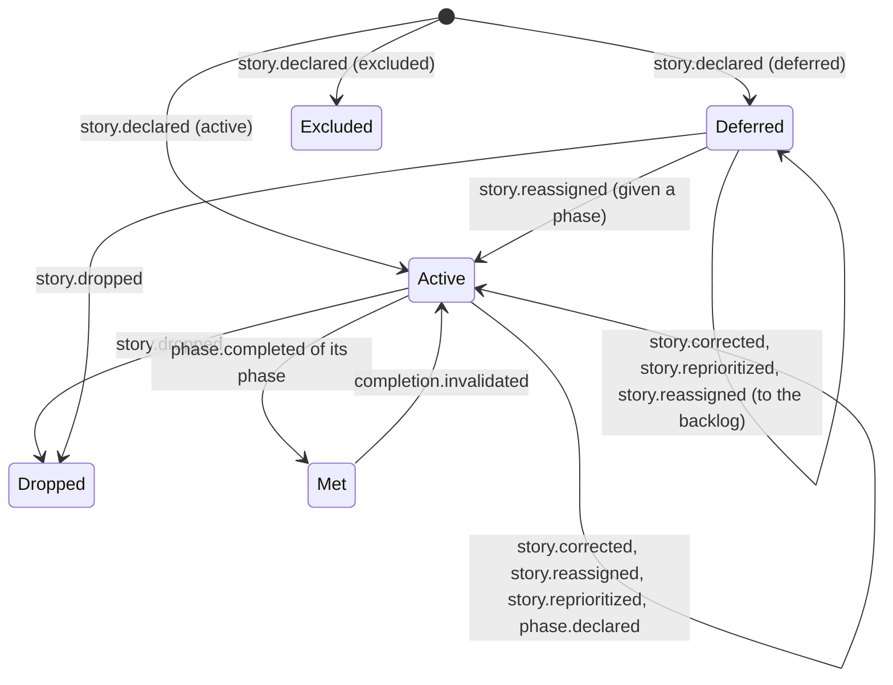
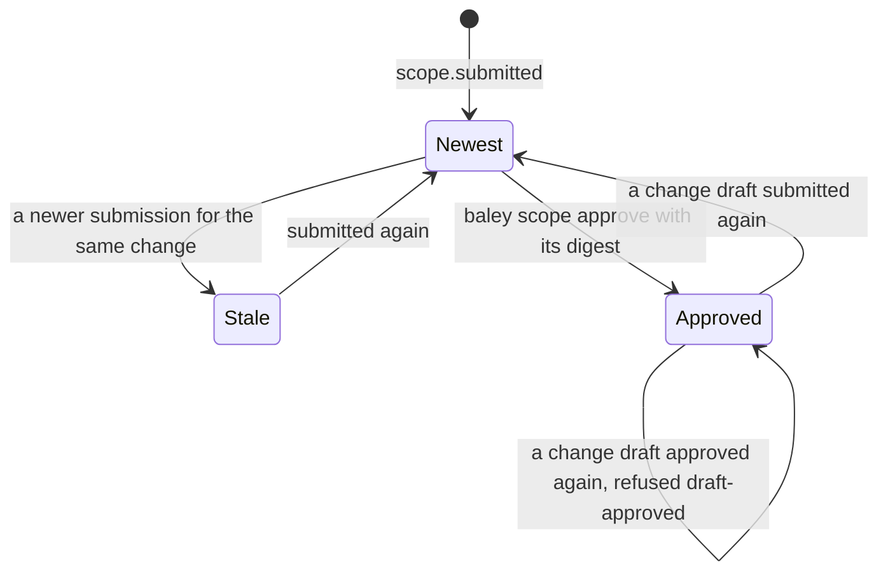
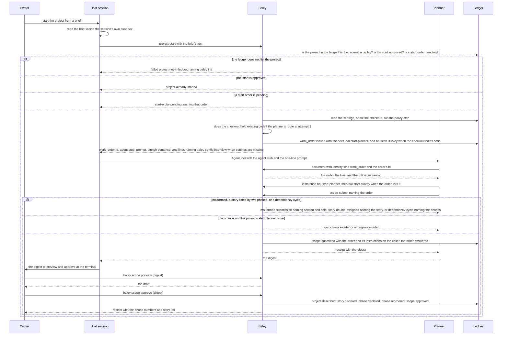
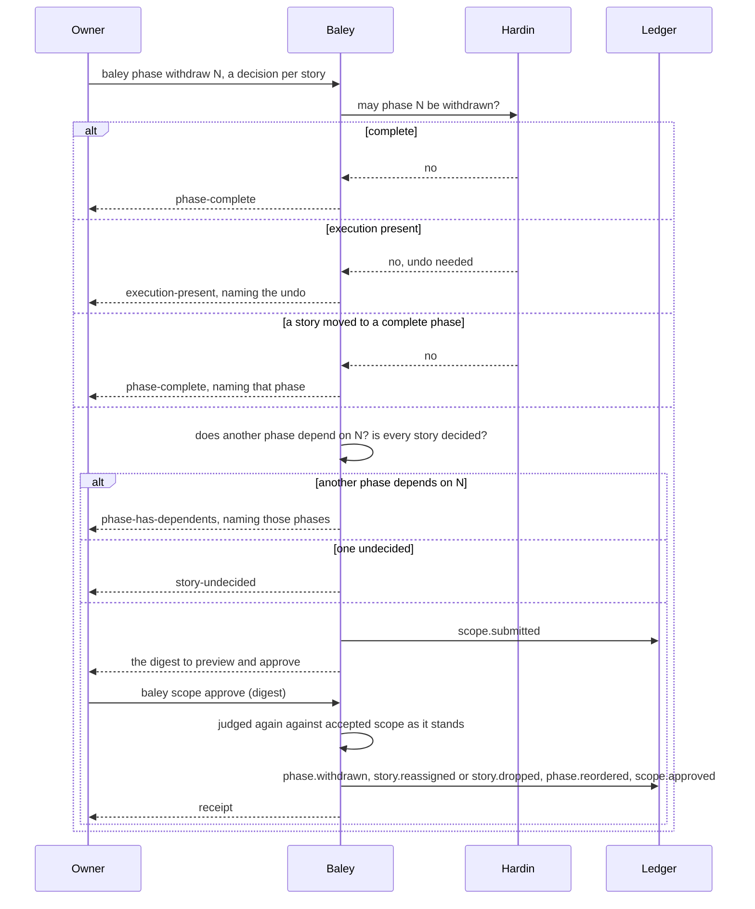

# 0004: Starting a project and changing scope

| | |
|---|---|
| Status | Accepted |
| Design issue | [#46](https://github.com/jcrenshaw-dev/baley/issues/46), [#45](https://github.com/jcrenshaw-dev/baley/issues/45); build issues [#23](https://github.com/jcrenshaw-dev/baley/issues/23), [#25](https://github.com/jcrenshaw-dev/baley/issues/25) |
| Requirement prefix | PRJ |
| Applies | [0002: System design](0002-system-design.md) |
| Related | ADRs: [0004](../adr/0004-project-identity.md), [0006](../adr/0006-no-markdown-records.md), [0007](../adr/0007-forge-anchors.md), [0009](../adr/0009-served-instructions.md), [0017](../adr/0017-stories-and-sprints.md), [0031](../adr/0031-one-term-per-concept.md) · C4 view: components ([0002](0002-system-design.md) Figure 4) |

The current design of this area, and nothing else. Edit it in place when the design changes; git holds the history. It describes the design only, never the work still to do.

## 1. Purpose and scope

This area decides how a project gets its first scope and how an approved scope changes afterwards:

- starting a project: the project description, the first stories and the first roadmap, as one submission the owner approves;
- the roadmap commands: declaring, editing, reordering and withdrawing a phase;
- the story commands: declaring, correcting, reassigning and dropping a story;
- the backlog: the stories in priority order;
- what the start checks on the forge and in the settings, and what it offers to fix.

It does not decide a story's acceptance criteria (truths), their revision, phase planning or plans ([0005: Context, plans and acceptance](0005-context-plans-and-acceptance.md)), how execution is undone ([0011: Milestones, landing, undo and pause](0011-milestones-landing-undo-pause.md)), how a repository or ruleset is created on the forge (0011), how settings are written ([0003: Configuration and routing](0003-configuration-and-routing.md)), or how the owner's identity on an approval is read ([0012: Host interface](0012-host-interface.md)).

Hand-offs: `baley init` ([0001](0001-evidence-ledger.md), EVD-R17) gives the repository its project id and file; this area's start needs it run first and names it as the owner's step when it has not been. The `roadmap`, `phase` and `backlog` views (section 6, [0001](0001-evidence-ledger.md)) serve what this area records to Hardin, context authoring and progress ([0013](0013-next-action-and-progress.md)). The planner that drafts the first scope is dispatched with a work order ([0002](0002-system-design.md) section 8) and routed by [0003](0003-configuration-and-routing.md).

In the component view of [0002](0002-system-design.md) (Figure 4) this area is one of the domain areas; it uses Hardin for what may happen next, the work order composer for the planner's dispatch, and the ports for the ledger, git and the forge.

## 2. Terms

| Term | Meaning |
|---|---|
| Project description | What the project is, its core value and its constraints, in the owner's words. |
| Story | One numbered statement of what the project must do, declared by the owner on the roadmap, with a status: `active`, `deferred` or `excluded`. A story carries its own acceptance criteria (truths), written in [0005](0005-context-plans-and-acceptance.md). |
| Backlog | The stories in priority order. A story in no phase waits in the backlog. |
| Phase | One working increment of the roadmap: a number, a name, a goal, detail text, dependencies on other phases, and the stories committed to it. One phase is active per project; its planning, size, capacity and close are designed in [0005](0005-context-plans-and-acceptance.md). |
| Roadmap | The ordered list of phases. |
| Scope | The description, the stories and the roadmap together. |
| Submission | A typed draft of a scope change, whole and validated, identified by its digest. It is recorded in the ledger as a draft when it is submitted, and only its approval changes accepted scope. |
| Approval | The owner's yes to one submission, given at the terminal and bound to its digest, with the owner's identity (`owner.name`, else git `user.name`) and Baley's clock. |
| Preview | The roadmap and story changes a submission would make, shown before approval. |
| Phase number | A whole number given to a phase when it is declared. It never changes and is never reused. |
| Order | The position of a phase in the roadmap: a separate fact from its number, changed by reorder. |
| Truth | One acceptance criterion of a story, in the sentence form [0005](0005-context-plans-and-acceptance.md) defines. A truth has a version. |
| Context | A phase's approved goal and the truth versions of its committed stories at the time ([0005](0005-context-plans-and-acceptance.md)). |
| Withdraw | Remove a phase from the roadmap, keeping every record of it. |
| Brief | The owner's description of the project, written elsewhere. The session reads it in its own sandbox and sends its text to the start. |
| Start order | The start planner's work order, which `project start` issues and a start submission answers by naming it ([0012](0012-host-interface.md)). |
| Survey | The planner's reading of an existing codebase before drafting the first scope. |

## 3. Requirements

| Id | Rule | Why | Depends on | Status |
|---|---|---|---|---|
| PRJ-R1 | One operation, `project start`, starts a project in a new repository and in an existing codebase alike. Baley reads the checkout: when HEAD has a root commit and its tree tracks a file besides the project file, the planner's work order includes the survey instruction, so the planner reads what exists before drafting; when HEAD is unborn or tracks only the project file, it does not. The records are the same either way. | One contract to learn and test; Baley can tell the two cases apart itself. | SYS-P2 | Active |
| PRJ-R2 | The start's submission, the project description, the first stories and the first roadmap, is recorded as a draft when it is submitted. Its approval by the owner, by digest, records the description, the stories and the roadmap all or nothing. | Scope exists only once the owner has said yes to the whole of it. | SYS-P5, EVD-R2 | Active |
| PRJ-R3 | Every field of a submission is validated before any event is recorded; a malformed submission is refused naming the section and the field at fault. | A refusal that names the fault is fixable at once. | SYS-P3 | Active |
| PRJ-R4 | Stories carry a priority order, and an active story is committed to at most one phase that is not complete; one committed to none waits in the backlog. A submission that commits one to two such phases is refused naming the story. | The backlog is the order of what is promised; a phase commits from it. | PRJ-R3, PLN-R1 | Active |
| PRJ-R5 | The session reads the brief inside its own sandbox and sends its text as the start's `brief` argument, and the server reads no path for it. The brief is handed to the planner inside its work order, stored as a `record` payload. A blank brief, empty or only whitespace, is refused `brief-blank`, and one over 65,536 bytes of UTF-8 is refused `brief-too-large`, both before anything is prepared and with nothing recorded. | The owner's own writing is the best input. A server that read a path a model names, outside the session's sandbox, could carry any file the owner can read into the ledger, and a bad brief must not leave a half-started project. | PRJ-R1 | Active |
| PRJ-R6 | The start needs the project already in this machine's ledger. For a project the ledger does not list it is answered `failed` `project-not-in-ledger`, naming `baley init` as the owner's step, and the start runs no `baley init`, which remains its own command. Once a start is approved, the start is refused `project-already-started`; changes go through the scope-change operations. | The owner ties a checkout to the ledger, never a model; one record of how the project began. | EVD-R17, ADR 0004, CFG-R11 | Active |
| PRJ-R7 | There is no research step. Reading the codebase and the problem is part of the planner's work order; only the approved submission becomes scope. | Research prose is not evidence of anything; the approved scope is. | ADR 0006 | Active |
| PRJ-R8 | The start checks the forge: a remote exists, the forge is reachable, and the tag ruleset that anchors rely on is in place; it records what it found as `forge.checked`. When something is missing it offers to create it; creation is an external step run only on the owner's approval, under claim, act, record, by [0011](0011-milestones-landing-undo-pause.md). A project with no forge runs unanchored and the ledger says so. A forge that cannot hold a tag ruleset, such as a private GitHub repository without a paid plan, is recorded as unprotected and anchoring goes on. | Anchors need a forge, and the owner should learn that at the start, not at the first landing. | ADR 0007, ADR 0026, SYS-P5, SYS-P7 | Active |
| PRJ-R9 | When the start finds no global settings file, or a project file that sets nothing beyond `[project]`, its answer carries one line for each, naming the missing file, saying the other file's settings and Baley's defaults apply, and naming `baley config interview` ([0003](0003-configuration-and-routing.md)), and the start planner's order is still issued, under the host's merged effective policy: a missing global file, or a project file with nothing beyond `[project]`, leaves the other layer's settings in force, and only a setting no layer sets takes Baley's default. The start runs no interview: the owner runs it at the terminal. When both hold settings the answer carries no such line. | A new user learns the setup step from the start's own answer, and only the owner's command line writes settings. | CFG-R11 | Active |
| PRJ-R10 | A phase's number is assigned when it is declared, as the next whole number, and never changes. Its order is a separate recorded fact, changed by `phase reorder`. Inserting a phase is declaring it and reordering it. Decimal numbers do not exist. | Every reference to a phase in the record stays true forever. | EVD-R2 | Active |
| PRJ-R11 | One phase declaration shape is used by the start, by `phase declare` and by every later edit: name, goal, detail text, dependencies on other phases, and the stories it serves. Editing records a new declaration and keeps the earlier one. | One shape to validate and serve. | PRJ-R3 | Active |
| PRJ-R12 | A phase with no execution recorded (declared, context approved, or plans approved) may be withdrawn directly. The owner decides, for each active story it served, the phase it moves to or that it is dropped, and approves the previewed roadmap and story changes. | Scope can shrink, and every promise it carried is accounted for. | PRJ-R4, PRJ-R13 | Active |
| PRJ-R13 | A phase whose execution has started is withdrawn only after its execution is undone (`phase.undone`, [0011](0011-milestones-landing-undo-pause.md)). Until then `phase withdraw` is refused with `execution-present`, naming the phase and the undo it needs. A complete phase is never withdrawn; the request is refused with `phase-complete`. A complete phase also takes no new story: a `story declare` or `story reassign` into it, or a `phase withdraw` moving a story to it, is refused with `phase-complete`, naming the complete phase. | Removing a phase from the roadmap must not leave its code in the repository unaccounted for, and finished work stays finished. | SYS-P4 | Active |
| PRJ-R14 | A story's truths may be revised after they were approved, including after a phase that committed the story has started execution. A truth whose text changes gets the next version; an unchanged truth keeps its version; earlier versions are kept. The operation is [0005](0005-context-plans-and-acceptance.md)'s `story truths submit`. | The owner's understanding changes, and the record must follow it without losing history. | EVD-R2 | Active |
| PRJ-R15 | After a revision, a plan bound to an older truth version is no longer approved for execution; the phase is re-planned before more work runs, and committed code stays. A completion based on older truths stops applying. | Work is measured against the truths in force. | PRJ-R14, PLN-R4, [0007](0007-verification.md) | Active |
| PRJ-R16 | A revision is refused with `dispatch-active` while a worker is dispatched on a phase that committed the story. | A running worker must finish or be stopped under the truths it was given. | PRJ-R14 | Active |
| PRJ-R17 | A story's wording is corrected by `story edit`, at any time, for any active story; every earlier wording is kept. Correcting a story no phase serves (dropped or excluded) is refused with `story-not-served`. | One place to fix wording, and no editing of what the project no longer promises. | EVD-R2 | Active |
| PRJ-R18 | A request that names a phase, story or plan that does not exist is refused with `no-such-phase`, `no-such-story` or `no-such-plan`, naming it. "Unavailable" is answered only for a temporary condition. | A mistake must read as a mistake. | SYS-P10 | Active |
| PRJ-R19 | Every scope change (project start; project describe; phase declare, edit, reorder and withdraw; story declare, edit, reassign and drop; backlog reorder; and a revision of a story's truths, `story truths submit` in [0005](0005-context-plans-and-acceptance.md)) is a submission with a preview and an owner approval by digest, recorded as events that keep every earlier record. | Scope changes only with a record of what changed, who approved it and when. | SYS-P5, SYS-P6 | Active |
| PRJ-R20 | The project description is recorded as `project.described` on the project stream and served to refinement and planning ([0005](0005-context-plans-and-acceptance.md)) beside the roadmap. It is revised the same way as any scope change. | The planner and the analyzer work from what the owner said the project is. | PRJ-R2 | Active |

## 4. Roles and actors

| Actor | Receives | Returns | Model and effort from |
|---|---|---|---|
| Owner | Previews; the interview questions; the forge report and offers | The description and answers in the session; approvals by digest at the terminal; story decisions on a withdraw | Not applicable |
| Planner (dispatched worker) | The start order: the brief, the start planner's instruction with the submission shape, the story statuses and the assignment rule, and the survey instruction when the checkout has code | A typed submission: description, stories, roadmap, through `scope-submit` naming its order | `roles.planner.model`, `roles.planner.effort` ([0003](0003-configuration-and-routing.md)) |
| Host session | The start order's receipt, with the agent stub, prompt and launch sentence; the start's settings lines; the submission receipt with its digest | The brief's text; the launched planner; a failure report and retry when the planner cannot launch or returns no valid result. Never an approval | Not applicable |
| Baley: this area | Submissions and approvals | Previews, refusals, receipts, events | Not applicable |
| Hardin ([0002](0002-system-design.md)) | A scope change request | Whether it may happen now (execution present, dispatch active, phase complete) | Not applicable |
| Forge adapter ([0011](0011-milestones-landing-undo-pause.md)) | A check request; a create request on approval | Remote, reachability and ruleset facts; the created repository or ruleset | Not applicable |

The analyzer and the plan checker take no part in this area; they act on a story's refinement and a phase's plans ([0005](0005-context-plans-and-acceptance.md)).

## 5. Commands and operations

Every operation here is implemented once in the library and served as a typed operation on the host interface, reachable from a session through the stub skill that names it ([ADR 0009](../adr/0009-served-instructions.md)). The owner's own acts and reads also have commands under `baley project`, `baley scope`, `baley phase`, `baley story` and `baley backlog`, the same `baley story` namespace that holds the refinement operations of [0005](0005-context-plans-and-acceptance.md), and each command calls the same function as the operation a session calls ([ADR 0044](../adr/0044-owner-acts-on-the-command-line.md)). Every approval is the exception: it is given only on the command line and is never served over MCP, because over MCP the call comes from the model and nothing proves a person answered, while the sandbox keeps agents from running the command line against Baley's home, where the ledger lives. A submission comes from the planner's work, so `scope submit` is served to a session only, and so is `project start`, which only issues the planner's work order.

Each change follows the same three steps: submit (the submission is recorded as a draft and its digest returned), approve (the owner's yes to that digest, at the terminal), record (the approval's events). Every submission is recorded in the ledger as a draft when it is submitted ([ADR 0043](../adr/0043-submissions-recorded-as-drafts.md)). A draft survives a restart, can be read by its digest from any session or from the terminal, and can be approved until a newer submission for the same change, the same kind and target, is recorded; the newer one is then the newest draft, even when it repeats an earlier digest. A change draft approved after its latest submission is not approved again; submitting the same content again makes it a fresh draft that can be. The end of a session discards no draft. Recording a submission changes no accepted scope: only an approval does.

After the start, each change is its own `baley_apply` operation, spelled with a hyphen: `project-describe`, `phase-declare`, `phase-edit`, `phase-reorder`, `phase-withdraw`, `story-declare`, `story-edit`, `story-reassign`, `story-drop` and `backlog-reorder`. Each takes a `request_id`, a UUID in lowercase hyphenated form that a retry of the same change repeats, and a `submission` holding the change's members, which the subsections below list; an argument other than those two is refused `invalid-arguments`, and so is a `request_id` in any other form. A change names phases by their numbers and stories by their ids, never by position or label. Baley adds a `kind` member holding the operation's spelling, so a `kind` the caller sends is an unknown member. The owner also has five commands for the changes that carry only numbers and ids: `baley phase reorder <NUMBER>...`, `baley phase withdraw <NUMBER> [<STORY>=<PHASE>|<STORY>=drop]...`, `baley story reassign <ID> <PHASE>|backlog`, `baley story drop <ID>` and `baley backlog reorder <ID>...`. Each turns its words into the members a session sends, so it records the same draft, with the same digest, for the same content, and a word that is not a whole number from 1, `drop` or `backlog` where the command takes one is refused before the ledger is read. A command records its draft as the owner with no caller, after checkout admission and the policy step, as `scope approve` does, and prints the draft's kind, digest and time and the `baley scope approve` command that approves it, exit 0. Declarations, edits and `project describe` come only from a session, since an agent drafts their text.

A change's body is its members with the kind added, and its digest is the SHA-256 of that body's canonical JSON, so two kinds with the same content, a `phase reorder` and a `backlog reorder` holding the same order, have different digests. A start's body has no `kind` member. Each draft also has a target, the change it belongs to among its kind's drafts: the phase number of a `phase edit` or `phase withdraw`; the story id of a `story edit`, `story reassign` or `story drop`; `order` for either reorder; `description` for `project describe`; a declaration's own digest for a `phase declare` or `story declare`, since each declaration is a change of its own; and `project` for a start. So edits of two different phases are both approvable, and a newer edit of one phase makes only that phase's older edit stale. A change's receipt gives `status` `ok`, the `digest`, the `kind` and `recorded_at`, never the change.

A change is judged whole in two parts. Its shape comes first: the submission must be an object, an unknown member anywhere in it is refused before any other fault, then each member is judged in the order its subsection lists it. A fault is `malformed-submission`, its details naming the `section` and the `field`, such as `depends_on[1]` or `decisions[0].to`. Text is taken as written and must not be empty or only whitespace; a phase number or story id is a whole number from 1 to 4,294,967,295; a list of numbers repeats none, except a reorder's `order`, whose repeat is left to the judgement against accepted scope and refused `order-incomplete` there. Then, before the write is prepared, the change is judged against accepted scope as the `roadmap` view holds it. A change submitted before the start is approved is refused `project-not-started`, so no phase or story is declared outside the start's order; after it, each kind's rules run in the order its refusal table gives, so one change always gets one answer. A withdrawn phase is no phase a change can name: a change naming one is refused `no-such-phase`. A refusal records nothing. A body identical to one purged from the ledger cannot be stored again, and the call is answered `failed` `text-purged` with nothing recorded; the same `request_id` with a different change, or another kind, is refused `request-id-reuse`.

### project start

Served to a session only, as `project-start` on `baley_apply`: it only issues a work order, so it has no command-line form. It needs the project already in this machine's ledger and runs no `baley init` and no settings interview (PRJ-R6, PRJ-R9). It records one `work_order.issued`, the start order, on the project's `roadmap` stream under command kind `project.start`, after the write's checkout admission and policy step ([0012](0012-host-interface.md) section 8).

- **Inputs:** `request_id`, a UUID in lowercase hyphenated form that a retry of the same start repeats; `brief`, the brief's whole text, which the session reads in its own sandbox and sends (PRJ-R5); and an optional `instruction`, the identity of the instruction the session follows, `bal-project` from the project front door, whose evidence then goes on every event of the call. An argument other than these is refused `invalid-arguments`. The request digest covers the brief's SHA-256, so the same brief under the same request id is a replay and another brief under it is `request-id-reuse`.
- **Outputs:** the start order, recorded with the brief stored as a `record` payload and named as its one input, `brief`. Its id is a fresh lowercase UUID, which is also its `request`, the id of its chain's first order. It is for the role `planner` and the subject `start`, at attempt 1, under the route for the planner resolved from the host's policy at the policy step's version ([0003](0003-configuration-and-routing.md) section 5), with the agent stub for that route's rung. It lists the instruction `bal-start-planner`, then `bal-start-survey` when the checkout holds existing code: HEAD has a root commit and its tree tracks a file besides the project file (PRJ-R1). HEAD's files are listed only when it has a root commit, so an unborn HEAD runs no listing. The receipt gives `status` `ok`; `work_order`, the order's id; `request`; `attempt`, 1; `agent`, such as `bal-planner-high`; `model`, the route's model or null; `prompt`, the one line the session gives the worker, `Read Baley work order <id> and follow it.`; `launch`, the sentence saying to start that agent with the Agent tool and the prompt, naming the model as the Agent tool's `model` parameter when there is one and otherwise saying to pass none; `recorded_at`; `existing_code`, whether the checkout holds existing code; and `settings`, present only when settings are missing, one line when there is no global settings file, saying the project file's settings and Baley's defaults apply, and one when the project file sets nothing beyond `[project]`, saying the global settings file's settings and Baley's defaults apply to this project, each naming `baley config interview` (PRJ-R9). The receipt never holds the brief. The start records no `forge.checked`: the forge check (PRJ-R8) is Build 6's.
- **Refusals:** judged in this order, so one start always gets one answer. Every one records nothing, except that a failure at the policy step or later can follow a checkout admission that stays recorded, as for every write.

  | Code | Status | When | Requirement |
  |---|---|---|---|
  | `invalid-arguments` | refused | The arguments do not match the shape or name an unknown field, or `request_id` is not a UUID in lowercase hyphenated form | PRJ-R3 |
  | `brief-blank` | refused | The brief is empty or only whitespace | PRJ-R5 |
  | `brief-too-large` | refused | The brief is over 65,536 bytes of UTF-8 | PRJ-R5 |
  | `unknown-instruction`, `instruction-unavailable` | refused | `instruction` names an identity the registry does not have, or one it does not serve yet | HST-R11 |
  | `project-context-invalid`, `not-a-project`, `config-unavailable`, `project-not-in-ledger`, `ledger-busy`, `ledger-unavailable` | failed | Preparation's own answers before the replay lookup: the project directory cannot be walked, holds no `baley.toml` in its repository, or its working-tree `baley.toml` gives no project id; the ledger does not list the project, which names `baley init` as the owner's step; or the ledger cannot answer ([0012](0012-host-interface.md) section 5) | PRJ-R6, CFG-R4 |
  | `project-already-started` | refused | The project's start is approved: a `scope.approved` of kind `start` exists | PRJ-R6 |
  | `start-order-pending` | refused | A start planner order of this project is still pending, neither failed nor answered. `details.work_order` names it, and the reason says to read it with `document`, or to fail it with `work-order-fail` and retry it with `work-order-retry` | PRJ-R6 |
  | `config-unavailable` | failed | The global file or HEAD's copy of `baley.toml` cannot be read or is invalid, naming the file and the fault, or the repository root or a settings path is not UTF-8 | CFG-R9 |
  | `checkout-facts-unavailable`, `project-id-conflict` | failed | Checkout admission cannot gather the checkout's facts, or finds a fork; or HEAD's tracked files cannot be listed | EVD-R17 |
  | `unknown-model` | refused | The planner's stored model is not in the host's accepted names | CFG-R14 |
  | `ledger-busy` | failed | A start order was recorded, or the start approved, after the check read the ledger, so the transaction recorded nothing, or the host's catalog could not be read because the ledger is busy. The same call can be sent again | PRJ-R6 |
  | `request-id-reuse` | refused | The request id was already used for another start, or another call | HST-R18 |

  A request the ledger already holds, the same `request_id` and the same brief, is answered with its recorded receipt before any check, so a retried start is not refused `start-order-pending` by the order it issued itself. The start runs no `baley init`, so `baley init`'s own refusals, `not-a-repository`, `not-repository-root` and `project-name-required`, never answer it: a directory with no project is `not-a-project`, and a project the ledger does not list is `project-not-in-ledger`.

### scope submit

- **Inputs:** the submission, judged whole. It has exactly the members below, and an unknown member anywhere in it is refused:
  - `description`: `what` and `core_value`, each text, and `constraints`, a list of text that may be empty;
  - `stories`: a list of at least one story, in priority order, each with a `label` that no other story in the submission has, a `sentence`, and a `status` of `active`, `deferred` or `excluded`;
  - `roadmap`: a list of at least one phase, in roadmap order, each with a `name`, a `goal` and a `detail`, each text, `depends_on`, the phases it depends on as 1-based positions in `roadmap`, and `stories`, the active stories it serves, by label.

  Text is taken as written and must not be empty or only whitespace. The submission names no phase number and no story id: phases refer to each other by position and to stories by label, and Baley assigns numbers and ids at approval. It carries no work order id. Over MCP the operation is `scope-submit` on `baley_apply`, with a `request_id`, a UUID in lowercase hyphenated form that a retry of the same submission repeats, `work_order`, the id of the start order the submission answers, as that order's receipt gave it, and the `submission`. An argument other than those three is refused `invalid-arguments`, and so is a `request_id` or a `work_order` in any other form than a lowercase hyphenated UUID. The order is required: no draft is recorded without one.

  The order rides on the call's caller, never in the submission: every event of the submission's transaction carries the order's id and the instruction evidence the order recorded, `bal-start-planner` and, when listed, `bal-start-survey` ([0012](0012-host-interface.md) HST-R11). So the draft's digest is the digest of the submission content alone, while the request digest covers the order too, so one request id cannot answer two orders.
- **Outputs:** `scope.submitted` on the `project` stream, with the submission's canonical JSON stored as a `record` payload, and the receipt: `status` `ok`, the `digest`, the `kind` `start`, the number of `stories` and of `phases`, and `recorded_at`. The receipt never holds the submission. The digest is the SHA-256 of the submission's canonical JSON and nothing else, so the same content has one digest from any session. Every submit records, so submitting a digest again makes it the newest draft again. The first submission naming a pending start order marks it `answered` in the `work_order` view, and each submission adds its digest to the order's drafts once. A later submission naming the same answered order is recorded as the newest draft, and the newest draft is the one the owner can approve. The order's accepted result is the draft the owner approves: a `document` read of the order gives the start approval's digest when it is among the order's drafts ([0012](0012-host-interface.md) section 5).

  The preview is read by the digest: by a session with `document` and the identity `{"kind": "draft", "digest": "<digest>"}`, and by the owner with `baley scope preview <digest>`. Both give the draft as its latest submission recorded it, with stories by label and phases by position, since numbers and ids do not exist before approval. Neither records anything. A digest no submission has is `unknown-draft`; over MCP a digest not written as 64 lowercase hexadecimal characters names no draft and is answered `unknown-draft` without a read, and on the command line it is refused before the ledger is read. A draft whose body this project purged answers its tombstone and this project's purge reason, and its body is never opened, even when another project holds the same bytes ([0001](0001-evidence-ledger.md)).
- **Refusals:** judged in this order: the arguments, the `request_id` and then the `work_order` id, then the submission's shape, member by member in the order of the inputs above, then story assignment, then dependency cycles, then the order the call names, then whether the project's start is approved. So one submission always gets one answer.

  | Code | When | Requirement |
  |---|---|---|
  | `malformed-submission` | A member is missing, null, blank, of the wrong type or unknown; `stories` or `roadmap` is empty; two stories share a label; a `depends_on` entry is not a position in `roadmap` or is repeated; a phase's `stories` entry is repeated, names a label the submission lacks, or names a story that is not `active`. The details name the `section` and the `field` as a path with zero-based list indexes, such as `roadmap[1].goal` | PRJ-R3 |
  | `story-double-assigned` | Two phases list one story. The details name the story by label and the first two phases that list it, by 1-based position | PRJ-R4 |
  | `dependency-cycle` | Phases depend on each other in a cycle, including a phase that depends on itself. The details name every phase on a cycle by 1-based position, ascending | PRJ-R11 |
  | `no-such-work-order` | This project's `work_order` view holds no order with the id `work_order` names. The slot is `work_order` | PRJ-R2, HST-R11 |
  | `wrong-work-order` | The order `work_order` names is not the start planner's: its role is not `planner` or its subject is not `start`. The slot is `work_order` | PRJ-R2, HST-R11 |
  | `project-already-started` | The project's start is approved: a `scope.approved` of kind `start` exists | PRJ-R6 |

  An order passes in any state, pending, answered or failed, since a later submission under an answered order is the newest draft. A body identical to one purged from the ledger cannot be stored again, and the call is answered `failed` `text-purged` with nothing recorded. The same `request_id` with a different submission is refused `request-id-reuse`.

### scope approve

- **Inputs:** the digest of any draft, a start's or a change's, alone, as the receipt writes it: 64 lowercase hexadecimal characters. Anything else is refused before the ledger is read. The owner and the time are Baley's: the owner is `owner.name` from the global settings, else git `user.name` ([0012](0012-host-interface.md) HST-R10), and the time is Baley's clock when the approval is recorded. Nothing a caller sends supplies either.
- **Outputs:** for a start, in one transaction, in this order: `project.described`; one `story.declared` per story, in submission order, with ids Baley assigns as the next whole numbers after the highest story id ever declared; one `phase.declared` per phase, in roadmap order, numbered as the next whole numbers after the highest phase number ever declared, withdrawn phases included, with its dependencies as phase numbers, its stories as story ids and its detail stored as a `record` payload; one `phase.reordered` with the new numbers in roadmap order; and `scope.approved` last, binding the digest, with the owner's name and Baley's time. A story's `phase` is the number of the phase that lists it, or none when no phase does. For a change, in one transaction, the events its subsection names, taken over accepted scope as the transaction reads it, then `scope.approved` of the change's kind. Every event is recorded with actor `owner`. The receipt gives the kind, the digest, the owner, the time, the phase numbers and the story ids the approval recorded (for a start, the assigned phase numbers in roadmap order and story ids in submission order; for a change, the phase it declared, edited or withdrew and the stories it declared, corrected, moved or dropped), and the command prints them as three lines, an empty list as `none`, exit 0.
- **Refusals:** judged in this order, so one approval always gets one answer. Each prints `<code>: <reason>`, a stale draft's followed by the path, and exits 2.

  | Code | When | Requirement |
  |---|---|---|
  | `unknown-draft` | No draft has the digest, its `scope.submitted` at its latest submission is not found among the events, or no newest draft of its change is listed | PRJ-R19 |
  | `project-already-started` | A start draft, and the project's start is approved. Judged before staleness, so once one start draft is approved, approving any other start draft is refused this way, not with `stale-draft` | PRJ-R6 |
  | `draft-approved` | A change draft already approved after its latest submission. The details name that approval's `owner` and `at`. Judged before staleness, since the draft was already acted on | PRJ-R19 |
  | `stale-draft` | A newer submission for the same change, the same kind and target, was recorded after this draft's latest submission. The details name the first differing part as a path into the content, looked for in the kind's member order: for a start, the description, then the stories entry by entry, then the roadmap entry by entry, such as `roadmap[1].goal`; for a change, its members in the order its subsection lists them, inside a list entry by entry and inside a withdrawal's decisions member by member, such as `decisions[0].to`. A member one draft holds and the other lacks differs | PRJ-R19 |

  A change draft that passes these is judged again against accepted scope as it stands at approval, with the same refusals and the same order as at submission, so an approval after scope moved is refused what a submission now would be. Those refusals name the `digest` as the slot at fault, where a submission's name the `submission`.

  Run outside a checkout of a project it is refused `not-a-project`, and for a project the ledger does not list, `project-not-in-ledger`. With neither `owner.name` nor git `user.name` readable it is refused `owner-identity-missing`, naming both ways to set one; that refusal comes after checkout admission and the policy step, whose records stand. A draft whose body this project purged, or whose body no longer judges as the submission its digest names, is never approved: the answer is `failed` `ledger-unavailable`, exit 1. So is an approval of a start, a `phase declare` or a `story declare` whose numbering would pass the largest phase number or story id Baley can hold (4,294,967,295), and its transaction records nothing, since wrapping would reuse a number. A `phase edit` that gives no detail keeps the detail in force; when this project purged that detail the approval is answered `failed` `text-purged`, naming `detail`, with nothing recorded, and the edit must give a new detail.

  Served on the command line only, as `baley scope approve <digest>`, and never over MCP: over MCP the call comes from the model and nothing proves a person answered, while the sandbox keeps agents from running the command line against Baley's home, where the ledger lives ([ADR 0044](../adr/0044-owner-acts-on-the-command-line.md)). `baley_apply` has no `scope-approve` spelling, so a call spelled that way is refused `unknown-operation`.

### Refusals judged against the ledger

A refusal of a start submission, a change submission or an approval judged against the ledger records nothing at all. It is judged from the ledger before the write is prepared: over MCP after the replay lookup and before the settings are read, on the command line before checkout admission. So no checkout admission (`checkout.seen`), no policy step (`policy.effective`) and no `command.completed` is recorded for it. A start's order check and start-once check, a project start's start-once and pending-order checks, a change's judgement against accepted scope and an approval's whole judgement are each judged this way. A refusal of the submission's content, its shape, is judged before the ledger is read at all.

A retry of a submission request already completed, the same `request_id` with the same submission, is answered with its recorded receipt and never refused, even when scope moved since: a retried start is not refused `project-already-started` after the start was approved, and a retried change is not refused by the scope it was checked against. When the check refuses, the request is looked up again first, so a request recorded since the first lookup is replayed rather than refused. The library function Build 4 T9's `phase plan` records a `phase edit` with does the same: it looks its request up before the scope check and again after a check that refuses, and answers with the digest its recorded receipt names, so a receipt the ledger holds for another change under the same request is `request-id-reuse`. Each `baley scope approve`, and each of the owner's change commands, is a new request, so it has no retry by id: running an approval again after it was recorded is judged afresh and refused `project-already-started` for a start or `draft-approved` for a change.

When a call landing between another call's judgement and its transaction moved a fact that transaction confirms, the transaction records nothing. Each transaction confirms only the facts listed here for it. A start submission's transaction confirms that no start approval exists. A project start's confirms that no start approval exists and that no start planner order is pending. A change submission's confirms that the `roadmap` document and every `phase` document its check read are unchanged. A start approval's confirms that the draft's latest submission, its `scope.submitted`, the absence of a start approval and the newest start draft are what the judgement read. A change approval's confirms the draft's latest submission and its `scope.submitted`, that no approval of its digest landed since, that the newest draft of its change is the one read, by digest and sequence, and that every scope document the judgement read is unchanged; for a `phase edit` that keeps the detail in force, it also confirms that the `phase_detail` document the detail came from has not moved and is not purged, so a detail purged between the steps is never stored again. The first step reads accepted scope before the earlier approvals of the digest, so an approval landing between those reads lands after the scope read, moves the `roadmap` document, and the second step refuses. When any of them moved, the call is answered `failed` `ledger-busy`, retryable, and the retry is judged afresh. The checkout admission and policy step recorded before the transaction stand.

### project describe

- **Inputs:** exactly the start's `description` members: `what` and `core_value`, each text, and `constraints`, a list of text that may be empty, judged by the start's description rule. Over MCP the operation is `project-describe`; it has no owner command.
- **Outputs:** the receipt with the digest; the preview is read by the digest as any draft's is. On approval `project.described` with the whole new description, then `scope.approved` of kind `project-describe`. Every earlier `project.described` stays in the record. The description refinement and planning read ([0005](0005-context-plans-and-acceptance.md)) is the `roadmap` view's, so it changes only when the owner approves this exact digest; a pending draft never reaches it.
- **Refusals:**

  | Code | When | Requirement |
  |---|---|---|
  | `malformed-submission` | A member is missing, blank, of the wrong type or unknown; the details name the member, such as `constraints[0]` | PRJ-R3 |
  | `project-not-started` | The project's start is not approved, so there is no description to revise. A start records its own description | PRJ-R20 |

### phase declare

- **Inputs:** the declaration shape, in this order: `name`, `goal` and `detail`, each text; `depends_on`, the numbers of the phases it depends on; `stories`, the ids of the active stories it serves; and an optional `position`, its 1-based place in the phase order, last when left out. Over MCP the operation is `phase-declare`; it has no owner command.
- **Outputs:** the receipt with the digest. On approval `phase.declared`, numbered one past the highest phase number ever declared, withdrawn phases included, with its detail stored as a `record` payload; then `phase.reordered` with the new phase at its position, or last; then `scope.approved`. Each story it lists is committed to it.
- **Refusals:** in this order.

  | Code | When | Requirement |
  |---|---|---|
  | `malformed-submission` | The shape: a member missing, blank, of the wrong type or unknown, a repeated entry in `depends_on` or `stories`, or a `position` of 0 | PRJ-R3 |
  | `project-not-started` | The project's start is not approved | PRJ-R19 |
  | `no-such-phase` | A dependency names no declared phase, or a withdrawn one (names it) | PRJ-R18 |
  | `no-such-story` | A story id no story has (names it) | PRJ-R18 |
  | `malformed-submission` | A listed story is not `active`; the field is its entry, such as `stories[0]` | PRJ-R4 |
  | `story-double-assigned` | Another declared phase serves a listed story (names the story and that phase) | PRJ-R4 |
  | `malformed-submission` | `position` is past one after the last phase in the order | PRJ-R10 |
  | `dependency-order` | Its position places it before a phase it depends on (names it and that phase) | PRJ-R11 |

### phase edit

- **Inputs:** `phase`, the phase's number, and only the fields that change, at least one: `name`, `goal` or `detail` as text, `depends_on` as phase numbers, `stories` as story ids. Over MCP the operation is `phase-edit`; it has no owner command. Build 4 T9's `phase plan` records and approves an edit through the same library functions, with plain values.
- **Outputs:** the receipt with the digest. On approval a whole new `phase.declared` for the same number: each field the edit gives, and each it leaves out taken from the phase as accepted scope holds it at approval, its stories being those it serves then and its detail the detail in force, stored again as a `record` payload. Then `scope.approved`. The earlier declaration stays in the record. A story the edit adds is committed to the phase, and one it leaves out returns to the backlog and keeps its status.
- **Refusals:** in this order.

  | Code | When | Requirement |
  |---|---|---|
  | `malformed-submission` | The shape, as `phase declare`, or no field to change, which names `submission` | PRJ-R3 |
  | `project-not-started` | The project's start is not approved | PRJ-R19 |
  | `no-such-phase` | No declared phase has the number, or it is withdrawn | PRJ-R18 |
  | `phase-complete` | The phase is complete and the stories it serves would change (names it) | PRJ-R13 |
  | `no-such-phase` | A dependency names no declared phase, or a withdrawn one (names it) | PRJ-R18 |
  | `no-such-story` | A story id no story has (names it) | PRJ-R18 |
  | `malformed-submission` | A listed story is not `active`, such as `stories[0]` | PRJ-R4 |
  | `story-double-assigned` | Another declared phase serves a listed story (names the story and that phase) | PRJ-R4 |
  | `dependency-cycle` | The new dependencies put phases on a cycle, a phase depending on itself included (names every phase on it, ascending) | PRJ-R11 |
  | `dependency-order` | Its dependencies include a phase later than it in the order (names it and that phase) | PRJ-R11 |

### phase reorder

- **Inputs:** `order`, the number of every declared phase, each once, in the new order. Over MCP the operation is `phase-reorder`; the owner's command is `baley phase reorder <NUMBER>...`.
- **Outputs:** the receipt with the digest. On approval `phase.reordered` with the order, then `scope.approved`.
- **Refusals:** in this order.

  | Code | When | Requirement |
  |---|---|---|
  | `malformed-submission` | The shape: `order` missing, empty, or holding an entry that is not a phase number | PRJ-R3 |
  | `project-not-started` | The project's start is not approved | PRJ-R19 |
  | `no-such-phase` | An entry names no declared phase, or a withdrawn one (names it) | PRJ-R18 |
  | `order-incomplete` | A declared phase is missing or repeated. The details list, ascending, the numbers the order must hold | PRJ-R10 |
  | `dependency-order` | A phase is placed before one it depends on (names it and that phase) | PRJ-R11 |

### phase withdraw

- **Inputs:** `phase`, the phase's number, and `decisions`, one for each story it serves, each with the story's id in `story` and, in `to`, the number of the phase that serves it instead or `drop`. No story is decided twice. Over MCP the operation is `phase-withdraw`; the owner's command is `baley phase withdraw <NUMBER> [<STORY>=<PHASE>|<STORY>=drop]...`.
- **Outputs:** the receipt with the digest; the preview shows the phase and each decision. On approval `phase.withdrawn`; then, for each story the phase serves, in its order, `story.reassigned` to its new phase, which makes it `active`, or `story.dropped`; then `phase.reordered` with the order without the phase; then `scope.approved`. The phase keeps every record and its `phase` and `roadmap` entries, with status `withdrawn`, outside the order. Its number is never reused, and a capture, a change or a dependency that names it is refused `no-such-phase`.
- **Refusals:** in this order, completion before execution, since a complete phase is never withdrawn whatever its execution.

  | Code | When | Requirement |
  |---|---|---|
  | `malformed-submission` | The shape: a member missing, of the wrong type or unknown, a story decided twice, or a `to` that is neither a phase number nor `drop` | PRJ-R3 |
  | `project-not-started` | The project's start is not approved | PRJ-R19 |
  | `no-such-phase` | No declared phase has the number, or it is already withdrawn | PRJ-R18 |
  | `phase-complete` | The phase is complete (names it) | PRJ-R13 |
  | `execution-present` | Execution has started and is not undone (names the phase and the undo) | PRJ-R13 |
  | `phase-complete` | A decision moves a story to a complete phase (names that phase) | PRJ-R13 |
  | `phase-has-dependents` | Another declared phase depends on this one (names every such phase, ascending). The owner edits their dependencies first | PRJ-R11 |
  | `story-undecided` | A story it serves has no decision (names it) | PRJ-R12 |
  | `no-such-story` | A decision names a story the phase does not serve (names it) | PRJ-R18 |
  | `no-such-phase` | A decision moves a story to a phase that is not declared, is withdrawn, or is the phase being withdrawn (names it) | PRJ-R18 |

### story declare, story edit, story reassign, story drop

- **Inputs:** `story declare`: exactly `sentence`, text; `status`, `active`, `deferred` or `excluded`; and `phase`, the number of the phase that serves it, or null for the backlog, a phase only for an `active` story. A capture id or any other member is unknown. `story edit`: `story`, its id, and `sentence`, the corrected text. `story reassign`: `story`, its id, and `phase`, the number of the phase that serves it now, or null for the backlog. `story drop`: `story`, its id. Over MCP the operations are `story-declare`, `story-edit`, `story-reassign` and `story-drop`; the owner's commands are `baley story reassign <ID> <PHASE>|backlog` and `baley story drop <ID>`.
- **Outputs:** the receipt with the digest. On approval, then `scope.approved`: `story.declared` with the id one past the highest ever declared, last in priority order; `story.corrected` with the new wording and the status it holds; `story.reassigned`, which makes a story given a phase `active` and leaves one sent to the backlog with its status; or `story.dropped`, which takes the story off any phase and gives it status `dropped`. Every earlier event stays in the record.
- **Refusals:** for each kind, the shape's `malformed-submission`, then `project-not-started`, then the rows that name the kind, in this order.

  | Code | When | Requirement |
  |---|---|---|
  | `malformed-submission` | A member missing, blank, of the wrong type or unknown; a `status` that is not `active`, `deferred` or `excluded`; or a `declare` giving a phase to a story that is not `active`, which names `phase` | PRJ-R3 |
  | `project-not-started` | The project's start is not approved | PRJ-R19 |
  | `no-such-phase` | `declare` into a phase that is not declared, or is withdrawn (names it) | PRJ-R18 |
  | `phase-complete` | `declare` into a complete phase (names it) | PRJ-R13 |
  | `no-such-story` | `edit`, `reassign` or `drop` of an id no story has (names it) | PRJ-R18 |
  | `story-not-served` | `edit`, `reassign` or `drop` of a dropped or excluded story, both final (names the story and its status) | PRJ-R17 |
  | `story-shipped` | `reassign` or `drop` of a story a complete phase serves (names the story and the phase) | PRJ-R13 |
  | `phase-complete` | `reassign` into a complete phase (names it) | PRJ-R13 |
  | `no-such-phase` | `reassign` to a phase that is not declared, or is withdrawn (names it) | PRJ-R18 |

### backlog reorder

- **Inputs:** `order`, the id of every active and deferred story, each once, in the new priority order. Over MCP the operation is `backlog-reorder`; the owner's command is `baley backlog reorder <ID>...`.
- **Outputs:** the receipt with the digest. On approval `story.reprioritized` with the order, then `scope.approved`. Dropped and excluded stories stay in the backlog, outside the order, after the ordered stories in their current relative order.
- **Refusals:** in this order.

  | Code | When | Requirement |
  |---|---|---|
  | `malformed-submission` | The shape: `order` missing, empty, or holding an entry that is not a story id | PRJ-R3 |
  | `project-not-started` | The project's start is not approved | PRJ-R19 |
  | `no-such-story` | An entry names no story (names it) | PRJ-R18 |
  | `order-incomplete` | An active or deferred story is missing or repeated, or a dropped or excluded story is listed. The details list, ascending, the ids the order must hold | PRJ-R4 |

### Revising a story's truths

The operation is `story truths submit` and `story truths approve` in [0005](0005-context-plans-and-acceptance.md); PRJ-R14 to PRJ-R16 are the rules it applies to a story already committed to a phase.

## 6. Records

### scope.submitted (event, `project` stream)

| Field | Type | Meaning |
|---|---|---|
| `digest` | digest | The SHA-256 of the submission's canonical JSON, its identity as a draft |
| `kind` | enum | The change kind, as in `scope.approved` |
| `target` | text | The change the draft belongs to among its kind's drafts: `project` for a start; the phase number of a `phase-edit` or `phase-withdraw`; the story id of a `story-edit`, `story-reassign` or `story-drop`; `order` for either reorder; `description` for `project-describe`; the draft's own digest for a `phase-declare` or `story-declare` |
| `body` | payload reference | The submission's canonical JSON as a `record` payload, which the event attaches |

The payload is at version 2. Only starts were recorded at version 1, which had no `target`, so a version-1 event reads with the start's target `project`, and a version-1 event of any other kind is refused rather than filed under a guessed target. Recorded once per submit, a repeated digest included. The accepted scope views ignore it.

### project.described (event, `project` stream)

| Field | Type | Meaning |
|---|---|---|
| `what` | text | What the project is |
| `core_value` | text | The one thing it must do well |
| `constraints` | list of text | What it must not do or depend on |
| `submission` | digest | The submission this came from: a start or a `project-describe` |

An approved start and every approved `project-describe` record one, and every earlier one stays in the record; the `roadmap` view holds the latest.

### story.declared, story.corrected, story.reassigned, story.reprioritized, story.dropped (events, `roadmap` stream)

Each event carries the fields its name is listed against, and `submission`.

| Field | Type | Meaning |
|---|---|---|
| `id` | integer | The story id: a whole number from 1, assigned by Baley at declaration as the next after the highest ever declared, never reused (declared, corrected, reassigned, dropped) |
| `sentence` | text | The wording (declared, corrected) |
| `status` | `active`, `deferred`, `excluded`, `dropped` | The status after the event (declared, corrected, reassigned, dropped). A correction keeps the status; a reassignment to a phase makes it `active` and one to the backlog keeps it; a drop makes it `dropped` |
| `phase` | phase number or null | The phase it is committed to (declared, reassigned); null means the backlog |
| `order` | list of story ids | The priority order the change gives, every active and deferred story once (reprioritized). It names no single story, so the event has no `id`; dropped and excluded stories follow the ordered ones in their current relative order |
| `submission` | digest | The submission this came from (every event) |

### phase.declared, phase.reordered, phase.withdrawn (events, `roadmap` stream)

Each event carries the fields its name is listed against, and `submission`.

| Field | Type | Meaning |
|---|---|---|
| `number` | integer | The phase's permanent number (declared, withdrawn) |
| `name`, `goal` | text | (declared) |
| `detail` | payload reference | The detail text as a `record` payload, which the event attaches (declared) |
| `depends_on` | list of phase numbers | (declared) |
| `stories` | list of story ids | The active stories served (declared) |
| `order` | list of phase numbers | The full order after the event, a withdrawn phase left out (reordered) |
| `submission` | digest | The submission this came from (every event) |

A start records one `phase.declared` per phase and one `phase.reordered`; a `phase-declare` records one of each; a `phase-edit` records a whole `phase.declared` for the same number, the fields it leaves out taken from accepted scope at approval; a `phase-withdraw` records `phase.withdrawn`, the stories' events and `phase.reordered`.

### scope.approved (event, `project` stream)

| Field | Type | Meaning |
|---|---|---|
| `submission` | digest | The approved submission |
| `kind` | enum | `start`, `project-describe`, `phase-declare`, `phase-edit`, `phase-reorder`, `phase-withdraw`, `story-declare`, `story-edit`, `story-reassign`, `story-drop`, `backlog-reorder`. A revision of a story's truths is approved by `story truths approve` and recorded as `story.refined` ([0005](0005-context-plans-and-acceptance.md)), not here |
| `owner` | text | The owner's identity: `owner.name` from the global settings, else git `user.name` |
| `at` | time | Baley's clock when the approval was recorded, the same as the command's time |

The event is recorded with actor `owner`, as is every event its approval records.

### forge.checked (event, `project` stream)

| Field | Type | Meaning |
|---|---|---|
| `remote` | URL or absent | The remote found |
| `reachable` | bool | Whether the forge answered |
| `ruleset` | `present`, `missing`, `unknown` | The tag ruleset anchors rely on |
| `offered` | list | What the start offered to create |

### story.refined (event, `roadmap` stream; defined in [0005](0005-context-plans-and-acceptance.md))

This area adds one rule to it: each truth carries a `version`, and a revision records a new `story.refined` whose unchanged truths keep their versions.

### Views

Every view is kept per project, and only `draft` reads a submission. The accepted scope views, `roadmap`, `phase`, `phase_detail` and `backlog`, change only on the events an approval records.

| View | Key | Content |
|---|---|---|
| `draft` | project, digest | One document per submitted digest: the change kind, the target, the sequence and time of that digest's latest submission, and its body's hash, never the body. Each digest is filed under its kind and target. Its `newest` index lists one change's drafts, by kind and then target, newest first by that sequence, so the newest draft of a change is the first it gives. When this project purges the body, the document gains `state` `purged` and the purge's reason and is kept, so a read answers the tombstone and never opens the body ([0001](0001-evidence-ledger.md)) |
| `roadmap` | project | One document: the latest project description; every phase ever declared, by number, each with name, goal, dependencies, the stories it serves now and status, `declared` or `withdrawn`; the latest phase order; the stories in priority order, each with id, wording, status, the phase serving it now and truth count; and the highest phase number and story id ever declared, which never go down, so an approval numbers past every declaration, withdrawn phases included. A withdrawn phase keeps its entry and is outside the order, so a roadmap read, `baley scope show` and `document` alike, gives the phases in order and then each withdrawn phase by number. Every event that moves a story keeps a phase's stories and the story's phase in step: a declaration commits the stories it lists and returns to the backlog those it no longer lists, a reassignment moves the story, and a drop takes it off its phase and keeps it with status `dropped`. A reprioritization puts the stories it lists first and every other story after them in its current relative order. This is the document a change is judged against, and the description read for refinement and planning |
| `phase` | project, phase number | One document per declared phase: name, goal, dependencies, the stories its latest declaration listed, status, `declared` or `withdrawn`, the approving digest, the declaration's time and sequence, and the detail body's hash, never the text. Its `by_status` index lists phases by status, then number. A later declaration of the same number replaces the document. A withdrawal keeps it with every field and status `withdrawn`, so a withdrawn phase is still read by its number. A reassignment or drop since the latest declaration names no earlier phase, so the stories a phase serves now are the `roadmap` view's, which a phase read gives. The current context (truth versions), plans, execution and completion state Hardin needs are added by the events that record them |
| `phase_detail` | project, `phase.declared` sequence | One document per phase declaration: the phase number and the detail body's hash. It is keyed by the declaration's sequence because a purge names each released body by sequence and hash; a `phase` document names its sequence. When this project purges the body, the document gains `state` `purged` and the purge's reason, so a phase read answers them and never opens the body |
| `backlog` | project | One document: the stories in priority order, each with id, wording, status, phase, refinement, truth count and size, the view [0005](0005-context-plans-and-acceptance.md) reads. A declared story goes last. It follows corrections, reassignments, drops and reprioritizations, and the phase declarations that commit a story they list or release one they no longer list; a dropped story stays with status `dropped` and no phase. Refinement is `unrefined`, the truth count 0 and the size none until refinement and sizing record them |

## 7. States

```mermaid
stateDiagram-v2
  [*] --> Declared: phase.declared
  Declared --> Declared: phase.declared (edit), phase.reordered
  Declared --> ContextApproved: every committed story refined (story.refined)
  ContextApproved --> ContextApproved: story.refined (revision)
  ContextApproved --> Planned: plan.approved
  Planned --> ContextApproved: story.refined (revision; plans invalid)
  Planned --> Executing: first task admitted
  Executing --> Planned: phase.undone
  Executing --> Complete: phase.completed
  Complete --> Executing: completion.invalidated
  Declared --> Withdrawn: phase.withdrawn
  ContextApproved --> Withdrawn: phase.withdrawn
  Planned --> Withdrawn: phase.withdrawn
  Withdrawn --> [*]
```

*Figure 1. States of a phase as this area sees them. Execution and completion transitions belong to [0006](0006-execution.md) and [0007](0007-verification.md); a withdraw from Executing is refused `execution-present` until `phase.undone` returns it to Planned; Complete is never withdrawn and is refused `phase-complete`. A withdrawn phase keeps every record and its `phase` and `roadmap` entries with status `withdrawn`, outside the order, and no change, capture or dependency can name it again. The `phase` view records only Declared and Withdrawn until the context, plan, execution and completion events are recorded.*

*Figure 2. States of a story. A correction, a reprioritization and a move to the backlog leave an active story active and a deferred one deferred, and a phase declaration that commits or releases an active story leaves it active; giving a deferred story a phase makes it active. Excluded and Dropped are final: a `story edit`, `story reassign` or `story drop` of either is refused `story-not-served`, and neither is in a backlog order. Met is derived from its phase's completion ([0007](0007-verification.md)).*

*Figure 3. States of a submission. Every submission is recorded as a draft when it is submitted, and its record stays in every state. The same change is the same kind and target. Only the newest draft of a change can be approved, and only its approval records scope events. An approved change draft is refused `draft-approved` when approved again; the same content submitted again is a fresh draft, which can be approved. The end of a session changes no state. Once a start is approved, approving that start again or any other start draft is refused `project-already-started`, and no start is submitted again, since a start submitted then is refused the same way. A draft whose body this project purged is never approved.*

## 8. Workflows

*Figure 4. Starting a project, as built. The session reads the brief in its own sandbox and sends its text, and Baley reads no file for it. `project-start` checks that the ledger lists the project, that no start is approved and that no start order is pending before it reads the settings, and records nothing when it refuses. It then issues the start planner's work order, and the session launches the named agent stub with the order's one-line prompt, passing the route's model as the Agent tool's `model` parameter only when the route has one. The planner reads its order and the instructions it lists, and submits with `scope-submit` naming the order, which records a draft carrying the order and its instructions on its caller. The owner previews and approves the draft by its digest at the terminal, not through the session, and Baley adds the owner's identity and its own time to the approval. Not drawn: the argument refusals `invalid-arguments`, `brief-blank` and `brief-too-large`, answered before anything is prepared; preparation's other `failed` answers; a replay, answered from its record; `project-already-started` at submission; and a planner that cannot launch or returns no digest, which the session reports with `work-order-fail` and retries with `work-order-retry`. The forge check of PRJ-R8 is Build 6's and is not drawn.*

*Figure 5. Withdrawing a phase from the terminal. A session's `phase-withdraw` is judged the same way and returns the digest to the session, and the owner approves it with `baley scope approve` at the terminal either way. Hardin's answers come from PRJ-R13's facts for each phase. Not drawn: `no-such-phase` for a phase that is not declared or is withdrawn, and for a decision moving a story to one; `no-such-story` for a decision naming a story the phase does not serve. Section 5's `phase withdraw` table gives every refusal in the order it is judged.*

The revision of a story's truths is [0005](0005-context-plans-and-acceptance.md) Figure 4.

## 9. Settings

Not applicable. This area reads no setting of its own. The start runs no settings interview: when the global settings file is missing, or the project file sets nothing beyond `[project]`, its answer names `baley config interview` ([0003](0003-configuration-and-routing.md)) for the owner to run at the terminal, and the start planner's order is issued under the host's merged effective policy, so the layer that is present keeps its settings in force and only a setting no layer sets takes Baley's default (PRJ-R9). The planner's route comes from `roles.planner.model`, `roles.planner.effort` and `escalate_on_failure` ([0003](0003-configuration-and-routing.md)).

## 10. Instructions served

| Instruction | Served to | Carries requirements |
|---|---|---|
| Start planner (`bal-start-planner`) | The planner, served inside the start order, which lists it by identity, version and hash with the brief as the order's input: where the brief is in the order, the survey to carry out first when the order also lists it, the submission shape `scope-submit` takes, the story statuses, the assignment rule that an active story is delivered by at most one phase and a deferred or excluded story by none, that no phase depends on itself, how to submit naming the order and what to do with each answer, and to report the digest for the owner to approve at the terminal. It holds no truth rules, since the start's submission holds no truths. It is a compiled registry entry served by identity, not a help row, so it has no skill stub | PRJ-R1, PRJ-R4, PRJ-R7, PRJ-R11 |
| Start survey (`bal-start-survey`) | The planner, listed in the start order after the start planner's text only when the checkout holds existing code: read the checkout with the host's own tools before drafting, and let what exists shape the description and the stories. A registry entry served by identity, with no help row and no skill stub | PRJ-R1, PRJ-R7 |
| Scope change stubs | The host session, as the skill stubs of the five front doors `bal-project`, `bal-scope`, `bal-phase`, `bal-story` and `bal-backlog`, each a help row whose text the registry serves by identity: which operations to call and with what, that the owner approves the draft at the terminal, and, for `bal-project`, how to launch the start order and report its failure and retry | PRJ-R19 |

## 11. Build status

The binary parks the inherited engine for Build 9 to delete, and nothing in production reaches it (`crates/baley/src/inherited.rs:1-4`). Build 4 T3 built the start's scope records, Build 4 T4 the scope changes, and Build 4 T5 `project start`, its planner's work order and the binding of a start submission to that order.

A session submits a start with `scope-submit` on `baley_apply`, and each change with its own spelling, `project-describe` to `backlog-reorder`, listed after it (`crates/baley/src/mcp/operations.rs:198-208`, `crates/baley/src/mcp/handler.rs:178-180, 196-200`). A change's arguments are judged before anything is prepared (`crates/baley/src/mcp/scope.rs:104-135`, `crates/baley/src/mcp/scope.rs:200-216`): each kind's shape, its digest over a body that holds the kind, and its target (`crates/baley-core/src/scope/change.rs:251-360`). The change is then judged against accepted scope as preparation's own check, after the replay lookup and before checkout admission and the policy step (`crates/baley/src/mcp/scope.rs:354-377`, `crates/baley/src/scope/submit.rs:216-228`), by the rules of section 5 (`crates/baley-core/src/scope/rules.rs:311-375`, `crates/baley-core/src/scope/rules.rs:614-673`), over the scope read from the events and the `roadmap` and `phase` views, which the recording's transaction confirms has not moved (`crates/baley/src/scope/read.rs:561-654`, `crates/baley/src/scope/submit.rs:330-367`). The owner's `baley phase reorder`, `baley phase withdraw`, `baley story reassign`, `baley story drop` and `baley backlog reorder` turn their words into the same members and submit through the same functions, as the owner (`crates/baley/src/scope/command.rs:184-219`, `crates/baley/src/scope/command.rs:335-354`, `crates/baley/src/scope/command.rs:603-680`).

`baley scope approve` approves a start or a change draft (`crates/baley/src/scope/command.rs:307-328`). Its first step judges a change draft against the newest draft of the same change and then against accepted scope as it stands, reading the scope before the earlier approvals of the digest (`crates/baley/src/scope/approve.rs:160-220`, `crates/baley-core/src/scope/approval.rs:173-205`). Its second step confirms what the first read, a carried phase detail included, and records the change's events (`crates/baley/src/scope/approve.rs:462-558`, `crates/baley-core/src/scope/change_events.rs:52-236`). `baley_apply` has no `scope-approve` spelling, so approval is given only on the command line. Build 4 T9's `phase plan` gets a `phase edit` it records from plain values, replayed before the scope check and answered with the digest its recorded receipt names, and approves it through the same two steps (`crates/baley/src/scope/submit.rs:383-425`, `crates/baley/src/scope/approve.rs:105-150`, `crates/baley/src/scope/approve.rs:388-458`).

The five change events are registered beside the six the start records (`crates/baley-core/src/scope/event.rs:89-110`), and the `draft`, `roadmap`, `phase` and `backlog` projectors, with their versions raised, are registered in view set 11, beside the `work_order` view that holds the start order (`crates/baley/src/ledger/open.rs:25-75`). A session reads a draft of any kind, the accepted roadmap, an accepted story and the start order with `document` (`crates/baley/src/mcp/document.rs:243-276`). The owner has `baley scope preview`, `baley scope show`, `baley phase show`, `baley backlog show` and `baley story show` (`crates/baley/src/main.rs:33-40`, `crates/baley/src/scope/command.rs:171-219`). The description refinement and planning read is the `roadmap` view's latest approved description (`crates/baley/src/scope/read.rs:393-406`); serving it to refinement and planning is Build 4 T7 and T9. The five scope front doors, `bal-project`, `bal-scope`, `bal-phase`, `bal-story` and `bal-backlog`, are help rows whose texts the registry serves, so each is an installed skill stub, and the start planner's and survey's texts are registry entries with no help row (`crates/baley/src/help/table.rs:23-47`, `crates/baley/src/instruction/scope.rs:6-156`, `crates/baley/src/instruction/start.rs:1-55`).

PRJ-R13's facts are read from the `phase` view, whose statuses in this build are `declared` and `withdrawn` only, so in production no phase has execution or completion, and `execution-present`, `phase-complete` and `story-shipped` are reached only from supplied facts (`crates/baley/src/scope/read.rs:602-611`) until Builds 5 and 6 record execution and completion. One race is not closed. A transaction cannot ask the store for an approval after a sequence, so when a draft was approved before its latest submission, the second step relies on the `roadmap` document moving to catch a second approval of the same digest landing between the steps. Every change approval Baley records appends an event the `roadmap` view projects, so this holds for every path Baley writes; a `scope.approved` appended with no roadmap event would pass. A store query for events after a sequence would close it, and Build 4 T11 adds that query beside the store reader it adds for git facts (`crates/baley/src/scope/approve.rs:471-481`).

A session starts a project with `project-start` on `baley_apply`, listed after the change operations with `work-order-fail` and `work-order-retry` (`crates/baley/src/mcp/operations.rs:209-211`, `crates/baley/src/mcp/handler.rs:184-192`). Its arguments are judged before anything is prepared: the shape, the request id, `brief-blank`, `brief-too-large` past 65,536 bytes and the instruction, and the request digest covers the brief's SHA-256 (`crates/baley/src/mcp/work_order.rs:53-147`). Its check runs after the replay lookup and before the settings: `project-already-started` from the project's events, then `start-order-pending` from the `work_order` view's `live` index, naming the pending order (`crates/baley/src/mcp/work_order.rs:149-174`, `crates/baley/src/scope/submit.rs:94-105`, `crates/baley/src/work_order/read.rs:38-60`). Preparation hands the write the host's policy the step recorded and the root commit checkout admission gathered (`crates/baley/src/mcp/prepare.rs:95-103, 524-550`). The checkout holds existing code when HEAD has a root commit and its tracked files, listed only then, hold a name besides the project file's (`crates/baley/src/checkout/gather.rs:68-121`, `crates/baley/src/mcp/work_order.rs:345-362`). The settings lines come from the prepared policy (`crates/baley/src/mcp/work_order.rs:176-197`). The order is composed with the planner's route at attempt 1 and recorded with the brief as a `record` payload, its transaction declaring that no start order is pending and no start is approved (`crates/baley/src/mcp/work_order.rs:205-266`, `crates/baley/src/work_order/issue.rs:76-92, 114-196`). The start records no `forge.checked`. A start submission names its order: `scope-submit` judges the order's id with its arguments, prepares under a caller carrying it, checks that the order is this project's start planner order before the start-once check, and puts the order's instruction evidence on its command's caller (`crates/baley/src/mcp/scope.rs:167-198, 271-344`, `crates/baley/src/scope/submit.rs:106-159`). The `work_order` view marks a pending order answered and lists each draft submitted under it (`crates/baley-core/src/work_order/view.rs:91-111`), and a `document` read of the order gives the start approval's digest as its accepted result when that draft is among them (`crates/baley/src/work_order/read.rs:151-197`). A failed start order is retried with `work-order-retry`, which refuses it once the start is approved or while another start order is pending (`crates/baley/src/mcp/work_order.rs:675-746`). The session server answers `plan-read` and `context-intake` (`crates/baley/src/mcp/operations.rs:107-108`) and `plan-submit` and `context-submit` (`crates/baley/src/mcp/operations.rs:156-157`) as `operation-unavailable`, and the operation baseline names Build 4 for them. It answers `verification-complete` (`crates/baley/src/mcp/operations.rs:136`), the roadmap tick, the same way and names Build 5. `baley init` stays the owner's own command (`crates/baley/src/init.rs:556-564`). Parsing and editing `ROADMAP.md` and `REQUIREMENTS.md` under `.planning/` is the parked engine's.

| Requirement | Status | Where |
|---|---|---|
| PRJ-R1, PRJ-R5 | Built | `project-start` takes the brief as text, refuses `brief-blank` and `brief-too-large` before anything is prepared, reads no file for it and stores it as the order's `record` input (`crates/baley/src/mcp/work_order.rs:53-147, 247-250`). The order lists `bal-start-survey` after `bal-start-planner` when HEAD has a root commit and its tree tracks a file besides the project file, and the records are otherwise the same (`crates/baley/src/mcp/work_order.rs:223-229, 325-328, 345-362`, `crates/baley/src/checkout/gather.rs:68-121`). Whether a live planner follows the survey and the brief is Build 4 T15's live run |
| PRJ-R2 | Built | A start submission is recorded as a draft, the body as a `record` payload and one `scope.submitted` (`crates/baley/src/scope/submit.rs:161-207`), and its approval records the description, the stories and the roadmap in one transaction (`crates/baley/src/scope/approve.rs:388-458`, `crates/baley-core/src/scope/approval.rs:255-356`). The submission answers the start order it names, which `project-start` issued (`crates/baley/src/scope/submit.rs:106-159`, `crates/baley/src/mcp/work_order.rs:205-343`) |
| PRJ-R3 | Built | A start submission is judged whole, its shape before story assignment and cycles, and a fault is `malformed-submission` naming the section and the field path (`crates/baley-core/src/scope/submission.rs:165-192`, `crates/baley-core/src/scope/submission.rs:323-382`). A change is judged whole under its kind the same way (`crates/baley-core/src/scope/change.rs:251-447`). Both are answered before anything is prepared or recorded (`crates/baley/src/mcp/scope.rs:167-216`), and the terminal prints the section and the field (`crates/baley/src/scope/command.rs:487-531`) |
| PRJ-R4 | Partly built | A start submission listing one story in two phases is refused `story-double-assigned` (`crates/baley-core/src/scope/submission.rs:385-403`), and a `phase declare` or `phase edit` listing a story another declared phase serves is too (`crates/baley-core/src/scope/rules.rs:441-484`); a phase listing a story that is not `active` is `malformed-submission`. The stories keep the submission's order as their priority order, a declared story goes last, and `backlog reorder` sets the order (`crates/baley-core/src/scope/rules.rs:392-411`, `crates/baley-core/src/scope/backlog.rs:43-189`). Whether a phase is complete is not recorded until Builds 5 and 6 |
| PRJ-R6 | Built | A start for a project the ledger does not list is preparation's `failed` `project-not-in-ledger`, naming `baley init` (`crates/baley/src/mcp/prepare.rs:372-388`), and the start runs neither `baley init` nor the interview (`crates/baley/src/mcp/work_order.rs:205-343`). `project-already-started` is judged from the events at the start, at submit and at a start order's retry (`crates/baley/src/scope/submit.rs:58-105`, `crates/baley/src/mcp/work_order.rs:149-174, 710-726`), and at approval, ahead of staleness (`crates/baley-core/src/scope/approval.rs:65-89`), and confirmed inside each transaction (`crates/baley/src/scope/submit.rs:186-206`, `crates/baley/src/work_order/issue.rs:76-92`, `crates/baley/src/scope/approve.rs:569-580`). `baley init` is built as its own command (`crates/baley/src/init.rs:556-564`) |
| PRJ-R7 | Built | The accepted scope views ignore `scope.submitted`, so only an approved submission becomes scope (`crates/baley-core/src/scope/roadmap.rs:83-95`). The start runs no research step: the survey is an instruction the planner's order lists, and the planner's text tells it to write no file (`crates/baley/src/instruction/start.rs:15-55`) |
| PRJ-R8 | Not built | The start records no `forge.checked` and checks no forge (`crates/baley/src/mcp/work_order.rs:205-343`). The forge check is Build 6's |
| PRJ-R9 | Built | A start whose host policy has no global file, or no setting from the project file, carries a line for each naming `baley config interview` and runs nothing (`crates/baley/src/mcp/work_order.rs:176-197, 241-246`). The order's route is composed from the host's merged effective policy the policy step recorded, so the other layer's settings stay in force and only settings no layer sets take Baley's defaults (`crates/baley/src/mcp/work_order.rs:230-240, 333-342`) |
| PRJ-R10 | Built | A start numbers its phases after the highest ever declared and records one `phase.reordered` with the full order (`crates/baley-core/src/scope/approval.rs:255-374`); a `phase declare` takes the next number and records `phase.reordered` with it at its position, and `phase reorder` records the order it is given (`crates/baley-core/src/scope/change_events.rs:52-236`). The `roadmap` view keeps the highest number, never lowering it, withdrawn phases included (`crates/baley-core/src/scope/roadmap.rs:43-243`) |
| PRJ-R11 | Built | The start's phases, `phase declare` and `phase edit` use the declaration shape, name, goal, detail, dependencies and stories (`crates/baley-core/src/scope/submission.rs:323-382`, `crates/baley-core/src/scope/change.rs:288-360`), and a dependency cycle is refused `dependency-cycle` (`crates/baley-core/src/scope/submission.rs:405-475`, `crates/baley-core/src/scope/rules.rs:569-602`). An edit records a whole new `phase.declared`, its left-out fields taken from accepted scope at approval (`crates/baley-core/src/scope/change_events.rs:96-115`); the later declaration replaces the `phase` document and the earlier event stays (`crates/baley-core/src/scope/phase.rs:65-163`) |
| PRJ-R12 | Partly built | A declared phase is withdrawn with a decision for each story it serves, refused `story-undecided` without one and `phase-has-dependents` while another phase depends on it (`crates/baley-core/src/scope/rules.rs:486-528`), and its approval records `phase.withdrawn`, each story's move or drop and the order without it (`crates/baley-core/src/scope/change_events.rs:124-166`). The `phase` view records no context or plan approval yet, so a phase in those states is not told apart; they come with Build 4's context and plan approvals ([0005](0005-context-plans-and-acceptance.md)) |
| PRJ-R13 | Partly built | `execution-present`, `phase-complete` and `story-shipped`, and `phase-complete` for a story given to a complete phase, are judged over supplied facts per phase (`crates/baley-core/src/scope/rules.rs:604-673`). In production the facts come from the `phase` view, whose statuses say neither execution nor completion, so every fact is false (`crates/baley/src/scope/read.rs:602-611`) until Builds 5 and 6 record execution and completion, and `phase.undone` is Build 6 ([0011](0011-milestones-landing-undo-pause.md)) |
| PRJ-R14, PRJ-R15, PRJ-R16 | Not built | The parked engine refuses a second context approval `native-context-exists` (`crates/baley/src/context_service.rs:184-193`), writes truth version 1 always (`crates/baley/src/context/persistence.rs:33-49`), and its plan check accepts only version 1 (`crates/baley/src/plan/limits.rs:401-408`). The session server answers `context-submit` and `plan-submit` as unavailable (`crates/baley/src/mcp/operations.rs:156-157`) until Build 4 |
| PRJ-R17 | Built | `story edit` records `story.corrected` and keeps every earlier wording (`crates/baley-core/src/scope/change_events.rs:180-187`), and an edit of a dropped or excluded story is refused `story-not-served` (`crates/baley-core/src/scope/rules.rs:377-390`) |
| PRJ-R18 | Partly built | A capture naming a phase the `phase` view does not hold, or holds as withdrawn, is refused `no-such-phase` (`crates/baley/src/mcp/capture.rs:224-285`). A change naming a phase that is not declared or is withdrawn, or a story no story has, is refused `no-such-phase` or `no-such-story` (`crates/baley-core/src/scope/rules.rs:311-375`), and `baley phase show`, `baley story show` and `document` refuse a phase or story the accepted scope lacks the same way (`crates/baley/src/scope/read.rs:415-515`, `crates/baley/src/scope/command.rs:1017-1031`). `no-such-plan` is Build 4 |
| PRJ-R19 | Partly built | The start and every change are recorded as drafts with their digests and approved by digest at the terminal, with `unknown-draft`, `project-already-started`, `draft-approved` and `stale-draft` judged against the newest draft of the same kind and target (`crates/baley-core/src/scope/approval.rs:65-205`, `crates/baley/src/scope/approve.rs:105-220`). `project start` issues the planner's order, and its submission is previewed and approved like any other (`crates/baley/src/mcp/work_order.rs:205-343`). A revision of a story's truths is Build 4 T7 |
| PRJ-R20 | Partly built | An approved start or `project describe` records `project.described` on the `project` stream (`crates/baley-core/src/scope/change_events.rs:218-226`), the `roadmap` view holds the latest (`crates/baley-core/src/scope/roadmap.rs:123-131`), and the read refinement and planning take is that approved description alone (`crates/baley/src/scope/read.rs:393-406`). `baley scope show` and `document` print it. Serving it to refinement and planning is Build 4 T7 and T9 |

## 12. Open questions

| Question | Decided by |
|---|---|
| None | |
