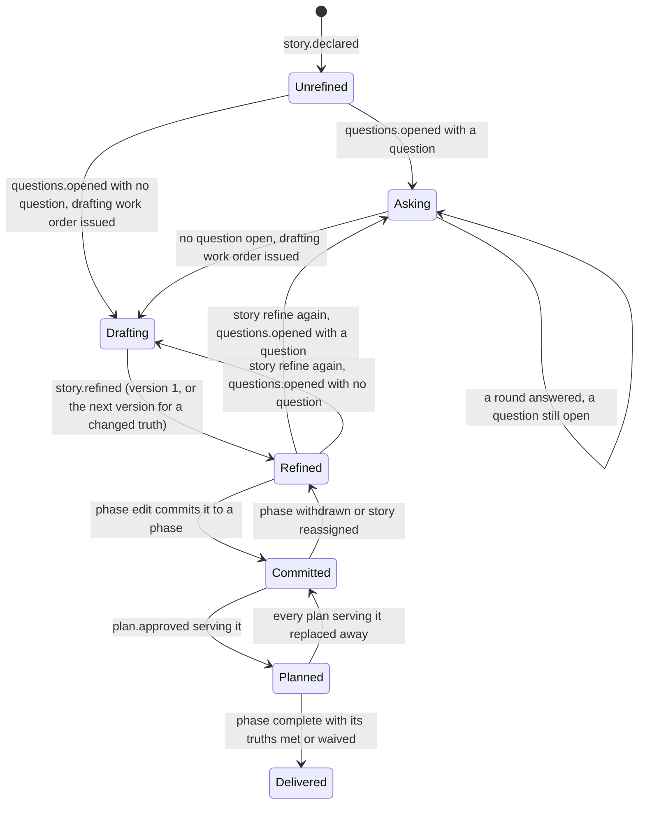
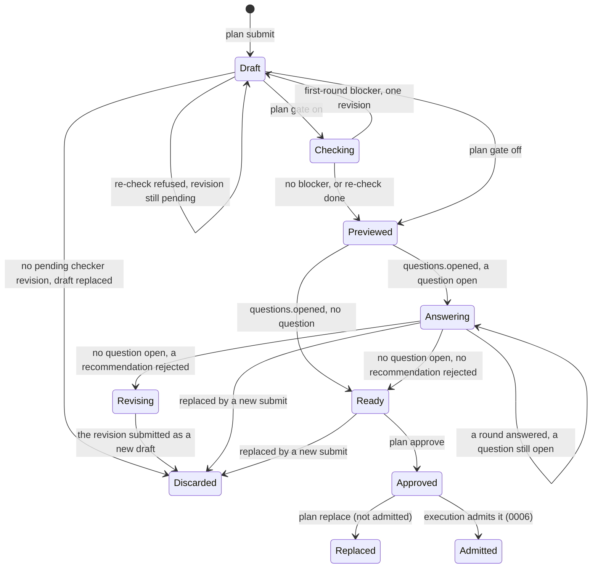
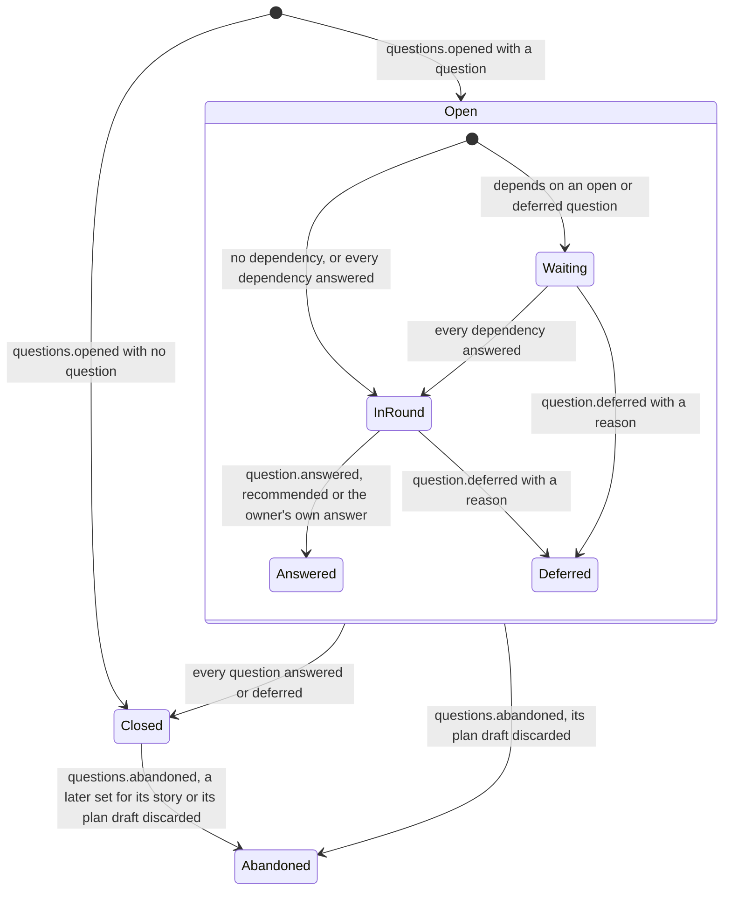
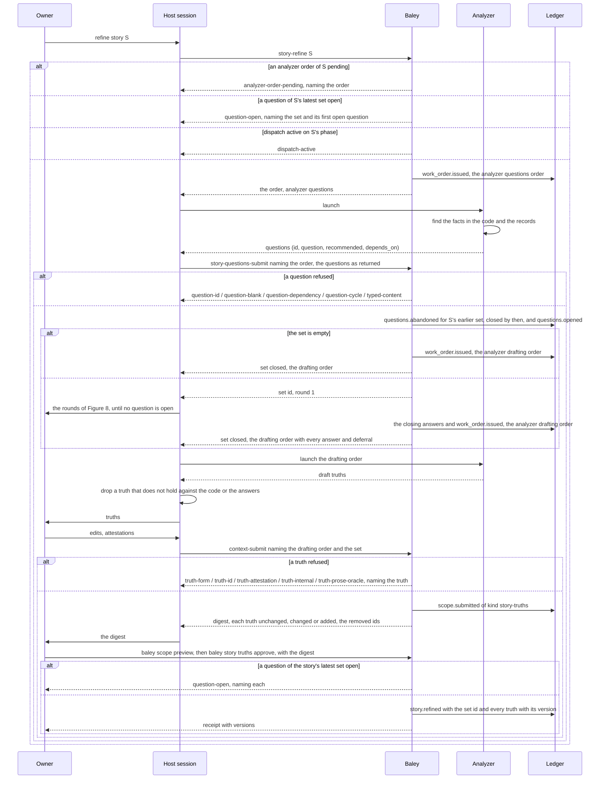
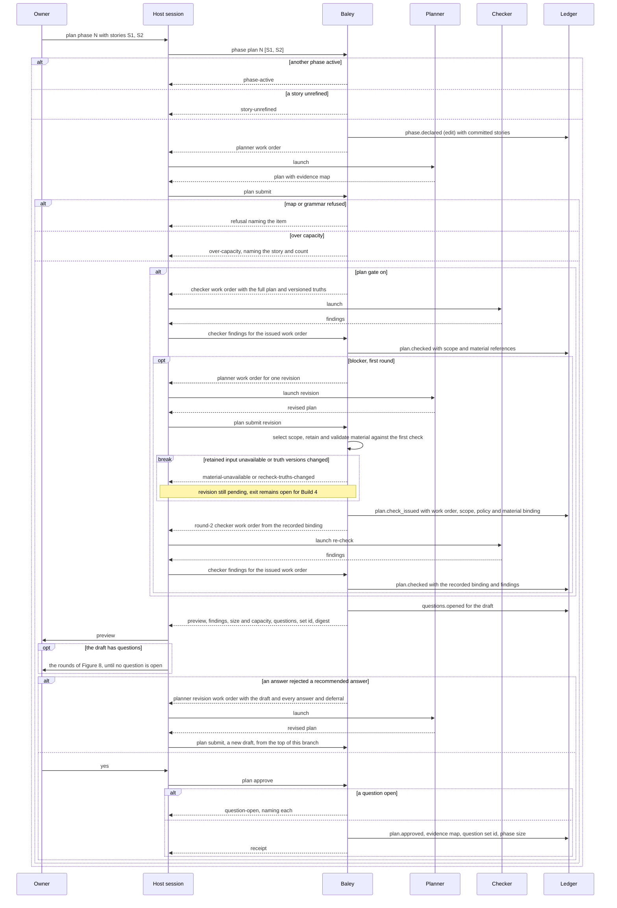
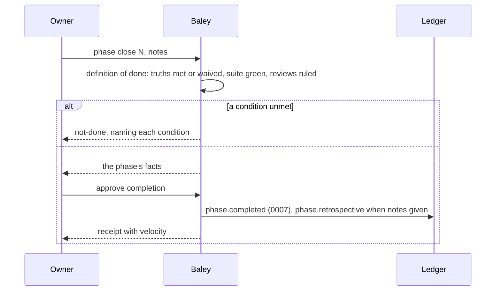
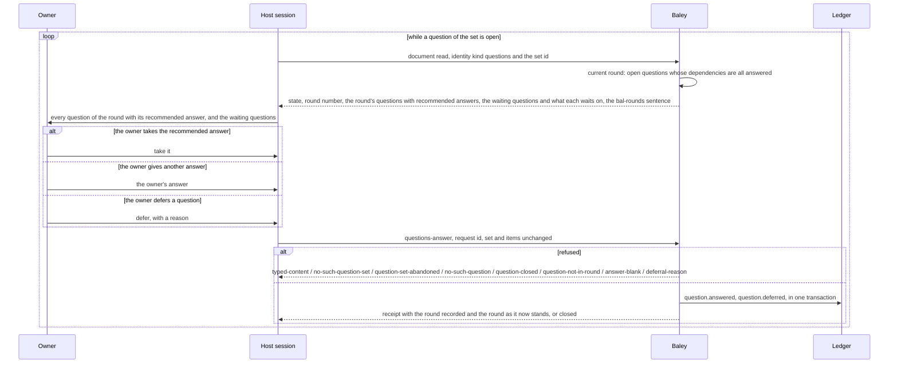

# 0005: Context, plans and acceptance

| | |
|---|---|
| Status | Accepted |
| Design issue | [#134](https://github.com/jcrenshaw-dev/baley/issues/134); build issue [#25](https://github.com/jcrenshaw-dev/baley/issues/25) |
| Requirement prefix | PLN |
| Applies | [0002: System design](0002-system-design.md) |
| Related | ADRs: [0006](../adr/0006-no-markdown-records.md), [0009](../adr/0009-served-instructions.md), [0017](../adr/0017-stories-and-sprints.md), [0030](../adr/0030-question-rounds.md), [0031](../adr/0031-one-term-per-concept.md), [0037](../adr/0037-plan-recheck-scope.md), [0042](../adr/0042-mocked-boundary-integration-checks.md) · C4 view: components ([0002](0002-system-design.md) Figure 4) |

The current design of this area, and nothing else. Edit it in place when the design changes; git holds the history. It describes the design only, never the work still to do.

## 1. Purpose and scope

Baley runs a project the way a Scrum team runs one, and this area is where that is codified: the backlog of stories, each with its acceptance criteria; the phase that commits stories and is planned as tasks; the plan check; and what has to be true for a phase to be done. It decides:

- what a story's acceptance criteria (truths) are, how they are written, and who approves them;
- how the decisions a story or a plan needs are put to the owner: the questions the analyzer and the planner ask, the rounds Baley works out from their dependencies, and the record of every answer and deferral;
- what a phase is, how stories are committed to it, and how its size and capacity are counted;
- the plan: its grammar, its file leases, its tasks, its suite, and the evidence map that binds each truth to the one check that proves it;
- how a plan is checked, approved, numbered and replaced;
- the rules Baley gives the planner for deriving tests, and where Baley's say over the project's tests ends;
- what "done" means for a phase, and the retrospective.

It does not decide how tasks are admitted and run, red then green, or the suite gate ([0006: Execution](0006-execution.md)); how verdicts are returned and a truth's status derived ([0007: Verification](0007-verification.md)); when a review fires and what a provider review looks like ([0008: Review](0008-review.md)); how the backlog and phases are declared, edited, reordered and withdrawn ([0004: Starting a project and changing scope](0004-starting-a-project-and-changing-scope.md)); or how a planner, analyzer or checker is routed ([0003](0003-configuration-and-routing.md)).

Hand-offs: 0004 declares stories and phases; this area refines stories with truths and fills a phase with plans. 0006 admits an approved plan. 0007 verifies against the evidence map this area recorded. The work order composer ([0002](0002-system-design.md) section 8) dispatches the analyzer, the planner and the checker with the instructions of section 10.

In the component view of [0002](0002-system-design.md) (Figure 4) this area is one of the domain areas.

## 2. Terms

| Term | Meaning |
|---|---|
| Backlog | The project's stories in priority order. |
| Story | One numbered statement of what the project must do, declared by the owner on the roadmap ([0004](0004-starting-a-project-and-changing-scope.md)). It carries its own acceptance criteria. |
| Truth | One acceptance criterion of a story: one sentence saying what a person can observe when the story is delivered. A truth has a version. |
| Refinement | Writing or revising a story's truths with the owner: the analyzer asks its questions, the owner answers them in rounds, then the analyzer drafts truths from the answers. |
| Question | One decision the owner must make, typed: an id, the question, a recommended answer, and the ids of the questions whose answers it depends on. A question never asks for a fact the code or the records can settle. |
| Question set | The questions of one refinement, or of one plan draft, put to the owner together and recorded together. |
| Open question | A question that is neither answered nor deferred. |
| Round | The open questions of a set whose dependencies are all answered: the ones the owner can decide now. Baley works out each round from the dependencies; nobody chooses it. |
| Deferral | The owner's recorded choice to leave a question undecided for now, with a reason. |
| Phase | The working increment of the roadmap, defined in [0004](0004-starting-a-project-and-changing-scope.md) (Terms): a goal and the stories committed to it. One phase is active per project (PLN-R7). |
| Phase planning | Committing stories to a phase and writing its plans. |
| Increment | What a completed phase delivers: something the owner can use, proven by its stories' truths and the suite. |
| Unit of work | One task: one signed commit with one narrowest verify command. |
| Size | The number of tasks a story's approved plans need; a phase's size is the sum over its stories. |
| Capacity | The owner's ceiling on a phase's size, in tasks. |
| Velocity | Tasks completed per phase, as a fact shown, never a decision input. |
| Plan | One typed document for a phase: the stories it serves, its file lease, its tasks, its suite and its evidence map. A phase may have several plans. |
| Lease | The exact files and directories a plan's tasks may change. |
| Suite | The project's test command, run by Baley at plan close ([0006](0006-execution.md)). |
| Evidence map | For each truth a plan serves, the items that have to exist and be connected for the truth to hold, and how each is checked. |
| Check | The one test that proves a truth: cause its trigger, look for its outcome. |
| Unit check, integration check | A check's level. A unit check exercises one unit with at most one simulated seam. An integration check runs two or more of the project's own units together, with every outside boundary mocked behind an interface the project owns. |
| Artifact, link, observation | The other evidence kinds: a thing that must exist; a value one part hands another; something a person or live system must see. |
| Plan check | A review of a submitted plan by the checker, before the owner sees it. |
| Definition of done | The conditions a phase must meet to be complete: every committed story's truths met or waived, the suite green, every review ruled. |
| Retrospective | The owner's notes at phase close, recorded in the owner's words. |
| Analyzer | The dispatched role that, during refinement, finds facts from the code and the records, asks questions for the decisions left to the owner, and drafts truths from the answers. |
| Planner | The dispatched role that writes plans and evidence maps, and asks questions for the decisions a plan needs from the owner. |
| Checker | The dispatched role that reviews a plan. |

## 3. Requirements

| Id | Rule | Why | Depends on | Status |
|---|---|---|---|---|
| PLN-R1 | The backlog is the project's stories in priority order, and a story carries its own truths. A phase's truths are the sum of its committed stories' truths. | Acceptance criteria belong to the thing being promised, and a phase promises a set of stories. | PRJ-R1, PRJ-R20 | Active |
| PLN-R2 | A truth is one sentence in a fixed form: `When <one trigger>, <one observer> sees / gets / is refused <one outcome>.`, or the property form `For any <input>, <observer> gets <outcome>.` One trigger (no "or" before the comma), one observer, one outcome; a second clause may only sharpen the same outcome. | A vague promise cannot be written, and seven cannot secretly be twenty. | | Active |
| PLN-R3 | Baley refuses a truth that is not in the form (`truth-form`), whose outcome names an internal such as a function or a field instead of something seen from outside (`truth-internal`), or whose expected value would come from a model call (`truth-prose-oracle`). The owner attests observability and a fixed oracle; Baley records the attestation and does not classify the sentence. | The answer must not move without the code moving, and the promise must be visible to a person. | PLN-R2 | Active |
| PLN-R4 | Truths are written with the owner during a story's refinement and approved by digest; they belong to the story, not to a plan. A truth whose text changes gets the next version; an unchanged truth keeps its version; every version is kept. Evidence written against an older version is stale. | Several plans deliver the same promises, and a promise that changed must not be proven by old evidence. | PLN-R1, PRJ-R14 | Active |
| PLN-R5 | There is no cap on truths per story. Baley shows the count; a story that reads too large is split by the planner with the owner's approval. | A number handed to the model becomes a target. | PLN-R17 | Active |
| PLN-R6 | Refinement dispatches the analyzer twice. The first work order carries the story, the project description, the roadmap and the code; the analyzer finds the facts itself from the code and the records and returns questions (PLN-R23) only for the decisions left to the owner, never draft truths. The host session submits the questions as returned, and they go to the owner in rounds (PLN-R24). When no question of the set is open, Baley issues the second work order, carrying the story, the questions and every recorded answer and deferral; the analyzer returns draft truths drawn from them. The host session drops a draft truth that does not hold against the code or the answers, and the owner edits, attests and approves the truths (PLN-R26). | What the owner did not say is found and decided before it is built on, a fact the code already holds is never put to the owner, and truths are drafted on decisions already made. | SYS-P2, SYS-P5, PLN-R23, PLN-R24 | Active |
| PLN-R7 | A phase ([0004](0004-starting-a-project-and-changing-scope.md)) is a goal and the stories committed to it. Phase planning commits stories in backlog order unless the owner reorders, and writes the phase's plans. One phase is active per project; a second is refused with `phase-active` until the first is complete or withdrawn. | One phase at a time is the discipline; the record shows which. | PRJ-R7, PRJ-R11 | Active |
| PLN-R8 | A phase is a working increment: its exit proof is its committed stories' truths, each verified by its one check, plus the suite. There is no separate whole-application test command. | Progress is real at every step. | PLN-R19 | Active |
| PLN-R9 | Nobody estimates. A story's size is the number of tasks its approved plans need; a phase's size is the sum. `planning.phase_capacity` (tasks, default none) is the ceiling: a plan whose tasks would take the phase over capacity is refused with `over-capacity`, naming the story and the count, and the story waits for the next phase. Size changes only when a plan is approved or replaced. Velocity is shown per phase and never used to decide. | Units of work are counted, not guessed, so there is no churn and no number for the model to hit. | PLN-R17 | Active |
| PLN-R10 | One phase by default. The planner may propose splitting a story or a phase; a split counts only when the owner approves it. | Scope never changes without the owner. | SYS-P5 | Active |
| PLN-R11 | A plan is typed content: phase, plan number, the story ids it serves, `files` and `directories` (the lease: exact paths, no trailing separator on a file, at most 256 declarations, no duplicates, `files: []` only with directories), goal, context, notes, ordered `tasks` (unique id, title, files within the lease, action, one or more `verify` commands each naming the narrowest command that settles the task), the suite, the evidence map, and `questions` (the decisions the plan needs from the owner, each in the shape of PLN-R23, empty when there are none). Unknown keys and prose bodies are refused (`typed-content`). Task prose never contributes paths, and a decision the owner must make is never left in `notes` or task prose. | Baley reads records, never documents. | ADR 0006, SYS-P3, PLN-R23 | Active |
| PLN-R12 | The evidence map binds every truth a plan serves to evidence items of four kinds: `artifact`, `link`, `check`, `observation`. Each item names its truth and version and a one-line reason ("what change would break this"). Exactly one `check` per truth version across the phase; a second is refused with `truth-check-limit`. A `check` names its command, its expected literal or property, its test file and function, its setup, its call, its `level` (`unit` or `integration`), its `boundary` (the one unit a unit check exercises, or the project units an integration check runs together) and its `fakes` (every filesystem, process and clock seam a unit check's unit touches, or every outside boundary an integration check mocks). A `link` is allowed only where the truth's own words name the value crossing (`link-value-not-named`). An `observation` is written only when what it names can be seen at the phase's close and no check can establish it, and can never make a truth met, only `concerns` ([0007](0007-verification.md)). | The check is the truth; the other kinds are things the verifier inspects; nothing multiplies. | PLN-R4 | Active |
| PLN-R13 | Baley refuses at plan submit: a truth the plan serves with no item (`uncovered-truth`); an item naming no truth or a stale truth version (`evidence-item-truth`, `truth-version-mismatch`); a truth with items but no check (`truth-without-check`); a check with a blank command, expected value or test file (`check-command`, `check-expected`, `check-test-file`); a task file outside the lease (`lease`); a story not committed to the phase (`story-not-in-phase`); a plan for a phase with no refined stories (`no-truths`); the same item id with a different definition across plans (`evidence-item-conflict`). | The map must be complete and consistent before anyone builds against it. | PLN-R11, PLN-R12 | Active |
| PLN-R14 | Plan numbers within a phase are assigned in order and never reused. Replacing an approved plan needs its own owner approval naming the plan and the digest it replaces; a plan admitted to execution is not replaced (`admitted-plan`); a gap plan gets a new number ([0006](0006-execution.md)). | Every plan the record ever named can be found. | EVD-R2 | Active |
| PLN-R15 | A plan is submitted whole, previewed, and approved by the owner by digest with owner and time. Every draft is recorded in the ledger when it is submitted ([ADR 0043](../adr/0043-submissions-recorded-as-drafts.md)): it survives a restart, is read by its digest from any session or from the terminal, and is approved by its digest only at the terminal ([ADR 0044](../adr/0044-owner-acts-on-the-command-line.md)). A draft stops being approvable only when a newer submission replaces it or this project purges its body, never because a session ended. Approving an older digest when a newer draft exists is refused with `stale-draft`, naming the first differing part. A retry of the same approval is answered once. How a pending checker revision is keyed, and how a draft whose re-check was refused leaves that state, remain open for Build 4 (section 12). | The owner approves exactly what was shown. | SYS-P5, SYS-R6 | Active |
| PLN-R16 | Between submit and preview, when `review.triggers.plan.gate` is not `off`, Baley dispatches the checker with the plan and its stories' versioned truths. The checker returns findings, each with a severity: a truth no task makes true is a blocker; a task no truth needs is a warning; a finding without severity is refused. A blocker buys one planner revision and one re-check, then the plan goes to the owner with the findings. The first check reads the whole submitted plan against its stories' versioned truths. The re-check uses `review.triggers.plan.recheck`, either `full` or `diff`, with default `full`. Full reads the whole revised plan against the same truths. Diff reads every addition, modification and deletion since the checked draft, with before-and-after context. Both scopes check whether every first-round blocker is closed and may return new findings. Scope changes neither the number of rounds nor the gate's effect. Warnings never buy a round. The gate value says what the findings do ([0008](0008-review.md)). The round-2 work order binds the first check, the original and revised plan digests, the truth versions, the actual scope, the material references and the policy version that selected the scope. Before issue, the retained inputs must match the named first check and submitted revision. `plan submit` records this binding in `plan.check_issued` before returning the work order. A retry must keep that recorded binding. Missing or mismatched inputs refuse the re-check, without substituting current source or another scope. | The plan is judged against the goal before the owner spends time on it, at the cheapest effort, and the owner can turn it off. | PLN-R7, CFG-R12 | Active |
| PLN-R17 | Baley never hands the model a number to hit: no coverage percentage, test count, tests per file or truth count. The only numbers are the owner's settings, applied by Baley and reported as refusals when crossed. | Any number given to the model becomes a target. | | Active |
| PLN-R18 | The planner derives tests under the rules of section 10, compiled into Baley and served in the work order: one responsibility per test, one seam at most for a unit check, an integration check where a truth's outcome depends on two or more of the project's own units working together, with only outside boundaries mocked and each behind an interface the project owns ([ADR 0042](../adr/0042-mocked-boundary-integration-checks.md)), the real logic that owns the decision, expected values from the requirement, tests that depend only on the project's language toolchain and its own test libraries, no program started, a fresh temporary directory as the one filesystem seam. The project's language and test command come from the project file (`workflow.test_command`) and its root manifest; Baley being written in Rust chooses nothing for the project. | Bounded, meaningful evidence in any language. | SYS-R8, CFG-R5 | Active |
| PLN-R19 | Baley owns truths, the evidence map, the red-then-green record for checks ([0006](0006-execution.md)) and the verdict ([0007](0007-verification.md)). The project owns how its tests are written and run: style, framework, count, coverage, mutation, CI. Baley ships one default test style as guidance and never refuses on style. CI status is information at landing, never acceptance evidence. | Acceptance is few and reviewed; tests are many and the developer's. | | Active |
| PLN-R20 | A phase is complete when every committed story's truths are met or waived, the suite is green, and every review the phase raised is ruled. Baley derives this from the record ([0007](0007-verification.md)); the owner's approval of completion is the review of the increment. | Done means proven. | SYS-P4 | Active |
| PLN-R21 | At phase close Baley shows the phase's facts (tasks planned and done, checks red then green, suite runs, reviews and rulings, waivers, deviations, refusals hit) and takes the owner's notes as an optional `phase.retrospective` record in the owner's words. | A decision the owner makes after a phase is a scope or policy change, and the record says why. | PLN-R20 | Active |
| PLN-R22 | Stories are mirrored one way to forge issues and phases to forge milestones through the forge adapter; forge edits are ignored; the ledger stays the truth. | Teammates who live on the forge see the backlog there. | SYS-P6, [0011](0011-milestones-landing-undo-pause.md) | Backlog |
| PLN-R23 | A question is typed content: `id` (unique within its set), `question` (one decision the owner must make), `recommended` (the answer the asker recommends), and `depends_on` (the ids of questions in the same set whose answers it needs, empty when none). The analyzer's questions for one refinement form one question set; a plan draft's `questions` field forms another. Baley refuses a set with a blank or colliding id (`question-id`), a blank question or recommended answer (`question-blank`), a dependency on an id outside the set or on the question itself (`question-dependency`), or a dependency cycle (`question-cycle`). Unknown keys are refused (`typed-content`). | Every question arrives with the asker's best answer and its place in the order, so the owner can decide quickly and in the right order; a cycle would hold a question that can never be asked. | ADR 0006, SYS-P3 | Active |
| PLN-R24 | Baley works out each round from a set's dependencies, deterministically over plain values. A question is open until it is answered or deferred. An open question whose `depends_on` are all answered is in the current round; an open question that depends on an open or a deferred question waits. Round 1 is every question with no dependency. Each `questions answer` call is one round, numbered in the order recorded; after it Baley works out the next round from the answers so far. The set is closed when no question is open. The host session puts every question of the current round to the owner, each with its recommended answer, shows the waiting questions and what each waits on, and relays the owner's answers and deferrals unchanged; it answers, drops, merges, rewords and reorders none. An answer to a waiting question is refused with `question-not-in-round`. | The owner decides only what can be decided now, in an order the record fixes, and nobody decides in the owner's place. | PLN-R23, SYS-P5 | Active |
| PLN-R25 | Every answer is recorded as `question.answered` with the owner's answer, whether it takes the recommended answer, the round, the owner and the time. An answer that rejects the recommended answer is recorded the same way, in the owner's words. A deferral is recorded as `question.deferred` with the owner's reason. Answers and deferrals are never edited or removed; a question already answered or deferred is refused with `question-closed`, and a blank answer with `answer-blank`. A later set for the same story abandons the story's older set, which is closed by then, since a story's open set is never abandoned by a later story set (PLN-R26); the discard of the plan draft a set belongs to (replaced, PLN-R15) abandons that set. Either way Baley records `questions.abandoned` naming the set and the cause, its recorded answers and deferrals stay, and a call on it is refused with `question-set-abandoned`. | A rejected recommendation, and why, is as much a decision as an accepted one, and the next reader needs both. | PLN-R24, ADR 0006 | Active |
| PLN-R26 | `story truths approve` is refused with `question-open` while a question of the story's latest set is open, and with `question-set-abandoned` when the draft being approved was drafted from a set that is no longer the story's latest; `plan approve` is refused with `question-open` while a question of the draft's set is open. The owner closes a question without answering it only by deferring it on the record, with a reason, whether it is in the current round or waiting; a deferral with a blank reason is refused with `deferral-reason`. A deferral closes only its own question: a question that waits on a deferred one can never enter a round, and stays open until the owner defers it too. | Nothing is approved on a decision nobody made, unless the owner says on the record that it can wait and why. | PLN-R24, PLN-R25, SYS-P5 | Active |
| PLN-R27 | The planner puts every decision a plan needs from the owner in the plan's `questions` field and writes the plan on the recommended answers. Baley opens the draft's question set when it gives the preview, and the rounds of PLN-R24 run before `plan approve`. When the set closes with an answer that rejects a recommended answer, the draft is not approved as written: `plan approve` on it is refused with `answer-not-applied`, and Baley issues the planner a revision work order carrying the draft and every answer and deferral on its set. The host session submits the revision as a new draft, whose questions are only decisions not yet made. A deferral leaves the plan on that question's recommended answer, and the preview shows it as deferred. | A plan written on a recommendation the owner turned down must not be approved as written, and the revision starts from the owner's answers. | PLN-R11, PLN-R15, PLN-R26 | Active |

## 4. Roles and actors

| Actor | Receives | Returns | Model and effort from |
|---|---|---|---|
| Owner | Each round's questions with their recommended answers, and the waiting questions; draft truths; plan previews; checker findings; phase facts at close | Answers (the recommended answer or the owner's own) and deferrals with reasons; approvals by digest; reorders and splits; retrospective notes | Not applicable |
| Analyzer (dispatched) | Questions work order: the story, the project description, the roadmap, the code, the question grammar. Drafting work order: the story, its question set with every answer and deferral, the truth form and refusals | Questions (first work order); draft truths (second work order) | `roles.analyzer.*` ([0003](0003-configuration-and-routing.md)) |
| Planner (dispatched) | The phase's goal and stories with their truths, the lease and task grammar, the evidence map grammar, the question grammar, the test derivation rules, the capacity ceiling as a fact; in a revision work order, the draft and every answer and deferral on its set | A typed plan with its evidence map and its questions; a proposed split when needed | `roles.planner.*` |
| Checker (dispatched) | The submitted plan and its stories' versioned truths for round 1; the retained material selected by PLN-R16 and every first-round blocker for round 2 | Findings with severity | `roles.checker.*`, gated by `review.triggers.plan.gate` |
| Host session | Work orders to launch; each round's questions; drafts to put to the owner | The analyzer's questions as returned; the owner's answers and deferrals, relayed unchanged; approvals; adjudicated draft truths and checker output | Not applicable |
| Baley: this area | Submissions, approvals | Previews, refusals, records | Not applicable |
| Hardin | A refinement, phase or plan request | Whether it may happen now (phase active, dispatch active, plan admitted) | Not applicable |

## 5. Commands and operations

Every change follows submit (preview and digest), approve (owner, by digest), record. Answers and deferrals are the one exception: they are the owner's own acts, relayed by the host session, and `questions answer` records them as given (PLN-R25). Over MCP Baley cannot tell whether the owner gave an answer, so an answer or deferral a session relays is recorded as Baley's, with the session as the caller and `owner.name` and Baley's clock in each record; only one given at the terminal with `baley questions answer` is recorded as the owner's ([ADR 0047](../adr/0047-owner-acts-relayed-by-a-session.md)). Each operation is implemented once and reachable from a session through the stub skills ([ADR 0009](../adr/0009-served-instructions.md)). The owner's own acts and reads, such as answers, deferrals, rounds and previews, also have commands under `baley story`, `baley questions`, `baley phase` and `baley plan`, each calling the same function as the operation a session calls ([ADR 0044](../adr/0044-owner-acts-on-the-command-line.md)). Every approval, `story truths approve` and `plan approve` among them, is given only on the command line and is never served over MCP, because over MCP the call comes from the model and nothing proves a person answered, while the sandbox keeps agents from running the command line against Baley's home, where the ledger lives. A step whose only purpose is to issue a work order, such as `story refine`, is served to a session only, and an approval that also releases a work order records that order and returns its id, so a session can launch it.

### story refine

- **Inputs:** a story id. A session sends it as `story-refine` on `baley_apply`, with `request_id` (a fresh lowercase UUID, the same on a retry), `story` and an optional `instruction`. It is served to a session only and has no command at the terminal, since its only purpose is to issue a work order.
- **Outputs:** one analyzer work order, recorded as `work_order.issued` on the `roadmap` stream with subject `story/<id>` at attempt 1; the receipt names it and says in `analyzer` which of the two it is, `questions` or `drafting` (PLN-R6). It is the drafting order when the story's latest set is closed and the story was not refined from it, and the questions order otherwise: before any set, or once the story was refined from its latest set. Either order binds, as `record` payloads read at issue, the story, the approved description, the accepted roadmap and, once the story was refined, its current truths with their versions; the drafting order adds the set's questions with every answer and deferral. The analyzer returns its questions to the host session, which submits them with `story questions submit`, or its draft truths, which the session checks and submits with `story truths submit`.
- **Refusals:** judged in order, each recording nothing: `no-such-story` for a story the roadmap does not hold or a dropped one, while a deferred or excluded story can be refined (PRJ-R18); `analyzer-order-pending` while an analyzer order of the story is pending, naming that order, since a story has one live analyzer order: the session reads that order with `document`, or fails it with `work-order-fail` and retries it with `work-order-retry`; `question-open` while a question of the story's latest set is open, naming the set and its first open question in submitted order, so a set mid-answer is never abandoned by a new one, and the owner ends a set early only by deferring its open questions, each with a reason (PLN-R26); `dispatch-active` when a worker is dispatched on a phase that committed the story (PRJ-R16), judged over the `phase` view's status, which says no worker is dispatched until Build 5 records dispatch.

### story questions submit

- **Inputs:** the story id, the analyzer's questions work order id, and the questions as the analyzer returned them (PLN-R23). A session sends them as `story-questions-submit` on `baley_apply`, with `request_id`, `story`, `work_order` and `questions`, exactly as returned.
- **Outputs:** in one transaction, the story's latest set, closed by then, abandoned with cause `superseded` (PLN-R25), and `questions.opened` recorded for the story naming the questions order, which the `work_order` view then marks answered. The receipt gives the set id in `set` and round 1 in `now`, as `questions round` gives it. An empty set is closed at once: its receipt's `now` says `closed`, and `drafting` names the analyzer's drafting work order, issued in the same transaction (PLN-R6). When another analyzer order of the story is pending, no drafting order is issued, and the session's next `story refine` is refused `analyzer-order-pending` naming the pending order, which the session follows.
- **Refusals:** `question-id`, `question-blank`, `question-dependency`, `question-cycle`, `typed-content` (PLN-R23), the last also for a question id, question or recommended answer over 4,096 bytes and a `depends_on` naming an id twice; each names the question by its position in the list and, past the grammar, by its id. Then, in order: `no-such-story` for a story the roadmap does not hold or a dropped one (PRJ-R18); `no-such-work-order` when this project holds no order with that id, and `wrong-work-order` when the order is not the story's analyzer questions order, both whatever the order's state; `question-open` while a question of the story's latest set is open, naming the set and its first open question, so a late or repeated analyzer return never abandons a set mid-answer (PLN-R26); `dispatch-active` (PRJ-R16). Each records nothing.

### questions round

- **Inputs:** a question set id. A session reads it as a `document` read on `baley_query` with identity `{"kind":"questions","set":"<set id>"}`; the owner prints it with `baley questions round <set>`.
- **Outputs:** read only; nothing is recorded. The set's state, `open`, `closed` when no question is open, or `abandoned` once its abandonment is recorded; the round number, one more than the highest round recorded on the set and 1 when none is; the current round's questions, each with its recommended answer; each waiting question with its direct dependencies that are not answered, each marked `open` or `deferred`; the answered questions with their answers, whether each took the recommended answer, the round, the owner and the time; the deferred questions with their reasons, the round, the owner and the time; an abandoned set's cause and time; and a sentence naming the rounds relay instruction, `bal-rounds` (section 10). A `document` read too long for one part is cut into parts as every `document` read is. The terminal prints the same round with every recorded text escaped, and leaves out the relay sentence (PLN-R24, PLN-R25).
- **Refusals:** `no-such-question-set` when this project holds no set with that id, another project's set included; the refusal echoes none of the id (PLN-R24).

### questions answer

- **Inputs:** the set id and one item for each question the owner settles: `{"question":"<id>","act":"take"}` takes the recommended answer, `{"question":"<id>","act":"answer","answer":"<the owner's words>"}` gives the owner's own answer, and `{"question":"<id>","act":"defer","reason":"<the owner's reason>"}` defers it. A session sends them as `questions-answer` on `baley_apply`, with `request_id` (a fresh lowercase UUID, the same on a retry), `set` and `items`. The owner gives them at the terminal as `baley questions answer <set>` with `--take QUESTION`, `--answer QUESTION TEXT` and `--defer QUESTION REASON`, each repeatable, sent as the takes, then the own answers, then the deferrals. The owner and the time are never inputs: Baley records `owner.name`, falling back to git `user.name`, and its own clock, and refuses the call `owner-identity-missing` when neither name is set. The call may settle some or all of the current round, and may defer any open question, waiting or not.
- **Outputs:** every `question.answered` and `question.deferred` of the call recorded in one transaction on the set's stream, all or none, each with the round. A take records the recommended text with `accepted` true and an own answer the owner's words with `accepted` false; no text is compared with the recommendation. The receipt gives the set, the round recorded, the time, and in `now` the round as it stands after the call, in `questions round`'s shape, whose state is `closed` when no question is open. A receipt is never cut into parts, so when that round would pass the 24,576-byte part bound, `now` holds only the state, the round number, the `document` identity to read the round from and the relay sentence. A retry with the same `request_id` is answered from its record; a set that moved between the check and the transaction is answered `ledger-busy` with nothing recorded. When a call relayed over MCP closes a story's set, it also issues the analyzer's drafting work order in the same transaction, its `questions` input holding the set's answers and deferrals with the call's own, and names it in the receipt's `drafting` (PLN-R6); when an analyzer order of the story is pending, no drafting order is issued, so the story keeps one live analyzer order, and the session's next `story refine` follows it. A close at the terminal with `baley questions answer` issues no order, since a work order is issued only to a session ([ADR 0044](../adr/0044-owner-acts-on-the-command-line.md)): its receipt says the set is `closed`, and the session's next `story refine` sees the closed set and issues the drafting order. For a plan draft's set the further outputs are `ready` (the draft may be approved) or, when an answer rejected a recommended answer, the planner's revision work order (PLN-R27); they are Build 4 T9's (section 11), and until then that receipt says only that the set is `closed`.
- **Refusals:** judged in order, and the first refuses the whole call with nothing recorded: the call's grammar, then the set (`no-such-question-set`, then `question-set-abandoned`), then each item in the call's order through `no-such-question`, `question-closed`, `question-not-in-round`, `answer-blank` and `deferral-reason`. Every item is judged against the round as it stood before the call, so an answer to a question that only another answer in the same call would bring into the round is refused `question-not-in-round`. Over MCP a malformed argument or request id is refused `invalid-arguments` before the call's grammar, as for every write ([0012](0012-host-interface.md)).

  | Code | When | Requirement |
  |---|---|---|
  | `typed-content` | `items` is empty or not a list; an item is not an object, lacks `question` or `act`, names another act, or carries a member its act does not take; a question is named twice; a question id, answer or reason is over 4,096 bytes | PLN-R24 |
  | `no-such-question-set` | This project holds no set with that id | PLN-R24 |
  | `question-set-abandoned` | A later set for the story, or the discard of its plan draft, abandoned the set | PLN-R25 |
  | `no-such-question` | A question id the set lacks | PLN-R24 |
  | `question-closed` | The question is already answered or deferred | PLN-R25 |
  | `question-not-in-round` | An answer, not a deferral, to a question outside the round as it stood before the call; a deferral may close a waiting question | PLN-R24 |
  | `answer-blank` | An own answer that is missing, empty or only whitespace | PLN-R25 |
  | `deferral-reason` | A deferral whose reason is missing, empty or only whitespace | PLN-R26 |

### story truths submit, story truths approve

- **Inputs:** `submit`: a session sends it as `context-submit` on `baley_apply`, with `request_id`, `work_order` (the analyzer's drafting order it answers), `story`, `set` (the question set its truths were drafted from) and `truths`. Each truth is `id`, `form` (`when` or `for-any`), `trigger`, `observer`, `verb`, `outcome`, `kind` (`literal` or `property`), the owner's attestations `observable` and `fixed_oracle`, and an optional `human_verify` naming the tool or live service a person needs to prove it; a `for-any` truth puts its input in `trigger`. `approve`: the digest only, given at the terminal as `baley story truths approve <digest>`, never over MCP. The owner and the time are never inputs: Baley records `owner.name`, falling back to git `user.name`, and its own clock, and refuses the call `owner-identity-missing` when neither name is set.
- **Outputs:** `submit`: the draft's body recorded as a `record` payload and one `scope.submitted` of kind `story-truths` with target `story/<id>` on the `project` stream ([ADR 0043](../adr/0043-submissions-recorded-as-drafts.md)), which marks the drafting order answered. Every call records, so the same content submitted again is the newest draft again; only a retry of the same request is answered from its record. The receipt gives the digest, taken over the story, the set and the truths as submitted and nothing else, so it holds no version; each truth marked `unchanged`, `changed` or `added` against the story's current truths; and in `removed` the current truths the draft leaves out. A draft can be recorded while a question of its set is open; only its approval is refused then. The owner previews it at the terminal with `baley scope preview <digest>`, which marks the truths the same way and names the approving command. `approve`: one `story.refined` on the `roadmap` stream with actor `owner`, `owner.name` and Baley's time, carrying the story's whole truth list, each truth with the version it gets at approval (PLN-R4): an unchanged truth keeps its version, a changed one gets one more than the highest it ever had, a new id starts at 1, and an id removed and added back continues past its highest earlier version. No `scope.approved` is recorded. The receipt gives the story, the set, the owner, the time and each truth's id and version.
- **Refusals:** `submit` judges the truths truth by truth in submitted order, each whole before the next: its shape, its id, its form, then its attestations, `observable` before `fixed_oracle`. Then, in order, the story, the set and the order. `approve` judges the draft (`unknown-draft`, `stale-draft`, `draft-approved`), then the story, then the story's latest set (`question-set-abandoned`, then `question-open`), then `dispatch-active`; it reads and judges outside any transaction and confirms inside it that nothing it read has moved, answering `ledger-busy` with nothing recorded otherwise. Every refusal records nothing.

  | Code | When | Requirement |
  |---|---|---|
  | `truth-form` | `truths` is not a list; a truth is not an object, has an unknown member, lacks a text member other than `human_verify`, or has one that is not a string; a text over 4,096 bytes as written, before any trimming; a `form` other than `when` or `for-any`; a second trigger (an " or " in it) or a second observer (" and ", " & ", a comma or a semicolon in it); a blank part, `human_verify` included; a verb other than `sees`, `gets` or `is refused`; a kind other than `literal` or `property`; a `for-any` truth that is not `gets` with kind `property` | PLN-R2 |
  | `truth-id` | A blank truth id, or one an earlier truth of the submission has | PLN-R4 |
  | `truth-attestation` | An `observable` or `fixed_oracle` attestation missing or not a boolean | PLN-R3 |
  | `truth-internal` | The `observable` attestation recorded false: the owner attests the outcome names an internal | PLN-R3 |
  | `truth-prose-oracle` | The `fixed_oracle` attestation recorded false: the owner attests the expected value would come from a model | PLN-R3 |
  | `no-such-story` | The roadmap does not hold the story, or it is dropped | PRJ-R18 |
  | `no-such-question-set` | `submit` names a set this project does not hold, or another story's | PLN-R24 |
  | `question-set-abandoned` | `submit` names a set that is not the story's latest, or `approve` holds a draft drafted from one | PLN-R25, PLN-R26 |
  | `no-such-work-order`, `wrong-work-order` | `submit` names no order this project holds, or one that is not the story's analyzer drafting order, whatever its state | PLN-R6 |
  | `unknown-draft` | `approve` names a digest no recorded truth draft has | PLN-R15 |
  | `stale-draft` | A newer truth draft for the same story was submitted; names the first differing part, such as `truths[1].outcome` | PLN-R15 |
  | `draft-approved` | The draft was already approved after its latest submission; names the owner and the time | PLN-R15 |
  | `question-open` | `approve` while a question of the story's latest set is open; names each open question | PLN-R26 |
  | `dispatch-active` | `approve` while a worker is dispatched on the phase that committed the story, judged over the `phase` view's status, which says no worker is dispatched until Build 5 | PRJ-R16 |

### phase plan

- **Inputs:** the phase number; the stories to commit in order (default: the next backlog stories the owner picks).
- **Outputs:** the phase's committed stories recorded through `phase edit` (0004); the planner's work order id.
- **Refusals:** `phase-active` (PLN-R7); `no-such-phase`, `no-such-story` (PRJ-R18); `story-unrefined` when a committed story has no approved truths (PLN-R1); `story-in-phase` when the story is committed to another open phase (PRJ-R4).

### plan submit

- **Inputs:** the typed plan (PLN-R11) with its evidence map (PLN-R12) and its questions (PLN-R23).
- **Outputs:** the checker's work order when the plan gate is on; then the preview, the checker's findings, the plan's size and the phase's size against capacity, and the digest. With the preview Baley records `questions.opened` for the draft and gives the set id and round 1; a draft with no questions has an empty set, closed at once (PLN-R27). A new submit makes the draft it replaces stale, so approving that draft is refused `stale-draft`, and abandons that draft's set (PLN-R15, PLN-R25). The earlier draft keeps its record, and the plan and truth snapshots a check needs from it stay. For round 2, `plan submit` records `plan.check_issued` on `phase/<n>` before returning the work order. It binds the first check, the original and revised plan digests, the truth versions, the resolved scope, the material references and the policy version used to select the scope. Baley resolves the setting when it creates that work order. A retry must keep the binding from `plan.check_issued`.
- **Refusals:** every code of PLN-R13; `typed-content` (PLN-R11), also for a question's id, question or recommended answer over 4,096 bytes and a `depends_on` naming an id twice; `question-id`, `question-blank`, `question-dependency`, `question-cycle` (PLN-R23), each naming the question by its position and id; `over-capacity` (PLN-R9); `phase-not-active` (PLN-R7); `material-unavailable` when the retained draft, revision, truths or required comparison material cannot be read or does not match the work-order binding; `recheck-truths-changed` when the re-check's truths differ from those used by round 1 (PLN-R16). The evidence-map refusal `truth-version-mismatch` keeps its PLN-R13 meaning. After the one revision and re-check, remaining blockers go to the owner under the configured gate (PLN-R16).

Baley recognizes a checker revision from the draft awaiting the one revision granted by its first `plan.checked` result. The caller supplies the revised plan, not a first-check reference; Baley selects that reference from the draft's check state and validates all retained material against it and the revision. A refused re-check leaves this state intact, so another submit in the same draft lineage remains a revision. The draft survives a server restart, as every draft does ([ADR 0043](../adr/0043-submissions-recorded-as-drafts.md)); how a draft whose re-check was refused leaves that state is an open question for Build 4 in section 12.

### plan approve

- **Inputs:** the digest, owner, time.
- **Outputs:** `plan.approved` with the next plan number; the evidence map and the question set id recorded; the phase's size updated.
- **Refusals:** `stale-draft`, `unknown-draft` (PLN-R15); `question-open` while a question of the draft's set is open (PLN-R26); `answer-not-applied` when an answer on the draft's set rejected a recommended answer (PLN-R27).

### plan replace

- **Inputs:** the plan number, the digest being replaced, the new plan.
- **Outputs:** as `plan submit` then `plan approve`, recording `plan.replaced`.
- **Refusals:** as `plan submit`; `admitted-plan` (PLN-R14); `no-such-plan` (PRJ-R18).

### phase close

- **Inputs:** the phase number; optional retrospective notes.
- **Outputs:** the phase's facts; when the definition of done holds and the owner approves, `phase.completed` ([0007](0007-verification.md)) and `phase.retrospective` when notes were given.
- **Refusals:** `not-done` naming each unmet condition (a story's truth unmet, the suite not green, a review unruled) (PLN-R20).

## 6. Records

### truth (part of `story.refined`, `roadmap` stream)

| Field | Type | Meaning |
|---|---|---|
| `story` | story id | The story it belongs to, carried once by `story.refined` |
| `id` | truth id | Unique within the story |
| `version` | integer | Given at approval, never at submit: 1 for an id the story never had; one more than the highest version the id ever had when `form`, `trigger`, `observer`, `verb`, `outcome` or `kind` changes, or when the id comes back after a revision removed it; unchanged otherwise, so a change to an attestation or to `human_verify` keeps the version |
| `form` | `when`, `for-any` | The sentence form; a `for-any` truth's input is its `trigger` |
| `trigger`, `observer`, `verb`, `outcome` | text | The sentence's slots; `verb` is `sees`, `gets` or `is refused` |
| `kind` | `literal`, `property` | Whether the outcome is one value or a property |
| `observable`, `fixed_oracle` | bool | The owner's attestations, true in every recorded truth |
| `human_verify` | text, or absent | The tool or live service a person needs to prove the truth; absent when none is needed |

Each of a truth's texts, `id`, `form`, `trigger`, `observer`, `verb`, `outcome`, `kind` and `human_verify`, is at most 4,096 bytes as written, before any trimming, the limit questions and answers use; an over-long one is refused `truth-form` with nothing recorded.

`story.refined` carries the story, the id of the question set its truths were drafted from, the submission digest, `owner` and `at`, and the story's whole truth list inline, each truth with its version, so a purge of the draft's body removes no truth in force; the answers and deferrals stay on that set's own records. It replaces the story's current truths in the `truths` view and sets the truth count of the story's `roadmap` and `backlog` entries to the length of its truth list. A truth's status (`pending`, `met`, `concerns`, `unmet`, `waived`) is derived by [0007](0007-verification.md), never stored.

### plan (payload of `plan.approved`, `phase/<n>` stream)

| Field | Type | Meaning |
|---|---|---|
| `phase`, `plan` | integers | The phase and the plan number |
| `stories` | list of story ids | The stories it serves |
| `files`, `directories` | lists of paths | The lease |
| `goal`, `context`, `notes` | text | For the executor |
| `tasks` | list | `id`, `title`, `files`, `action`, `verify` |
| `suite` | command | The suite Baley runs at close |
| `evidence_map` | list of items | See below |
| `questions` | list of questions | The plan's questions (PLN-R23), as submitted |
| `question_set` | set id | The set its questions were put to the owner in; the answers and deferrals are that set's records |
| `size` | integer | The number of tasks |

### evidence item

| Field | Type | Meaning |
|---|---|---|
| `id` | item id | Unique within the phase |
| `truth`, `truth_version` | truth id, integer | The truth it serves |
| `kind` | `artifact`, `link`, `check`, `observation` | |
| `spec` | table | `artifact`: path or record. `link`: caller, callee, value. `check`: command, expected {literal or property, value}, test {file, function}, setup, call, level (`unit` or `integration`), boundary, fakes. `observation`: what is to be seen, by whom. |
| `reason` | text | What change would break this |

### questions.opened (event; `roadmap` stream for a story's set, `phase/<n>` stream for a plan draft's set)

| Field | Type | Meaning |
|---|---|---|
| `set` | set id | A fresh lowercase UUID Baley mints when it opens the set, never derived from the content, so two sets with the same questions never share an id |
| `subject` | `story`, `plan` | Whose decisions these are |
| `story` | story id | For a story's set: the story being refined |
| `work_order` | work order id | For a story's set: the analyzer's questions work order that returned them |
| `phase`, `plan_digest` | integer, digest | For a plan draft's set: the phase and the draft whose `questions` field these are |
| `questions` | list of questions | See below, in submitted order. Every text is inline in the event, never a payload, and each is at most 4,096 bytes |
| `at` | time | When Baley recorded the set, by its own clock |

A set's state (open, closed, abandoned) and each question's state (waiting, in the current round, answered, deferred) are derived from these records, the answers and deferrals on them, and `questions.abandoned`; they are never stored.

### question (part of `questions.opened` and of a plan's `questions`)

| Field | Type | Meaning |
|---|---|---|
| `id` | question id | Unique within the set |
| `question` | text | The one decision the owner must make |
| `recommended` | text | The answer the asker recommends |
| `depends_on` | list of question ids | The questions in the same set whose answers it needs; empty when none |

### question.answered, question.deferred (events, same stream as their set)

| Field | Type | Meaning |
|---|---|---|
| `set`, `question` | set id, question id | The question settled |
| `round` | integer | The round it was settled in |
| `answer` | text | `question.answered` only: the owner's answer; the recommended text when the owner took it |
| `accepted` | bool | `question.answered` only: true when the owner took the recommended answer, false when the owner rejected it |
| `reason` | text | `question.deferred` only: why the owner leaves it undecided |
| `owner`, `at` | owner, time | Who settled it and when: `owner.name`, falling back to git `user.name`, and the time of the command that recorded it, by Baley's clock. Neither is ever taken from the caller |

One `questions answer` call writes its answers and deferrals in one transaction, under one command of kind `questions.answer`. A call a session relays over MCP is recorded with actor `baley` and the session as the caller; a call given at the terminal with actor `owner` and no caller ([ADR 0047](../adr/0047-owner-acts-relayed-by-a-session.md)). Answers, deferrals and reasons are inline, each at most 4,096 bytes.

### questions.abandoned (event, same stream as its set)

| Field | Type | Meaning |
|---|---|---|
| `set` | set id | The set abandoned |
| `cause` | `superseded`, `draft-replaced` | A later set for the same story; the plan draft replaced |
| `at` | time | When Baley recorded it |

Baley records it in the same transaction as the later set's `questions.opened` or the new draft.

### plan.check_issued (event, `phase/<n>` stream)

`plan submit` appends this event when it issues the checker's round 2, before handing the work order to the host. It uses the existing phase stream.

| Field | Type | Meaning |
|---|---|---|
| `work_order` | work order id | The round-2 check being issued |
| `round` | 2 | The re-check |
| `previous_check` | event reference | The first `plan.checked` result and its original plan digest |
| `original_plan_digest`, `plan_digest` | digests | The first draft and submitted revision |
| `truth_versions` | list of story ids, truth ids and versions | The unchanged truths from the first check |
| `scope` | `full`, `diff` | The selected reading scope |
| `scope_policy_version` | integer | The policy version that selected the scope |
| `material` | payload references | Original and revised plans, truths and the exact selected checker input |

`plan.checked` for that work order records the result with its issued binding. A retry must keep this binding and never select scope or material again. How the pending binding is keyed and read back before approval, and how draft discard closes a pending check, are open questions for Build 4 in section 12.

### plan.checked (event, `phase/<n>` stream)

| Field | Type | Meaning |
|---|---|---|
| `plan_digest` | digest | The submission checked |
| `findings` | list | severity (`blocker`, `warning`), location, claim, fix |
| `round` | 1 or 2 | First check or the re-check |
| `work_order` | work order id | The issued check whose result this event records |
| `scope` | `full`, `diff` | The scope actually issued: `full` for round 1 and the resolved re-check scope for round 2 |
| `previous_check` | event reference or absent | Required for round 2 and absent for round 1; identifies the first check and its draft digest |
| `truth_versions` | list of story ids, truth ids and versions | The stories' truths bound to the work order, unchanged between rounds |
| `material` | payload references | Retained plan and truth snapshots and the exact selected checker input, including the delta for `diff` |
| `scope_policy_version` | integer | The policy version used when the checked work order selected its scope |

The work order selects the full-plan input or the delta and blocker input from the retained material. Both carry the same versioned truths and every first-round blocker in round 2. The work order id, plan digest, scope, previous-check reference, truth versions, scope policy version and material references are copied from the issued work order, using `plan.check_issued` for round 2, never supplied by the checker or reconstructed from current files. Plan and truth snapshots and all generated checker input, including the delta, use `record` references, kept for the life of the project unless purged (0001). The event envelope records the policy of the command that appends the result; `scope_policy_version` identifies the policy that selected the work order's scope.

### plan.replaced (event), phase.retrospective (event)

`plan.replaced`: plan number, old digest, new digest, owner, time. `phase.retrospective`: phase number, the owner's notes, the facts shown, owner, time.

### Views

| View | Key | Content |
|---|---|---|
| `backlog` | project | Stories in priority order, each with its latest question set id, the refined marker (the set its latest `story.refined` names), the truth count of that refinement, its size when planned and the phase it is committed to. Its refinement state, unrefined, questions open with the current round, drafting or refined, is worked out when read from the latest set's `questions` document and the marker, never stored |
| `truths` | project, story | The story's current truths in submitted order, each with its version, and the set, digest, sequence and time of the latest `story.refined`; and every version each truth id ever had, oldest first, each kept once with the sequence of the `story.refined` that first carried it |
| `phase_plan` | project, phase | Goal, committed stories, plans with sizes, capacity, size, tasks done, definition of done state, velocity of closed phases. It is separate from the `phase` view of [0004](0004-starting-a-project-and-changing-scope.md), which serves Hardin the phase's context, plans, execution and completion state |
| `plan` | project, phase, plan | The approved plan, its evidence map, its question set, and its completed checks with each round's scope, previous-check reference and material references |
| `questions` | project, set | The set's facts and records only: its subject, the stream it was opened on, the questions as submitted, each answer with whether it took the recommendation, its round, owner and time, each deferral with its reason, round, owner and time, and its abandonment with the cause and time. Whether the set is open, closed or abandoned, each question's state (waiting and on what, in the current round, answered, deferred) and the current round are computed when the set is read, from the questions in submitted order and these records, never stored |

## 7. States

*Figure 1. States of a story in this area. A story's refinement state is never stored: it is worked out when read from its latest question set and its refined marker, the set its latest `story.refined` names. Unrefined is a story with no set, Asking one whose latest set has an open question, Drafting one whose latest set is closed with no approval naming it, and Refined one whose latest approval names its latest set. An empty set closes at once, so its story goes straight to Drafting. A story refined before keeps its approved truths while it is asked again and drafted, until new ones are approved. `story refine` in Asking is refused `question-open`, so a story's open set is never abandoned by a new one and no `story refine` leads from Asking: the owner ends a set early only by deferring its open questions, each with a reason. Withdrawn and dropped states are in [0004](0004-starting-a-project-and-changing-scope.md) Figure 2.*

*Figure 2. States of a plan. Every draft is recorded in the ledger when it is submitted, and Discarded means a newer submission replaced it, so it can no longer be approved; its record stays ([ADR 0043](../adr/0043-submissions-recorded-as-drafts.md)). The end of a session changes no state. Previewed is the moment Baley gives the preview and records the draft's question set. `plan approve` is refused in Answering (`question-open`) and in Revising (`answer-not-applied`). Admitted and later states belong to [0006](0006-execution.md). Each check is bound to its submitted draft; the second check uses PLN-R16's recorded scope.*

```mermaid
stateDiagram-v2
  [*] --> Planned: phase.declared with committed stories
  Planned --> Active: first plan.approved
  Active --> Active: plan.approved, plan.replaced, execution
  Active --> Done: definition of done holds
  Done --> Closed: owner approves completion; phase.retrospective optional
  Active --> Planned: every plan replaced away
```

*Figure 3. States of a phase as this area sees them. The phase lifecycle as a whole is [0004](0004-starting-a-project-and-changing-scope.md) Figure 1.*

*Figure 7. States of a question set and, inside it, of each question. Every state here is computed when the set is read, from its questions in submitted order and the answers, deferrals and abandonment recorded on it, never from the order they were recorded in, and none is stored. A story's set is abandoned by a later set for the same story only once it is closed, since `story refine` and `story questions submit` are refused `question-open` while it is open, and a plan draft's set is abandoned when its draft is discarded. The current round is every question in InRound. A question that waits on a deferred question never enters a round and closes only by its own deferral. Abandoned is terminal and keeps every recorded answer and deferral. The figure is numbered after the workflows so that the figure numbers other documents cite stay fixed.*

## 8. Workflows

*Figure 4. Refining a story. The analyzer is dispatched twice: once for its questions and, after the owner's rounds, once for the draft truths. Every refusal records nothing, and a story's earlier set is abandoned only once it is closed. An empty question set closes at once and the submit's receipt names the drafting order; a closing `questions-answer` over MCP names it in its receipt's `drafting`; after a close at the terminal the session's next `story-refine` issues it. While another analyzer order of the story is pending, neither close issues one. The session checks the draft truths against the code and the answers before the owner edits and attests them, and the owner approves at the terminal with `baley story truths approve`, which records `story.refined`; the session never approves ([ADR 0044](../adr/0044-owner-acts-on-the-command-line.md)).*

*Figure 5. Phase planning and a plan's submission, check, questions and approval. A revised draft is checked and previewed again and opens its own question set. Approving a draft whose set holds a rejected recommendation is refused with `answer-not-applied`. Round 2 reads the full revision or its changes, as selected by PLN-R16, and both scopes check every first-round blocker. Missing or mismatched retained inputs refuse the re-check before dispatch.*

*Figure 6. Closing a phase.*

*Figure 8. Putting a question set to the owner in rounds, for a story's refinement and for a plan draft alike. The host session reads the round with `document`, relays questions and answers through `questions-answer` and decides nothing; the owner can do the same at the terminal with `baley questions round` and `baley questions answer`. The owner may answer part of a round and may defer a waiting question. When a call over MCP closes a story's set, its receipt names the analyzer's drafting work order in `drafting` (Figure 4). A plan draft's set is to yield `ready` or the planner's revision work order, which are Build 4 T9's; until then its receipt says only that the set is closed.*

## 9. Settings

| Setting | Type | Default | Scope | Owner | Effect |
|---|---|---|---|---|---|
| `planning.phase_capacity` | integer, min 1, or absent | absent (no ceiling) | both | 0005 | The ceiling on a phase's size in tasks (PLN-R9) |
| `review.triggers.plan.gate` | see [0003](0003-configuration-and-routing.md) | `advisory` | both | [0008](0008-review.md) | Whether the checker runs and what its findings do (PLN-R16) |
| `review.triggers.plan.recheck` | `full`, `diff` | `full` | both | 0005 | The reading scope of round 2 for a plan check or plan review: `full` reads the whole revised plan; `diff` reads every addition, modification and deletion with before-and-after context. Both scopes check closure: every first-round blocker for the checker (PLN-R16), and every finding the owner ruled `fix` for a plan review (REV-R10). Both may report new defects. It does not control `diff` or `risk_surface` reviews. |
| `workflow.test_command` | command | absent | project | [0006](0006-execution.md) | The suite named in every plan (PLN-R18) |
| `roles.analyzer.*`, `roles.planner.*`, `roles.checker.*` | see [0003](0003-configuration-and-routing.md) | | both | 0003 | The three roles' model and effort |

## 10. Instructions served

| Instruction | Served to | Carries requirements |
|---|---|---|
| Analyzer questions | The analyzer, as `bal-analyzer-questions`, listed by its questions work order: the question grammar and its refusals; find every fact yourself from the code and the records and never ask the owner for one; ask only for the decisions left to the owner, each with a recommended answer and the ids of the questions it depends on; draft no truths yet; never decide. The text is ported from Cadence v3.9.0's analyzer contract (`skills/cad-assumptions-analyzer-contract/SKILL.md`) with the evidence rules of its context workflow (`cadence-core/workflows/context.md`) under [ADR 0048](../adr/0048-port-what-cadence-hands-agents.md), and its changes from Cadence's wording that accepted ADRs force are listed beside it (`crates/baley/src/instruction/analyzer.rs`, `QUESTIONS_TEXT`) | PLN-R6, PLN-R23 |
| Analyzer drafting | The analyzer, as `bal-analyzer-drafting`, listed by its drafting work order: the truth form, the refusals, the story's questions with every answer and deferral; draft truths on the owner's answers, not on the recommendations; assume no answer to a deferred question; a restated truth keeps its id; name in `human_verify` the tool or live service a truth's proof needs; leave the attestations to the owner; never decide. The text is ported from the same analyzer contract and the `acceptance_criteria` step of the same context workflow under [ADR 0048](../adr/0048-port-what-cadence-hands-agents.md), its ADR-forced changes listed beside it (`crates/baley/src/instruction/analyzer.rs`, `DRAFTING_TEXT`). Neither analyzer text is a help row, so neither has a stub | PLN-R2, PLN-R3, PLN-R4, PLN-R6, PLN-R25 |
| Planner | The planner, in its planning work order: the plan grammar with its `questions` field, the question grammar, the lease rules, the evidence map grammar, one check per truth, the test derivation rules below, the capacity ceiling as a fact, "propose a split rather than overfill", "put every decision the plan needs from the owner in `questions` with a recommended answer, write the plan on the recommended answers, and leave no decision in `notes` or task prose". In a revision work order it also receives the draft and every answer and deferral on its set, and applies them | PLN-R5, PLN-R9 to PLN-R13, PLN-R17, PLN-R18, PLN-R23, PLN-R27 |
| Checker | The checker, in its check work order: the six dimensions (story coverage, task completeness, sequencing, goal-backward truths, scope sanity, proportionality), severity rules, derive what must be true from the goal before opening the plan. For round 2, follow the work order's scope, check every first-round blocker and report new defects in the selected material | PLN-R16 |
| Default test style | The planner and, through [0006](0006-execution.md), the executor, when the project has set nothing: test a unit through what it exposes; fake only the outside world; never start a program; skip trivial code; write the expected value by hand | PLN-R19 |
| Stubs | The host session: which operation each of `story refine`, `story questions submit`, `questions round`, `questions answer`, `story truths submit`, `phase plan`, `plan submit`, `phase close` calls, and that the owner approves each preview. The `bal-context` front door, a help row with a stub, takes a story id and walks one refinement: the refinement read with `document` or `context-intake`, `story-refine` and the order's launch, `work-order-fail` and `work-order-retry` for an order that fails, the rounds through `bal-rounds`, the drafted truths checked and put to the owner for edits and attestations, `context-submit`, and the owner's preview and approval at the terminal with `baley scope preview` and `baley story truths approve`. It is ported from Cadence v3.9.0's `skills/cad-context/SKILL.md` and `cadence-core/workflows/context.md` under [ADR 0048](../adr/0048-port-what-cadence-hands-agents.md), its ADR-forced changes listed beside it (`crates/baley/src/instruction/context.rs`, `TEXT`) | PLN-R1 to PLN-R6, PLN-R15 |
| Rounds | The host session, with every question set, served by its identity `bal-rounds` at version 2 and named by `bal-context`, the round read and the answer receipt; it has no help row and no stub. Its first step submits the analyzer's questions as returned with `story-questions-submit`, an empty set's receipt naming the drafting order; then read the round with `document`; put every question of the current round to the owner with its recommended answer and show the waiting questions; relay each answer and deferral unchanged through `questions-answer`; answer, drop, merge, reword and reorder none; read again after each call until the set is closed, and return to the instruction that sent it there, whose next step launches the drafting order (`crates/baley/src/instruction/rounds.rs`, `TEXT`) | PLN-R6, PLN-R24, PLN-R25, PLN-R26 |

The test derivation rules the planner receives, as served:

> Treat a plan step as a container for work; separate its independently testable responsibilities instead of testing the whole step. For each responsibility, choose input classes, decision edges and failure responses justified by the requirement. Take expected values from that requirement; never invent behavior to make an answer available. Put each ambiguity the requirement leaves as a question in the plan's `questions` field, with a recommended answer, for the owner to decide.
>
> A generated unit test exercises one responsibility and one behavior, using at most one simulated external seam; split a unit that touches two. Run the real logic that owns the decision with supplied observations and independently justified expectations. In the one check's existing fields, connect the approved truth, production responsibility, inputs or seam, expected observable result and test. Name every other test in the task action with the meaningful defect it would catch. Stop when another case would distinguish no new required behavior or meaningful failure. Reuse adequate existing tests and relevant regressions; do not pursue test counts, a test per function, blanket permutations or coverage percentages. Use the managed project's approved language and test framework; Baley being written in Rust does not choose the project's language.
>
> Give every check a `level`. Write a unit check at one unit: `boundary` is the one unit the check exercises, named as a unit and not as a workflow, and `fakes` names every filesystem, process and clock seam that unit touches; do not leave it empty when the unit touches one. A check never starts a program to get its answer: not the project's binary, not git, not gpg, not a shell.
>
> When a truth's outcome depends on two or more of the project's own units working together, write its check as an integration check. Run those units together for real, and name them in `boundary`. Mock every outside boundary they reach, the database, the network, a third-party API, the clock, the filesystem or a host program, and name each in `fakes`. A mock sits behind an interface the project owns and serves the results and the failures the test needs. Never mock one of the project's own units inside an integration check. Where the project has no interface of its own at a boundary, say so in the plan and plan the seam first. Integration tests belong to the project's test command, so the suite runs them.
>
> Naming a fake is not permission to script one. A check builds the values it needs and asserts the rule over them. If the check has to supply the answer the unit is about to reach for, it measures nothing. When the unit stops in the middle of judging to ask git, the filesystem or the clock, that unit is not testable as written: say so in the plan and move the asking out, so the judging takes its facts as arguments. The small function that does the asking gets no check of its own.
>
> A generated test may rely only on the project's language toolchain and test libraries, including mocking libraries, from that language's package ecosystem. It must need no other language runtime, host-installed program, particular hardware or pre-existing machine state, and give the same result wherever the project builds. Test code starts no program. A test may create a fresh temporary directory as its one filesystem seam, keeps its reads and writes inside it, and makes no assertion depend on filesystem permissions, case sensitivity, symlink support or crash durability.
>
> When this phase first makes a running-program obligation runnable, add it to the map as a pending observation. Checks with mocked boundaries cannot establish real persistence, a real service, GUI interaction, performance or a live run of the assembled program, and passing them does not close that obligation. State what remains unverified.

## 11. Build status

The binary parks the inherited engine for Build 9 to delete, and nothing in production reaches it (`crates/baley/src/inherited.rs`, its module comment). The session server serves `context-intake` on `baley_query` and `context-submit` on `baley_apply` (`crates/baley/src/mcp/operations.rs`, `QUERY_OPERATIONS` and `APPLY_OPERATIONS`), and still answers `plan-read` and `plan-submit` as `operation-unavailable`, the operation baseline naming Build 4 for them. `baley context-instructions` and `baley plan-instructions` still print the parked engine's compiled context and plan instructions as text until Build 9 removes them; the parked context text contradicts the served `bal-context`, and no served path reaches it. In the parked engine truths belong to a phase's context, plans are rendered to `PLAN-N.md`, and nothing knows a story, the stories a phase commits, or a size.

| Requirement | Status | Where |
|---|---|---|
| PLN-R1 | Partly built | The `backlog` view lists every story approved scope declared, in priority order, which an approved `backlog reorder` changes, keeps a dropped story with status `dropped`, and records each story's latest question set, refined marker and truth count (`crates/baley-core/src/scope/backlog.rs`, `BacklogProjector`). The backlog read works out each story's refinement state from its latest set (`crates/baley/src/scope/read.rs`, `backlog`, through `crates/baley-core/src/truth/state.rs`, `refinement`), and `baley backlog show` prints it (`crates/baley/src/scope/command.rs`, `backlog_render`). A story carries its truths, with every version, in the `truths` view (`crates/baley-core/src/truth/view.rs`, `TruthsProjector`). A story's size, and a phase's truths read as the sum of its committed stories' truths, are phase planning's, Build 4 T9 |
| PLN-R7 to PLN-R10, PLN-R20 to PLN-R22 | Not built | In the parked engine truths are per phase (`crates/baley/src/context/model.rs`, `Submission`), and nothing knows committed stories, size or capacity |
| PLN-R2, PLN-R3 | Built | `judge_truths` (`crates/baley-core/src/truth/submission.rs`) judges a submission truth by truth, its shape, its id, its form and its two attestations, refusing `truth-form`, `truth-id`, `truth-attestation`, `truth-internal` and `truth-prose-oracle`, and classifies no sentence. `context-submit` (`crates/baley/src/mcp/refine.rs`, `serve_context`) judges the truths through it before anything is prepared. The parked engine's own validation (`crates/baley/src/context/validation.rs`, `validate`) is reached by no served path and goes in Build 9 |
| PLN-R4 | Partly built | A truth draft is recorded with no version (`crates/baley/src/refine/submit.rs`, `check` and `record`) and approved only by `baley story truths approve` (`crates/baley/src/refine/command.rs`, `approve`), whose two steps (`crates/baley/src/refine/approve.rs`, `judge` and `record`) give each truth its version (`crates/baley-core/src/truth/version.rs`, `versions`) and record `story.refined` with the story's whole truth list (`crates/baley-core/src/truth/event.rs`, `refined_payload`). The `truths` view keeps every version, and the refinement read returns them (`crates/baley/src/refine/read.rs`, `read`). Evidence written against an older version being stale is the plan's, Build 4 T8 and T9, which bind to these versions |
| PLN-R5 | Partly built | `judge_truths` accepts any number of truths, none included, and the backlog, the roadmap and `baley story show` show each story's count. The parked engine's `seven-truths` cap (`crates/baley/src/context/validation.rs`, `validate`) is reached by no served path and goes in Build 9. The planner's proposed split is Build 4 T9 |
| PLN-R6 | Built | `story-refine` (`crates/baley/src/mcp/refine.rs`, `serve`) chooses and issues the questions order or the drafting order (`crates/baley/src/refine/order.rs`, `check` and `issue`), refusing `analyzer-order-pending` and `question-open`, with the inputs it binds at issue (`crates/baley/src/refine/inputs.rs`, `read`). `story-questions-submit` (`crates/baley/src/mcp/refine.rs`, `serve_questions`, through `crates/baley/src/refine/questions.rs`, `check` and `record`) records the set as returned and, for an empty set, issues the drafting order, and a closing `questions-answer` over MCP issues it with the answers (`crates/baley/src/mcp/questions.rs`, `serve`). The analyzer's texts are `bal-analyzer-questions` and `bal-analyzer-drafting` (`crates/baley/src/instruction/analyzer.rs`), and `bal-context` walks a session through one refinement (`crates/baley/src/instruction/context.rs`). `baley context-instructions` still prints the parked context text, which says "Do not dispatch an analyzer" (`crates/baley/src/context/instructions.rs`, `ROLE`), until Build 9 removes it |
| PLN-R11 | Not built | Only the parked engine holds typed content and lease rules (`crates/baley/src/plan/model.rs`, `Task` and `Content`, and `crates/baley/src/plan/validation.rs`, `typed_content` and `arguments`), and its plan has no `questions` field. The session server answers `plan-submit` as unavailable (`crates/baley/src/mcp/operations.rs`, `APPLY_OPERATIONS`) until Build 4 |
| PLN-R12, PLN-R13 | Not built | Only the parked engine checks a plan's evidence map, associations and limits, and it has no refusals about committed stories (`story-not-in-phase`, `no-truths`) (`crates/baley/src/plan/associations.rs`, `validate_items`, `validate` and `validate_union`; `crates/baley/src/plan/limits.rs`, `content`, `checks` and `links`; `crates/baley/src/plan/evidence.rs`, `Map` and `Item`). The session server answers `plan-submit` as unavailable (`crates/baley/src/mcp/operations.rs`, `APPLY_OPERATIONS`) until Build 4 |
| PLN-R14 | Not built | Only the parked engine numbers a phase's plans and refuses to replace an admitted plan (`crates/baley/src/plan/inventory.rs`, `with_records`, and `crates/baley/src/plan/validation.rs`, `replacement_inner` and `admitted`). The session server answers `plan-submit` as unavailable (`crates/baley/src/mcp/operations.rs`, `APPLY_OPERATIONS`) until Build 4 |
| PLN-R15 | Not built | Only the parked engine holds a plan draft, approves it by digest and refuses `stale-draft` (`crates/baley/src/plan_service.rs`, `execute`). Its drafts are memory-only and lost on restart (`crates/baley/src/session/mod.rs`, `Drafts` and `drafts`). The session server answers `plan-submit` as unavailable (`crates/baley/src/mcp/operations.rs`, `APPLY_OPERATIONS`) until Build 4. Drafts recorded in the ledger and approved by digest at the terminal are built for the start's scope submission ([0004](0004-starting-a-project-and-changing-scope.md) section 11) and for a story's truths (the PLN-R4 row); plan drafts are Build 4 T9 |
| PLN-R16 | Not built | `/bal-plan` forbids checker dispatch (`crates/baley/src/plan/instructions.rs`, `ROLE`), and the parked engine still holds the 3.x checker verdict record as a fact kind (`crates/baley/src/evidence/mod.rs`, `Fact`, and `crates/baley/src/evidence/checker.rs`, `Checker`). Re-check scope selection, retained comparison material, `plan.check_issued` and pending-check lookup are not built |
| PLN-R17, PLN-R18, PLN-R19 | Built as text | The derivation rules are compiled into the parked planner text (`crates/baley/src/plan/instructions.rs`, `ROLE`), which `baley plan-instructions` prints. That text still tells the planner to flag ambiguity for the owner in prose, has no check `level`, and still sends integration to a pending observation |
| PLN-R23 | Partly built | `judge_set` (`crates/baley-core/src/questions/set.rs`) judges a set whole with every refusal of PLN-R23, and refuses `typed-content` for a text over 4,096 bytes and a `depends_on` naming an id twice. `open` and `abandon` (`crates/baley/src/questions/record.rs`) record `questions.opened` and `questions.abandoned` inside a caller's transaction. `story questions submit` calls them (`crates/baley/src/refine/questions.rs`, `record`) to open a story's set and abandon the story's earlier set, which is closed by then, since `question-open` refuses `story-refine` and `story-questions-submit` while it is open. `plan submit`, which opens a plan draft's set and abandons the replaced draft's, is Build 4 T9 |
| PLN-R24 | Built | `round_of` (`crates/baley-core/src/questions/round.rs`) works out the round from the questions in submitted order and the records, and `judge_call` and `judge_answers` (`crates/baley-core/src/questions/answer.rs`) judge a call against the round as it stood before it. The round is read with `document` (`crates/baley/src/mcp/document.rs`, `questions_answer`) and `baley questions round` (`crates/baley/src/questions/command.rs`, `round_render`), and a round is answered with `questions-answer` (`crates/baley/src/mcp/questions.rs`, `serve`) and `baley questions answer` (`crates/baley/src/questions/command.rs`, `record_answers`). The rounds relay is served as `bal-rounds` at version 2, whose first step submits a story's questions as returned (`crates/baley/src/instruction/rounds.rs`). It runs over the sets the PLN-R23 row's library functions open |
| PLN-R25 | Partly built | `check` and `record` (`crates/baley/src/questions/answer.rs`) record every answer and deferral of a call in one transaction with its round, owner and time, a take with the recommended text and `accepted` true and an own answer in the owner's words with `accepted` false; `question-closed`, `answer-blank` and `question-set-abandoned` are judged by `judge_answers`, and the `questions` view refuses any record that would replace one (`crates/baley-core/src/questions/view.rs`, `QuestionsProjector`). A story's set is abandoned `superseded` by the story's next set only once it is closed: `question-open` refuses `story-refine` (`crates/baley/src/refine/order.rs`, `check`) and `story-questions-submit` (`crates/baley/src/refine/questions.rs`, `check`) while a question of it is open. A replaced plan draft abandons its set once Build 4 T9 calls `abandon` |
| PLN-R26 | Partly built | `deferral-reason`, a deferral closing a waiting question, and a question waiting on a deferred one never entering a round are built (`judge_answers`, `round_of`). `baley story truths approve` refuses `question-open`, naming each open question of the story's latest set, and `question-set-abandoned` for a draft drafted from an older set (`crates/baley-core/src/truth/approval.rs`, `judge_truth_approval`). `question-open` on `plan approve` is Build 4 T9 |
| PLN-R27 | Not built | A plan's `questions` field is Build 4 T8 and T9, judged by `judge_set`. The draft's set opened with the preview, `answer-not-applied` and the planner's revision work order are Build 4 T9. A story set's close-time output, the analyzer's drafting work order, is built (the PLN-R6 row); a plan draft's, `ready` or the revision work order, plugs in at `receipt_value` (`crates/baley/src/questions/answer.rs`), which until then answers only `closed` for a plan draft's set |

## 12. Open questions

| Question | Decided by |
|---|---|
| How the plan checker's revision and a plan review's revision combine for one plan | Build 4, at the hand-off between `plan submit` and the plan-triggered review in [0008](0008-review.md) |
| How a draft whose re-check was refused leaves that state | Build 4 T9 and T10, at the draft and checker revision state in `plan submit` |
| How a pending round-2 binding is keyed and read back before a plan number exists, and how discarding its draft closes the pending check | Build 4, at `plan.check_issued`, `plan.checked` and draft discard |
| The exact conditions under which a check's verdict is `rejected` for a test that could not have failed | [0007: Verification](0007-verification.md) |
| How the analyzer, planner and checker work orders are delivered to the session's subagents on Claude Code, and how their output is adjudicated there | [0012: Host interface](0012-host-interface.md) |
